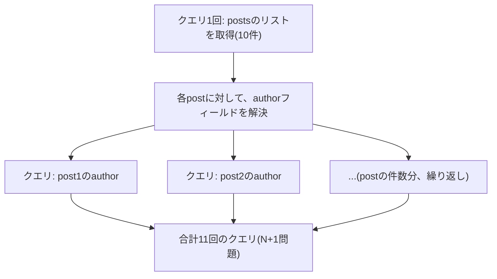

## はじめに

- **この記事で得られること**: [GraphQLとRESTful APIの違い](/articles/graphql-vs-rest-guide)で扱った、GraphQLがオーバーフェッチ/アンダーフェッチを解消する柔軟性の、意外な副作用である**N+1問題**と、それを解決する**DataLoader**という仕組みを体系的に理解します。
- **対象読者**: GraphQLの基本的な利点は理解しているものの、N+1問題がなぜ発生し、どう解決されるのかを説明できない方を想定しています。
- **読むのにかかる想定時間**: 約20分

この記事は[『上位1%』シリーズ 全記事ガイド](/sitemap)の一部、[Web/APIシリーズ](/sitemap#シリーズ一覧)の5.1本目です。

## 前提知識

- [GraphQLとRESTful APIの違い](/articles/graphql-vs-rest-guide): GraphQLのリゾルバーという仕組みの基本的な理解が前提になっています。

## 全体像をつかむ

**GraphQLのリゾルバーは、フィールドごとに、それぞれ独立して動作**します。**例えば、複数の投稿(posts)のリストと、各投稿の著者(author)情報を一度に取得するクエリでは、投稿のリストを取得する1回のクエリの後、個々の投稿それぞれに対して、著者情報を取得する追加のクエリが、投稿の件数と同じ回数だけ発行されてしまい**ます。**これが、1(リスト取得)+ N(件数分の追加クエリ)で、N+1問題と呼ばれる性能問題**です。

## 基礎から徹底解説

### DataLoaderの仕組み:バッチ処理とキャッシュの組み合わせ

**DataLoaderは、イベントループの1つのティックの間に、個々のリゾルバーから要求されたキー(例えば著者ID)をすべて集約し、`WHERE id IN (...)`のような、1回のまとめた問い合わせへ変換するバッチ処理**を行います。**これにより、件数に関わらず、N+1回のクエリが、常に2回(リスト取得+バッチ取得)に短縮され**ます。**さらに、同じリクエストの中で、同じキーが複数回要求された場合は、最初の1回だけ実際に取得し、以降はキャッシュされた結果を返すという、重複排除の機能も兼ね備えて**います。

### DataLoaderは、リクエストごとに、新しく作り直す必要がある

**DataLoaderのインスタンスを、リクエストをまたいでグローバルに共有してしまうと、認可のスコープが異なる別の利用者に対して、キャッシュされた結果がそのまま返ってしまう、情報漏洩のリスクが生まれ**ます。**この危険を避けるため、DataLoaderは、リクエストごとに、必ず新しいインスタンスとして作り直す**必要があります。

一部のリゾルバーだけDataLoaderを使っても、効果は限定的

**N+1問題が発生する可能性のある、すべてのリゾルバーが、一貫してDataLoaderを使用していなければ、バッチがうまく集約されず、性能上の効果が限定的になってしまい**ます。**一部のリゾルバーだけに場当たり的に導入するのではなく、チーム全体で一貫した運用方針を持つことが重要**です。

## プロが見ている視点(上位1%の理解)

### 1つの柔軟性が、ある問題を解決すると同時に、別の新しい問題を生むことがある

**GraphQLのリゾルバーが、フィールドごとに独立して動作するという柔軟性は、まさにオーバーフェッチ/アンダーフェッチという問題を解決した、その同じ仕組みです。しかし、この柔軟性こそが、N+1問題という、まったく新しい性能問題の原因にもなっています。** **ある仕組みが解決した問題だけに注目せず、「その同じ仕組みが、他にどんな新しい問題を生む可能性があるか」を一段掘り下げて考える**習慣が、上位1%のエンジニアの視点です。

## よくある誤解・つまずきポイント

- **誤解1: 「GraphQLは、オーバーフェッチ/アンダーフェッチを解決しているので、性能問題は発生しない」**
  GraphQLのリゾルバーが独立して動作する設計そのものが、N+1問題という、別の性能問題を引き起こす可能性があります。
- **誤解2: 「DataLoaderは、単純なキャッシュ機構にすぎない」**
  DataLoaderは、キャッシュだけでなく、個々のリゾルバーからの要求を集約し、1回のまとめた問い合わせへ変換する、バッチ処理の機能も兼ね備えています。
- **誤解3: 「DataLoaderのインスタンスは、サーバー起動時に1つだけ作成し、使い続けるべきだ」**
  DataLoaderのインスタンスをリクエストをまたいでグローバルに共有すると、認可のスコープが異なる利用者間で、情報が漏洩するリスクがあります。

## 障害・トラブルシューティングの視点

1. **GraphQL APIのレスポンスが遅く、データベースへのクエリ数が異常に多い**: N+1問題が発生していないか、該当するリゾルバーがDataLoaderを使用しているかを確認します。
2. **DataLoaderを導入したのに、クエリ数が思ったほど減らない**: N+1問題が発生する可能性のあるすべてのリゾルバーが、一貫してDataLoaderを使用しているかを確認します。
3. **異なる利用者間で、本来見えるはずのないデータが混入している**: DataLoaderのインスタンスが、リクエストをまたいでグローバルに共有されていないかを確認します。

## まとめ

- N+1問題は、リストを取得する1回のクエリの後、個々の要素に対する追加のクエリが、件数分だけ発行されてしまう性能問題です。
- DataLoaderは、個々のリゾルバーからの要求を1回のまとめた問い合わせへ変換するバッチ処理と、重複排除のキャッシュを組み合わせて、この問題を解決します。
- DataLoaderのインスタンスは、情報漏洩を避けるため、リクエストごとに新しく作り直す必要があります。
- N+1問題が発生する可能性のあるすべてのリゾルバーで、一貫してDataLoaderを使用する必要があります。

**今日から意識すべきこと**
1. GraphQL APIを実装する際は、リストと、その要素に紐づくフィールドを解決するリゾルバーに、N+1問題が発生していないかを必ず確認しましょう。
2. ある仕組みが1つの問題を解決したと分かったら、その同じ仕組みが他の新しい問題を生んでいないかも、一段掘り下げて確認しましょう。

## 参考文献

- [DataLoader in GraphQL | BrowserStack](https://www.browserstack.com/guide/dataloader-in-graphql)
- [Batching and Caching | GraphQL Golden Path](https://goldenpath.graphql.org/solutions/batching-caching/)
