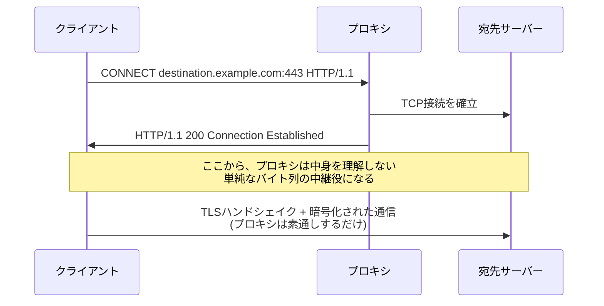

## はじめに

- **この記事で得られること**: [Squidで明示的プロキシを構築し、URL単位のアクセス制御を体験するハンズオン](/articles/squid-proxy-handson-guide)を終えた後、多くの人が抱く疑問があります。「同じURL単位の制御は、HTTPSサイトにも適用できるのか」。この記事では、その答えの核心にある**CONNECTメソッド**という、HTTP本来の仕組みを理解します。**プロキシは、クライアントとサーバーの間に素通しのTCPトンネルを掘るだけで、暗号化された通信の中身を一切見ていない**という実態と、[プロキシとファイアウォールの使い分け](/articles/proxy-firewall-guide)で扱った、意図的に中身を復号する**SSLインスペクション**との、決定的な違いを体系的に理解します。
- **対象読者**: 明示的プロキシでHTTPの通信を中継・制御できることは理解しているものの、プロキシがHTTPSサイトへのアクセスを、具体的にどう中継しているのかを説明できない方を想定しています。
- **読むのにかかる想定時間**: 約16分

この記事は[『上位1%』シリーズ 全記事ガイド](/sitemap)の一部、[Webプロキシ/キャッシュ基礎シリーズ](/sitemap#シリーズ一覧)の3.1本目です。

## 前提知識

- [Squidで明示的プロキシを構築するハンズオン](/articles/squid-proxy-handson-guide): プロキシが、HTTPのURL単位でアクセス制御を行えるという理解が前提になっています。
- [プロキシとファイアウォールの使い分け](/articles/proxy-firewall-guide): SSLインスペクションが、通信を一度復号して検査し、再暗号化する技術であるという理解が前提になっています。

## 全体像をつかむ

**HTTPには、GETやPOSTとは目的が根本的に異なる、CONNECTという特殊なメソッドが存在します。** クライアントがHTTPSサイトへプロキシ経由でアクセスする際、まずプロキシに対して`CONNECT destination.example.com:443 HTTP/1.1`というリクエストを送ります。**これは「このホスト名とポートへ、TCP接続を中継してください」という依頼であり、HTTPのリクエストを転送してほしいという依頼ではありません。** プロキシはこの依頼を受け取ると、指定された宛先への生のTCP接続を確立し、以降は**クライアントとサーバーの間で流れるバイト列を、意味を理解せずにそのまま転送し続ける、単純なトンネル**になります。この時点から、プロキシとクライアントの間、プロキシとサーバーの間で、TLSのハンドシェイクが行われ、暗号化された通信が確立されますが、**プロキシ自身は、その暗号化された通信の鍵を持っていないため、中身を一切読むことができません。**

## 基礎から徹底解説

### なぜHTTPSサイトでは、URLパス単位のアクセス制御ができないのか

[Squidのハンズオン](/articles/squid-proxy-handson-guide)で体験したURL単位のアクセス制御は、プロキシが**HTTPリクエストの内容(`GET /path/to/page HTTP/1.1`というリクエスト行)を読み取れる**ことを前提にしていました。**しかしCONNECTメソッドによるトンネルが確立した後、プロキシは暗号化された通信の中身を一切見ることができず、クライアントがサーバーへ送っている実際のHTTPリクエスト(パスを含むURL全体)を知る手段がありません。** プロキシが知ることができるのは、**CONNECTリクエストの時点で渡された、宛先のホスト名とポート番号だけ**です。このため、**HTTPSサイトに対するアクセス制御は、既定では「ホスト名単位」までしか行えず、「このホストの、この特定のパスだけを許可・拒否する」という、HTTPで可能だった粒度の制御は、CONNECTトンネルだけでは実現できません。**

TLSのSNI(Server Name Indication)との関係

透過型プロキシのように、クライアントが明示的にCONNECTを送ってこない構成では、プロキシは、TLSハンドシェイクの最初に平文で送られる**SNI**(Server Name Indication)というフィールドから、接続先のホスト名を読み取ります。**SNIから得られる情報も、ホスト名だけ**であり、CONNECTメソッドの場合と同様に、パス単位の制御はできません。[透過型プロキシを構築するハンズオン](/articles/transparent-proxy-handson-guide)で扱った透過型プロキシも、HTTPSサイトに対しては、このSNIによるホスト名ベースの制御が基本になります。

### CONNECTメソッドにも、プロキシ認証が要求される

[プロキシ認証の仕組み](/articles/proxy-auth-guide)で扱った407ステータスコードは、通常のHTTPリクエストだけでなく、**CONNECTリクエストに対しても同様に返されます。** プロキシが認証を要求する設定になっている場合、クライアントは、まずCONNECTリクエストを送った段階で、プロキシから407を受け取り、認証情報を付与して再度CONNECTリクエストを送り直す、という流れになります。**認証が完了して初めてトンネルが確立される**ため、未認証のクライアントが、プロキシを経由して任意のHTTPSサイトへ無制限にアクセスできてしまう、という事態は防がれています。

## プロが見ている視点(上位1%の理解)

### CONNECTトンネルと、SSLインスペクションは、まったく別の動作モードである

ここまでの説明から分かるように、**CONNECTメソッドによる素通しのトンネルは、プロキシの既定の動作です。** これに対し、[SSLインスペクション](/articles/proxy-firewall-guide)は、**プロキシが意図的に、クライアントとの間、サーバーとの間で、それぞれ個別にTLSのセッションを確立し直す**ことで、暗号化された通信の中身を復号して検査する、まったく別の動作モードです。**SSLインスペクションを行うには、プロキシが提示する証明書を、クライアント側で信頼させる設定(社内CAのルート証明書のインストールなど)が必須**であり、これを行わない限り、プロキシはCONNECTトンネルのまま、中身を一切見ることができません。**「プロキシを導入すれば、HTTPSの中身まで自動的に検査できる」という誤解は、CONNECTメソッドが既定の動作であり、SSLインスペコンションは別途有効化が必要な、追加の仕組みであることを理解していないところから生まれます。**

## よくある誤解・つまずきポイント

- **誤解1: 「プロキシを経由している以上、HTTPSサイトへのアクセスも、URLのパス単位で制御できるはずだ」**
  CONNECTメソッドによる既定のトンネルでは、プロキシはホスト名しか知ることができず、パス単位の制御にはSSLインスペクションという追加の仕組みが必要です。
- **誤解2: 「CONNECTメソッドは、HTTPSサイト専用の特殊な仕組みであり、認証とは無関係だ」**
  CONNECTリクエストに対しても、通常のHTTPリクエストと同様に407ステータスコードが返され、プロキシ認証の対象になります。
- **誤解3: 「SSLインスペクションを使わないプロキシは、HTTPS通信に対して何もしていない」**
  SSLインスペクションを使わない場合でも、プロキシはCONNECTメソッドによるTCPトンネルの中継役を担っており、ホスト名単位での接続許可・拒否という制御は行っています。

## 障害・トラブルシューティングの視点

1. **HTTPサイトはURLパス単位で制御できるのに、HTTPSサイトは同じ粒度で制御できない**: SSLインスペクションが有効化されているかを確認します。無効であれば、CONNECTメソッドの既定の動作により、ホスト名単位の制御しかできないことを前提に、要件を見直します。
2. **HTTPSサイトへのアクセス時に、プロキシ認証のポップアップが表示される**: CONNECTリクエストに対する407応答であり、通常のプロキシ認証フローと同じ挙動です。
3. **SSLインスペクションを有効化したら、特定のアプリケーションだけ通信エラーになった**: そのアプリケーションが、証明書のピン留め(Certificate Pinning)などの仕組みにより、プロキシが提示する証明書を拒否していないかを確認します。

## まとめ

- CONNECTメソッドは、プロキシに対して「このホスト名とポートへ、TCP接続を中継してほしい」と依頼する、HTTP本来の仕組みです。
- CONNECTトンネルが確立すると、プロキシは暗号化された通信の中身を一切見ることができず、宛先のホスト名とポート番号しか知りません。
- このため、HTTPSサイトに対するアクセス制御は、既定ではホスト名単位までしか行えません。
- SSLインスペクションは、CONNECTトンネルとは別の、意図的に通信を復号する動作モードであり、クライアント側での証明書信頼設定が必須です。

**今日から意識すべきこと**
1. HTTPSサイトのアクセス制御を検討する際は、「ホスト名単位で十分か、パス単位まで必要か」を明確にし、必要であればSSLインスペクションの導入を検討しましょう。
2. 「プロキシを入れればHTTPSの中身も自動的に見える」という思い込みを捨て、CONNECTメソッドとSSLインスペクションが別の動作モードであることを意識しましょう。

## 参考文献

- [RFC 9110: HTTP Semantics - CONNECT](https://www.rfc-editor.org/rfc/rfc9110.html#name-connect)
- [Server Name Indication | MDN Web Docs](https://developer.mozilla.org/en-US/docs/Glossary/SNI)
