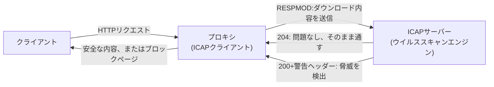

## はじめに

- **この記事で得られること**: [Squidのオープンプロキシ化の危険性](/articles/squid-open-proxy-hardening-handson-guide)で扱ったACLは、URLベースのアクセス制御でした。しかし、企業のプロキシは、ダウンロードしたファイルのウイルススキャンや、アップロード内容のDLP(データ漏洩防止)検査も行っていることがよくあります。この記事では、**ICAP**(Internet Content Adaptation Protocol)という、プロキシがこれらのスキャン機能を、自分自身には実装せず、**別の専用サーバーへ丸ごと「丸投げ」する**仕組みを体系的に理解します。
- **対象読者**: 企業のプロキシが、ウイルススキャンのような機能も持っていることは知っているものの、その機能が、プロキシソフトウェア自身にどう実装されているのかを説明できない方を想定しています。
- **読むのにかかる想定時間**: 約17分

この記事は[『上位1%』シリーズ 全記事ガイド](/sitemap)の一部、[Webプロキシ/キャッシュ基礎シリーズ](/sitemap#シリーズ一覧)の10.1本目です。

## 前提知識

- [Squidのオープンプロキシ化の危険性を再現し、ACLによるアクセス制限で防御する](/articles/squid-open-proxy-hardening-handson-guide): プロキシがアクセス制御の機能を持っているという、基本的な理解が前提になっています。

## 全体像をつかむ

**企業のプロキシは、ウイルススキャンやDLP検査のような、高度なコンテンツ検査機能を提供していることがよくありますが、この検査自体は、Squidのようなプロキシソフトウェア自身が行っているわけではありません。** **ICAPは、プロキシ(ICAPクライアント)が、リクエストやレスポンスの中身を、専用のICAPサーバーへ丸ごと送り、検査・加工した結果だけを返してもらう、シンプルな中継プロトコル**です。**プロキシ自身は、HTTPの中継とキャッシュという、本来の役割に専念し、コンテンツの検査という、まったく別の専門性を持つ処理は、専用のサーバーへ分離**されています。

## 基礎から徹底解説

### REQMODとRESPMOD:検査するタイミングが違う、2つの方向

**ICAPには、主に2つの処理方向があります。「REQMOD(リクエスト修正)」は、クライアントが送信しようとしているリクエスト(アップロード内容など)を、宛先サーバーへ届く前に検査**します。**「RESPMOD(レスポンス修正)」は、宛先サーバーから返ってきたレスポンス(ダウンロードするファイルなど)を、クライアントへ届く前に検査**します。アンチウイルス機能は、主にRESPMODを使い、ダウンロードされるファイルの内容を、クライアントに渡る前にスキャンします。

### 204 No Content:「変更不要」を効率的に伝える仕組み

**ICAPサーバーが、検査対象の内容に問題がないと判断した場合、本文を含まない「204 No Content」という応答を返します。** **プロキシは、この204を受け取ると、元のリクエスト・レスポンスを、そのまま変更せずに使い続ける**という決まりになっています。この仕組みにより、問題のないコンテンツを、わざわざICAPサーバーから丸ごと送り返してもらう必要がなく、通信量を抑えられます。問題が検出された場合は、警告ヘッダーを含む「200 OK」などの応答で、ブロックページへの差し替えなどが指示されます。

大きなファイルは、204が使えない場合がある

**プロキシが204応答を受け入れるには、元のHTTPメッセージのコピーを、メモリ上に保持しておく必要があります。** **ペイロードが一定の大きさ(Squidの実装では64KB)を超える場合や、サイズを事前に判断しづらい場合には、204を受け入れられず、ICAPサーバーから、検査済みの本文全体を送り返してもらう必要が生じる**ことがあります。この制約は、ICAPの設計そのものよりも、実装上のメモリ管理に起因する、実務上の注意点です。

## プロが見ている視点(上位1%の理解)

### ICAPは、プロキシという1つの役割の中に、「中継」と「検査」という、2つの独立した専門性が同居していないことを示す仕組み

**「このプロキシは、ウイルススキャンもできる」という1つの機能に見えても、実際には、プロキシ自身が持つHTTP中継・キャッシュという専門性と、ICAPサーバーが持つコンテンツ検査という、まったく別の専門性が、ICAPという薄いプロトコルで接続されているだけ**です。**この構造を知っていると、「プロキシのベンダーを変えずに、アンチウイルスエンジンだけを別のベンダーに切り替える」といった、実務上の柔軟な構成変更が、なぜ可能なのかが理解できます。** 1つの製品名の裏に、複数の独立した専門コンポーネントが組み合わさっているという見方は、このシリーズ全体を通じて繰り返し登場してきた視点です。

## よくある誤解・つまずきポイント

- **誤解1: 「プロキシのウイルススキャン機能は、プロキシソフトウェア自身が実装している」**
  多くの場合、プロキシは検査処理そのものを行わず、ICAPという中継プロトコルを使って、専用のICAPサーバーへ処理を委ねています。
- **誤解2: 「REQMODとRESPMODは、同じタイミングで同じ内容を検査する」**
  REQMODはクライアントからのリクエスト(アップロードなど)を、RESPMODはサーバーからのレスポンス(ダウンロードなど)を、別々のタイミングで検査します。
- **誤解3: 「204応答は、常に受け入れられる」**
  ペイロードが大きすぎる場合など、実装上の制約により、204を受け入れられないケースがあります。

## 障害・トラブルシューティングの視点

1. **ファイルのダウンロードが、原因不明に遅くなった**: RESPMODによるICAPサーバーへの検査転送が、ボトルネックになっていないかを確認します。
2. **特定の大きなファイルだけ、スキャン結果の反映に問題がある**: ペイロードサイズの制約により、204応答が使えていない可能性を確認します。
3. **ICAPサーバーがダウンしたときに、プロキシ全体が機能停止する**: ICAPサーバーへの接続失敗時の、フェイルオープン/フェイルクローズの設定を確認します。

## まとめ

- ICAPは、プロキシがリクエストやレスポンスの内容を、専用のICAPサーバーへ丸ごと送り、検査・加工した結果を返してもらう、中継プロトコルです。
- REQMODはリクエスト(アップロードなど)、RESPMODはレスポンス(ダウンロードなど)を、別々のタイミングで検査します。
- 204 No Contentは、「変更不要」を効率的に伝える仕組みで、問題のないコンテンツの再送信を避けます。
- プロキシという1つの役割の中に、中継とコンテンツ検査という、2つの独立した専門性が、ICAPという薄いプロトコルで接続されています。

**今日から意識すべきこと**
1. 「プロキシのウイルススキャン機能」という言葉に出会ったら、その検査が、実際にはICAPサーバーという別のコンポーネントで行われていることを意識しましょう。
2. ICAPサーバーがダウンしたときの挙動(フェイルオープン/フェイルクローズ)を、事前に確認しておきましょう。

## 参考文献

- [Feature: ICAP (Internet Content Adaptation Protocol) | Squid Wiki](https://wiki.squid-cache.org/Features/ICAP)
- [ICAP | SafeSquid Documentation](https://docs.safesquid.com/admin_guide/security_scanners/icap.md)
