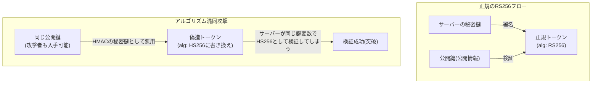

## はじめに

- **この記事で得られること**: [『alg: none』脆弱性のハンズオン](/articles/jwt-alg-none-handson-guide)では、署名検証を完全に無効化する攻撃を扱いました。この記事では、同じ原則を持つ、もう1つの攻撃——**アルゴリズム混同攻撃**(RS256→HS256)を、自分の手で再現します。RS256の**公開鍵**を、HS256の**秘密鍵**として悪用することで、偽造トークンの署名を突破する仕組みを体系的に理解します。
- **対象読者**: JWTの「alg: none」脆弱性は理解しているものの、RS256とHS256という、2つの異なる署名方式の違いを突いた、別種の攻撃があることを知らない方を想定しています。
- **読むのにかかる想定時間**: 約23分(ハンズオン)

この記事は[『上位1%』シリーズ 全記事ガイド](/sitemap)の一部、[Web/APIシリーズ](/sitemap#シリーズ一覧)の9.1本目です。

## 前提知識

- [JWTの「alg: none」脆弱性ハンズオン](/articles/jwt-alg-none-handson-guide): JWTのヘッダー・署名の基本構造と、「ヘッダーのalgを信用してはいけない」という原則の理解が前提になっています。

## 全体像をつかむ

**RS256は、秘密鍵で署名し、公開鍵で検証する、非対称な署名方式です。これに対し、HS256は、署名と検証の両方に、同じ1つの秘密の鍵(共有秘密)を使う、対称な署名方式です。** **RS256の公開鍵は、その名の通り公開されている**(あるいは、サーバーのJWKSエンドポイントなどから誰でも取得できる)という前提があります。**ここで、サーバー側の検証処理が、トークンのヘッダーに書かれた`alg`の値を信用し、RS256用に用意していた「鍵」を、HS256の検証にもそのまま使い回してしまうと、攻撃者は、公開されているRS256の公開鍵を、HS256のHMAC秘密鍵として使い、偽造トークンに署名できてしまいます。**



## ハンズオン:アルゴリズム混同攻撃を再現する

### Step 1: 正規のRS256トークン発行・検証環境を用意する

サーバー側で、RSA鍵ペアを生成し、秘密鍵でJWTに署名し、公開鍵で検証する、正規のRS256フローを構築します。

```python
import jwt
token = jwt.encode(payload, private_key, algorithm="RS256")
# 脆弱な検証コード(ヘッダーのalgに依存)
decoded = jwt.decode(token, public_key, algorithms=["RS256", "HS256"])
```

**ここに、脆弱性の本質があります。`algorithms`パラメータに、`RS256`と`HS256`の両方を許可し、同じ`public_key`変数を、両方の検証に使い回してしまっている**点です。

### Step 2: 公開鍵を入手し、HS256として偽造トークンに署名する

攻撃者の視点で、サーバーの公開鍵(多くの場合、JWKSエンドポイントなどで公開されている)を入手し、この公開鍵の文字列そのものを、HS256のHMAC秘密鍵として使い、任意のペイロード(例えば`role: admin`)を含む、偽造トークンに署名します。

```python
forged_token = jwt.encode({"user": "attacker", "role": "admin"}, public_key_pem, algorithm="HS256")
```

### Step 3: 偽造トークンが、サーバーの検証を突破することを確認する

この偽造トークンを、Step 1の脆弱な検証コードへ渡すと、**サーバーは、トークンヘッダーの`alg: HS256`を見て、HMAC検証ロジックへ進み、`public_key`変数を秘密鍵として使って検証**します。**偽造時に使った鍵(公開鍵の文字列)と、検証時に使われる鍵(同じ公開鍵の文字列)が一致するため、署名検証が成功**してしまいます。

<details>
<summary>真の原因は、「鍵の種類」と「アルゴリズム」が、紐付けられていないこと</summary>

**この脆弱性の根本原因は、検証処理が、「どの鍵が、どのアルゴリズムのために用意されたものか」を区別せず、トークン自身が主張する`alg`の値に従って、鍵の使い方を変えてしまっている**ことです。実際に、Node.jsの`jsonwebtoken`ライブラリの古いバージョン(4.2.2より前)では、この脆弱性が存在していました。**ライブラリが修正された後でも、検証時に`algorithms`パラメータを明示的に指定しない呼び出し方をしていると、別の形で同様の問題が再発する**こともあり、「ライブラリの既定値に頼らず、常に許可するアルゴリズムを明示的に1つ(または、用途ごとに固定した少数)に絞る」という原則が、唯一の確実な防御です。

</details>

## Step 4: 防御策を実装し、再度の攻撃が失敗することを確認する

検証コードを、`algorithms=["RS256"]`のみに固定し、かつ、RSA公開鍵オブジェクトを、HMACの文字列秘密鍵として誤って解釈できないよう、鍵の型自体を検証する実装へ修正します。この状態で、Step 2・3と同じ偽造トークンを再送し、検証が確実に失敗することを確認します。

## プロが見ている視点(上位1%の理解)

### 「公開されている情報」だからこそ、別の用途で悪用できるという非対称性への感度

**RS256の公開鍵は、「検証用の鍵として公開されている」ことは安全ですが、「HMACの秘密鍵として悪用される可能性がある」ことまでは、設計時に意識されていないことがあります。** **「この情報は公開されているから安全だ」という判断は、その情報が想定された用途で使われる限りにおいてのみ正しく、想定外の用途(今回はHMACの秘密鍵としての転用)に対しては、まったく別の脆弱性になり得る**という視点が、[『alg: none』脆弱性](/articles/jwt-alg-none-handson-guide)と共通する、「トークン自身の主張を信用しない」という原則の、もう1つの具体例です。

## よくある誤解・つまずきポイント

- **誤解1: 「RS256の公開鍵は公開情報なので、漏洩しても問題ない」**
  公開鍵自体の漏洩は想定された挙動ですが、検証コードがアルゴリズムごとに鍵の使い方を区別していない場合、この公開鍵がHMACの秘密鍵として悪用される危険性があります。
- **誤解2: 「JWTライブラリが最新版であれば、この種の脆弱性は発生しない」**
  ライブラリ自体が修正されていても、検証時に`algorithms`パラメータを明示的に指定しない呼び出し方をしていると、別の形で同様の問題が再発することがあります。
- **誤解3: 「alg: noneとアルゴリズム混同攻撃は、まったく別の対策が必要だ」**
  両者は、「ヘッダーのalgを信用してはいけない」という、共通の原則で防御できます。

## 障害・トラブルシューティングの視点

1. **JWTの検証コードを書く際、どのアルゴリズムを許可すべきか迷う**: 実際に使用する、単一の(あるいは用途ごとに固定した)アルゴリズムだけを、明示的に指定します。
2. **RS256用の公開鍵を、他の用途にも使い回していないか不安**: 鍵の型(非対称鍵か、共有秘密か)を、検証処理の実装レベルで区別しているかを確認します。
3. **JWTライブラリを更新したのに、脆弱性診断で同様の指摘を受けた**: 検証コードが、ライブラリの既定値に依存せず、`algorithms`パラメータを明示的に指定しているかを確認します。

## まとめ

- RS256は秘密鍵で署名・公開鍵で検証する非対称方式、HS256は同じ共有秘密で署名・検証する対称方式です。
- RS256の公開鍵は、検証用としては公開されていますが、HMACの秘密鍵として誤って使い回すと、偽造トークンの署名に悪用されます。
- 唯一の確実な防御は、検証時に許可するアルゴリズムを、トークンのヘッダーに依存せず、明示的に固定することです。
- ライブラリが修正された後でも、呼び出し方によって、同様の問題が再発することがあります。

**今日から意識すべきこと**
1. JWTの検証コードを書く際は、必ず`algorithms`パラメータを明示的に指定する習慣をつけましょう。
2. 「この情報は公開されているから安全だ」という判断を下す前に、想定外の用途での悪用可能性を、一段掘り下げて検討しましょう。

## 参考文献

- [JWT Algorithm Confusion Attack (RS256 vs HS256) | Sourcery](https://www.sourcery.ai/vulnerabilities/jwt-algorithm-confusion)
- [3 Ways JWTs Get Forged, and the One Rule That Stops Them All | HackerNoon](https://hackernoon.com/3-ways-jwts-get-forged-and-the-one-rule-that-stops-them-all)
