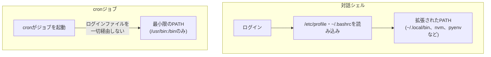

## はじめに

- **この記事で得られること**: [設定ファイルが『効く』までの仕組み](/articles/linux-config-activation-guide)では、デーモンが設定ファイルをどう読み込むかを扱いました。このハンズオンでは、cronというデーモンが、**ジョブを実行する際に、あなたの対話シェルの環境変数(特にPATH)を一切引き継いでいない**という、実務で非常によく遭遇する落とし穴を、自分の手で再現し、原因を特定する方法を体験します。
- **対象読者**: crontabでジョブを登録した経験はあるものの、「手動では動くのに、cronだと失敗する」という現象に遭遇したことがない、あるいは、原因を体系的に特定する方法を知らない方を想定しています。
- **読むのにかかる想定時間**: 約19分(ハンズオン)

この記事は[『上位1%』シリーズ 全記事ガイド](/sitemap)の一部、[Linux/OS基礎シリーズ](/sitemap#シリーズ一覧)の8.1本目です。

## 前提知識

- [設定ファイルが『効く』までの仕組み](/articles/linux-config-activation-guide): デーモンが、対話的なシェルとは異なる文脈で動作しているという、基本的な理解が前提になっています。

## 全体像をつかむ

**手動でターミナルから実行すれば正常に動くスクリプトが、crontabに登録すると、エラーメッセージも出さずに、静かに失敗する**ことがあります。**この現象の正体は、cronが、ログインシェルが起動する際に読み込まれる`/etc/profile`や`~/.bashrc`、`~/.bash_profile`を、一切経由せずにジョブを実行している**ことです。**cronが実際に持っている環境変数は、`PATH=/usr/bin:/bin`程度の、ごく最小限のものに限られています。**



## ハンズオン:cronの環境を、自分の目で書き出して比較する

### Step 1: 対話シェルの環境変数を書き出す

```bash
env > ~/interactive-env.txt
```

### Step 2: cronジョブとして、同じ`env`コマンドを実行する

crontabに、1分ごとに実行される、一時的なジョブを登録します。

```bash
* * * * * env > /tmp/cron-env.txt 2>&1
```

1分待ち、`/tmp/cron-env.txt`が作成されたことを確認します。

### Step 3: 2つの環境変数の内容を比較する

```bash
diff ~/interactive-env.txt /tmp/cron-env.txt
```

**この差分を見ると、PATHが大幅に短くなっていること、SHELLが`/bin/sh`になっていること(対話シェルがbashやzshであっても)、そして、ログインシェルで独自に設定したはずの環境変数が、cron側には一切存在しないことが、自分の目で確認できます。**

### Step 4: PATHに依存するスクリプトで、実際に失敗を再現する

対話シェルのPATHにのみ存在するコマンド(例えば、`~/.local/bin`に置いたスクリプトや、nvm・pyenvが管理するバイナリ)を呼び出す、簡単なスクリプトを用意し、まず手動で実行して成功することを確認します。次に、同じスクリプトをcronジョブとして登録すると、**「command not found」というエラーすら出力されず、静かに失敗する**様子を確認します。

<details>
<summary>エラーメッセージすら出ない理由</summary>

**cronは、既定では、ジョブの標準出力・標準エラー出力を、どこにも表示しません。** メールの配送設定(`MAILTO`)が行われていない環境では、エラーが発生したという事実すら、どこにも記録されず、本当に「静かに」失敗します。**この問題を調査可能にする、最初の一歩は、ジョブの定義自体に、`>> /path/to/log 2>&1`のような、明示的な出力のリダイレクトを追加すること**です。

</details>

## プロが見ている視点(上位1%の理解)

### 「動くはずだ」という思い込みの正体は、「どの環境で動くことを確認したか」の取り違え

**「手動で実行したら動いた」という確認は、実際には「対話シェルの、フルセットの環境変数の下で動いた」ことの確認に過ぎません。cronという、まったく別の実行コンテキストで動くかどうかは、別途、明示的に確認する必要がある**事実です。**実行コンテキストが変わるたびに、環境変数という、目に見えない前提条件が変わりうる**という視点を持つことが、この種の「原因不明の失敗」に、冷静に対処するための、上位1%のエンジニアの姿勢です。

## よくある誤解・つまずきポイント

- **誤解1: 「手動で実行して動いたスクリプトは、cronでも必ず動く」**
  cronは、ログインシェルが読み込む`.bashrc`などを経由せず、最小限の環境変数だけでジョブを実行するため、手動実行時とは異なる結果になることがあります。
- **誤解2: 「cronジョブが失敗したら、何らかのエラーメッセージが表示される」**
  cronは既定では、ジョブの標準出力・標準エラー出力をどこにも表示しないため、明示的なリダイレクト設定がない限り、エラーは静かに失われます。
- **誤解3: 「cronのSHELLは、自分が普段使っているシェルと同じだ」**
  cronの既定のSHELLは、多くの環境で`/bin/sh`であり、普段使っているbashやzshとは、構文の挙動が異なることがあります。

## 障害・トラブルシューティングの視点

1. **cronジョブが、手動実行時と異なる結果になる**: cronジョブの定義に、`env > /tmp/cron-env.txt`のような、環境変数を書き出す一時的な行を追加し、対話シェルの環境と比較します。
2. **cronジョブがエラーなく失敗しているように見える**: ジョブの定義に、`>> /path/to/log 2>&1`を追加し、標準出力・標準エラー出力を記録します。
3. **特定のコマンドだけが、cronで「command not found」になる**: スクリプト内で、そのコマンドをフルパスで指定するか、スクリプトの先頭で明示的にPATHを設定します。

## まとめ

- cronは、ログインシェルが読み込む`.bashrc`などを一切経由せず、最小限の環境変数だけでジョブを実行します。
- cronのPATHは、対話シェルのPATHよりも大幅に短く、SHELLも対話シェルとは異なることがあります。
- cronジョブの失敗は、既定では、どこにも表示されず、静かに失われます。
- `env`コマンドの出力を比較することで、対話シェルとcronの環境の違いを、自分の目で確認できます。

**今日から意識すべきこと**
1. cronジョブを登録する際は、スクリプト内でPATHを明示的に設定するか、コマンドをフルパスで指定しましょう。
2. cronジョブには、必ず標準出力・標準エラー出力のリダイレクトを設定し、失敗を静かに見逃さないようにしましょう。

## 参考文献

- [How to Debug a Cron Job That Runs but Exits Silently Because of PATH and Environment | DEV Community](https://dev.to/evvytools/how-to-debug-a-cron-job-that-runs-but-exits-silently-because-of-path-and-environment-53m0)
- [Why Crontab Scripts Are Not Working in Ubuntu | DEV Community](https://dev.to/stackallflow/why-crontab-scripts-are-not-working-in-ubuntu-1f11)
