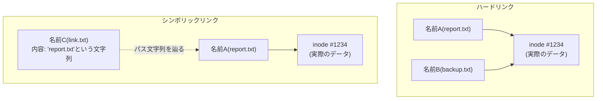

## はじめに

- **この記事で得られること**: [パーミッション(chmod)とは何か](/articles/linux-file-permissions-guide)で扱った、カーネルがinode(メタデータ)を検査しているという話を踏まえ、**ファイル名とは、実はファイルの実体そのものではなく、inodeという、本当の実体を指し示す「ラベル」に過ぎない**という理解を体系的に身につけます。**ハードリンクは、同じinodeに対して、もう1つの等価なラベルを追加する操作**であり、**シンボリックリンクは、パス文字列だけを内容として持つ、まったく別の独立したファイル**です。この違いを理解すると、**削除したはずのログファイルがディスク容量を解放しない**という、実務でよく遭遇する現象の正体まで説明できるようになります。
- **対象読者**: `ln`コマンドでハードリンクやシンボリックリンクを作成した経験はあるものの、両者の違いを、inodeという概念から説明できない方を想定しています。
- **読むのにかかる想定時間**: 約17分

この記事は[『上位1%』シリーズ 全記事ガイド](/sitemap)の一部、[Linux/OS基礎シリーズ](/sitemap#シリーズ一覧)の4.1本目です。

## 前提知識

- [パーミッション(chmod)とは何か](/articles/linux-file-permissions-guide): ファイルのowner/group/モードビットが、inodeというメタデータに記録されているという理解が前提になっています。

## 全体像をつかむ

**多くの人が、「ファイル名」こそがファイルの実体だと考えていますが、これは正確ではありません。** Linuxのファイルシステムでは、**ファイルの実際のデータと属性(所有者・パーミッション・サイズ・データブロックへのポインタなど)は、inodeという、番号で管理される実体の中に保存されています。** そして、**ディレクトリの中に見えている「ファイル名」は、そのinode番号を指す、単なる「ラベル」(ディレクトリエントリ)に過ぎません。** この前提に立つと、**ハードリンクとシンボリックリンクという、2種類の「リンク」の違いが、まったく異なる仕組みだということが見えてきます。**

## 基礎から徹底解説

### ハードリンク:同じinodeに対する、もう1つの等価な名前

**ハードリンク(`ln`コマンド、オプションなし)は、既存のファイルと同じinode番号を指す、新しいディレクトリエントリを作成する操作です。** 作成された2つの名前は、**どちらが「元の名前」でどちらが「リンク」かという区別が存在せず、完全に等価な、同じファイルへの2つの入口**です。**inodeは、自分を指しているディレクトリエントリの数(リンクカウント)を記録しており、`rm`コマンドでいずれかの名前を削除しても、リンクカウントが1減るだけで、inode自体とその中のデータは、リンクカウントが0になるまで削除されません。**

「削除したはずのログファイルが、ディスク容量を解放しない」現象の正体

実務でよく遭遇する、次のような現象があります。**巨大なログファイルを`rm`で削除したのに、`df`コマンドで確認すると、ディスクの空き容量が増えていない。** これは、**そのログファイルを開いたまま(ファイルディスクリプタを保持したまま)動作しているプロセスが、まだ存在している**ことが原因です。**`rm`コマンドは、ディレクトリエントリ(名前)を削除してリンクカウントを1減らすだけであり、そのプロセスが持つファイルディスクリプタという、名前とは別の経路を通じたinodeへの参照が残っている限り、リンクカウントは0にならず、実際のデータブロックは解放されません。** 対処法は、該当プロセスを再起動するか、`lsof | grep deleted`のようなコマンドで、削除済みだが開いたままのファイルを特定し、そのプロセスを再起動することです。

### シンボリックリンク:パス文字列だけを内容として持つ、独立したファイル

**シンボリックリンク(`ln -s`コマンド)は、ハードリンクとはまったく異なる仕組みです。** シンボリックリンクは、**それ自身が、独自のinodeを持つ、完全に独立した1つのファイルであり、その内容は、単なる「リンク先のパスを表す文字列」です。** シンボリックリンクにアクセスすると、カーネルは、**まずそのファイルの内容(パス文字列)を読み取り、そのパスを改めて辿って、本来の対象ファイルへアクセスする**という、1段階多い間接的な処理を行います。この結果、**リンク先の本体が削除・移動されると、シンボリックリンク自体は存在し続けるものの、辿った先に何もない「デッドリンク(ダングリングリンク)」になる**という、ハードリンクとは対照的な挙動が生まれます。

## プロが見ている視点(上位1%の理解)

### ハードリンクには、シンボリックリンクにはない、構造的な制約がある

**ハードリンクは、同じファイルシステム(パーティション)内でしか作成できません。** これは、**inode番号が、個々のファイルシステムの中でのみ一意に管理されている**ためです。別のファイルシステムへのハードリンクを作ろうとしても、参照すべきinode番号の対応先が存在しないため、失敗します。**また、多くの実装では、ディレクトリへのハードリンクも禁止されています。** これは、ディレクトリに対するハードリンクを許すと、ディレクトリツリーの中に循環参照が作られてしまい、`find`のようなツリー探索コマンドが無限ループに陥る危険があるためです。**シンボリックリンクは、パス文字列を内容として持つだけの独立したファイルであるため、これらの制約を一切受けず、別のファイルシステムをまたいで作成することも、ディレクトリを指すことも、どちらも自由にできます。** [/etcとLinuxのディレクトリ構成](/articles/linux-filesystem-hierarchy-guide)で扱った`/bin`から`/usr/bin`へのusrmergeが、ハードリンクではなくシンボリックリンクで実現されているのは、この制約の違いが理由の1つです。

## よくある誤解・つまずきポイント

- **誤解1: 「ハードリンクは、元のファイルのコピーであり、元を消せば連動して消える」**
  ハードリンクは、同じinodeへの、完全に等価な別の名前です。どちらを削除しても、残った名前からデータへアクセスし続けられます。
- **誤解2: 「`rm`でファイルを削除すれば、必ずディスク容量がすぐに解放される」**
  そのファイルを開いたまま動作しているプロセスが存在する限り、リンクカウントが0にならず、データブロックは解放されません。
- **誤解3: 「シンボリックリンクとハードリンクは、見た目が違うだけで、内部的には同じ仕組みだ」**
  ハードリンクは既存のinodeへの新しい名前であるのに対し、シンボリックリンクはパス文字列を内容として持つ、独自のinodeを持つ別のファイルです。

## 障害・トラブルシューティングの視点

1. **`rm`でファイルを削除したのに、ディスクの空き容量が増えない**: `lsof | grep deleted`で、削除済みだが開いたままのファイルを保持しているプロセスを特定します。
2. **シンボリックリンクを辿ろうとすると、ファイルが見つからないというエラーが出る**: リンク先の本体が削除・移動され、デッドリンク(ダングリングリンク)になっていないかを確認します。
3. **別のパーティションへハードリンクを作成しようとして失敗する**: ハードリンクは同じファイルシステム内でしか作成できないため、シンボリックリンクを使うか、ファイルを実際にコピーする必要があります。

## まとめ

- ファイル名は、ファイルの実体そのものではなく、inode番号を指す「ラベル」(ディレクトリエントリ)です。
- ハードリンクは、同じinodeを指す、完全に等価な新しい名前を追加する操作であり、inodeのリンクカウントで管理されます。
- シンボリックリンクは、パス文字列だけを内容として持つ、独自のinodeを持つ、独立したファイルです。
- ハードリンクは同じファイルシステム内でしか作成できず、ディレクトリを指すこともできませんが、シンボリックリンクにはこれらの制約がありません。

**今日から意識すべきこと**
1. 「ファイルを削除したのにディスク容量が減らない」という障害に遭遇したら、そのファイルを開いたままのプロセスがないかを確認しましょう。
2. ハードリンクとシンボリックリンクを選ぶ際は、ファイルシステムをまたぐ必要があるか、ディレクトリを指す必要があるかを、まず確認しましょう。

## 参考文献

- [link(2) — Linux manual page](https://man7.org/linux/man-pages/man2/link.2.html)
- [symlink(7) — Linux manual page](https://man7.org/linux/man-pages/man7/symlink.7.html)
