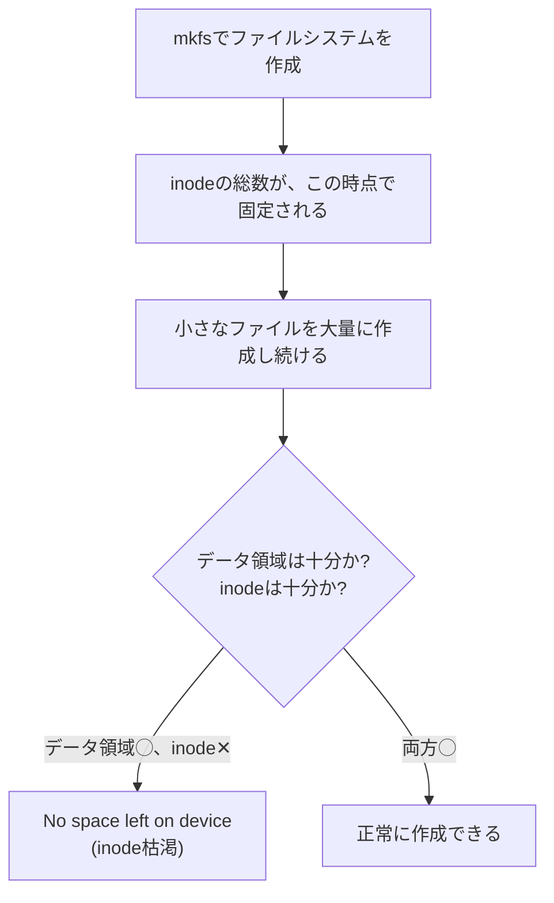

## はじめに

- **この記事で得られること**: [ハードリンクとシンボリックリンクの違い](/articles/linux-hardlink-symlink-guide)で扱った、inodeという、ファイルの本当の実体の先にある、**inodeの総数そのものが枯渇してしまう**という、実務でよく遭遇する障害パターンを体系的に理解します。
- **対象読者**: `df -h`でディスクの空き容量が十分にあるにもかかわらず、「No space left on device」というエラーに遭遇し、原因が分からなかった方を想定しています。
- **読むのにかかる想定時間**: 約18分

この記事は[『上位1%』シリーズ 全記事ガイド](/sitemap)の一部、[Linux基盤シリーズ](/sitemap#シリーズ一覧)の4.2本目です。

## 前提知識

- [ハードリンクとシンボリックリンクの違い](/articles/linux-hardlink-symlink-guide): inodeが、ファイル名とは別の、ファイルの本当の実体であるという理解が前提になっています。

## 全体像をつかむ

**ファイルシステム上のすべてのファイルとディレクトリは、そのサイズに関わらず、必ず1個のinodeを消費**します。**そして、そのファイルシステムが持てるinodeの総数そのものは、ファイルシステムを作成した時点(`mkfs`を実行した時点)で、固定されてしまい、後から増やすことができません。** **このため、小さなファイルを大量に作り続けると、ディスクのデータ領域にはまだ十分な空き容量があるにもかかわらず、inodeという「台帳の行」を使い切ってしまい、新しいファイルを一切作成できなくなる**ことがあります。

## 基礎から徹底解説

### 診断コマンド:df -hではなく、df -iを確認する

**`df -h`は、データ領域の使用率を表示しますが、inodeの使用率は表示しません。** **inodeの枯渇を診断するには、`df -i`を実行し、`IUse%`という列が100%に近づいていないかを確認**します。**`df -h`の使用率(`Use%`)が低いにもかかわらず、`df -i`の`IUse%`が100%に達していれば、これはinodeの枯渇という、典型的な症状**です。

### 実務でよくある原因:PHPのセッションファイル、メールキュー、ログの断片

**inodeの枯渇を引き起こす典型的な原因は、PHPのセッションファイル、Postfixのようなメールキューのスプールファイル、ローテーションされていない、リクエスト単位の細かいログファイルなど、サイズは小さいが、数が非常に多いファイル群**です。**該当するディレクトリを特定するには、`find`コマンドなどを使い、ディレクトリごとのファイル数を数える**ことが、実務上の定石です。

df -iも問題なさそうなのに、やはり「No space left on device」が出る場合

**`df -h`と`df -i`の両方に問題がなさそうなのに、それでも「No space left on device」が発生する場合、[ハードリンクとシンボリックリンクの違い](/articles/linux-hardlink-symlink-guide)で扱った、「削除したはずのファイルが解放されない」現象が原因である可能性**があります。**あるプロセスが、すでに削除されたファイルを、開いたファイルディスクリプタとして持ち続けている限り、そのinodeとデータ領域は解放されず、該当プロセスを再起動することで、初めて容量が解放される**ことがあります。

## プロが見ている視点(上位1%の理解)

### 「容量が足りない」という症状には、2つの、まったく別の資源の枯渇が隠れている

**多くの管理者は、「容量不足」という症状を見ると、反射的にデータ領域の空き容量だけを確認しますが、実際には、データ領域とinodeという、2つの異なる資源が、それぞれ独立して枯渇する可能性があります。** **「No space left on device」というエラーメッセージを見たら、データ領域だけでなく、inodeという、もう1つの資源も、必ず確認する**習慣が、上位1%のエンジニアの視点です。

## よくある誤解・つまずきポイント

- **誤解1: 「df -hで空き容量が十分にあれば、ファイルを作成できないはずがない」**
  データ領域とinodeは、それぞれ独立した資源であり、inodeが枯渇していれば、データ領域に十分な空きがあっても、新しいファイルを作成できません。
- **誤解2: 「inodeが足りなくなったら、既存のファイルシステムに、inodeを追加すればよい」**
  inodeの総数は、ファイルシステムを作成した時点で固定されており、後から追加することはできません。対応するには、ファイルシステムを再作成する必要があります。
- **誤解3: 「大きなファイルを削除すれば、必ずinode不足も解消される」**
  inode不足の原因は、多くの場合、サイズの大きいファイルではなく、数が非常に多い小さなファイルです。大きなファイルを1つ削除しても、inodeの消費数はほとんど変わりません。

## 障害・トラブルシューティングの視点

1. **df -hで空き容量があるのに、「No space left on device」が発生する**: `df -i`を実行し、`IUse%`が100%に近づいていないかを確認します。
2. **inodeの枯渇の原因となっているディレクトリを特定したい**: `find`コマンドなどを使い、ディレクトリごとのファイル数を数え、異常に多いディレクトリを探します。
3. **df -hとdf -iの両方に問題がないのに、容量不足が発生する**: 削除されたファイルを、まだ開いたファイルディスクリプタとして持ち続けているプロセスがないかを確認します。

## まとめ

- ファイルシステム上のすべてのファイルは、サイズに関わらず1個のinodeを消費し、inodeの総数はファイルシステム作成時に固定されます。
- `df -h`はデータ領域の使用率を、`df -i`はinodeの使用率を、それぞれ別々に表示します。
- inode枯渇の典型的な原因は、サイズは小さいが数が非常に多いファイル群です。
- データ領域とinodeという、2つの独立した資源が、それぞれ別々に枯渇する可能性があることを、常に意識する必要があります。

**今日から意識すべきこと**
1. 「容量不足」のエラーに遭遇したら、`df -h`だけでなく、`df -i`も必ず確認しましょう。
2. 小さなファイルを大量に生成するアプリケーション(セッション管理、ログ、キューなど)を運用する際は、inodeの消費状況を定期的に監視しましょう。

## 参考文献

- [No Space Left on Device While df Command Shows a Lot of Free Space | The Geek Diary](https://thegeekdiary.com/linux-no-space-left-on-device-while-df-command-shows-a-lot-of-free-space)
- [Knowledge Base: No Space Left on Device While There Is Plenty of Space Available | Gentoo Wiki](https://wikitest.gentoo.org/wiki/Knowledge_Base:No_space_left_on_device_while_there_is_plenty_of_space_available)
