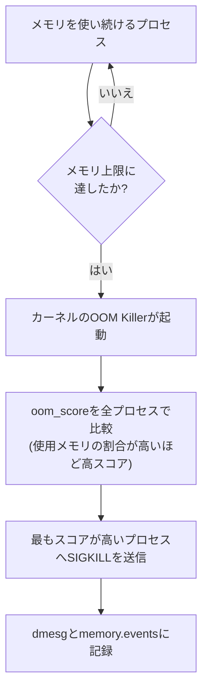

## はじめに

- **この記事で得られること**: [Linuxのcgroupsを自分の手で構築するハンズオン](/articles/linux-cgroups-handson-guide)では、`memory.max`によるメモリ上限を体験しました。では、**そのメモリ上限を実際に超えてしまったら、何が起こるのか**。この記事では、カーネルの**OOM Killer**(Out-Of-Memory Killer)という仕組みを、実際に発生させて、`dmesg`とcgroup v2の`memory.events`から、何が起きたのかを自分の手で特定します。
- **対象読者**: cgroupsによるメモリ制限は経験済みで、そのメモリ制限を超えたときに実際に何が起こるのかを、自分の手で確認したい方を想定しています。
- **読むのにかかる想定時間**: 約20分

この記事は[『上位1%』シリーズ 全記事ガイド](/sitemap)の一部、[Linux/OS基礎シリーズ](/sitemap#シリーズ一覧)の19.2本目です。

## 前提知識

- [Linuxのcgroupsを自分の手で構築するハンズオン](/articles/linux-cgroups-handson-guide): `memory.max`というメモリ上限の設定自体の理解が前提になっています。
- [journalctlでエラーログを調査する方法](/articles/linux-journalctl-guide): ログから原因を特定する、基本的な調査の型が前提になっています。

## 全体像をつかむ

**メモリ上限を超えたプロセスは、自分から異常終了するわけではありません。カーネルのOOM Killerが、システム全体のメモリ不足(あるいはcgroupのメモリ上限超過)を検知し、「どのプロセスを終了させるべきか」をスコアに基づいて判断し、強制的にSIGKILLで終了させる**のです。コンテナが突然再起動し、終了コードが137(128+9、つまりSIGKILLによる終了)だった場合、そのコンテナは、自分のバグでクラッシュしたのではなく、**OOM Killerに「殺された」だけ**というのが、この現象の正体です。



## ハンズオン:OOM Killerを実際に発生させ、原因を特定する

### Step 1: メモリ上限付きのcgroupを用意する

[cgroupsのハンズオン](/articles/linux-cgroups-handson-guide)と同じ要領で、`memory.max`を小さな値(例: 100MB)に設定したcgroupを作成します。

```bash
sudo mkdir /sys/fs/cgroup/oom-test
echo "104857600" | sudo tee /sys/fs/cgroup/oom-test/memory.max
```

### Step 2: わざとメモリを食い尽くすプロセスを、そのcgroup内で実行する

Pythonなどで、確保したメモリを解放せずに増やし続けるだけの、単純なスクリプトを用意し、そのPIDを、作成したcgroupの`cgroup.procs`へ登録してから実行します。

```python
data = []
while True:
    data.append(bytearray(10 * 1024 * 1024))  # 10MBずつ確保
```

### Step 3: `dmesg`で、OOM Killerの発生を確認する

メモリ上限に達すると、プロセスは突然終了します。**`dmesg`を確認すると、「Out of memory: Killed process」という行と、どのプロセス(PID・プロセス名)が選ばれ、どのcgroupで発生したかが記録**されています。

### Step 4: `memory.events`で、cgroup側からも確認する

```bash
cat /sys/fs/cgroup/oom-test/memory.events
```

**この中の`oom`と`oom_kill`というカウンタが、このcgroupでOOM Killerが実際に発動した回数**を示しています。`dmesg`というシステム全体のログと、`memory.events`というcgroup単位の記録を、両方確認することで、「このcgroupの、このメモリ上限が原因だった」と、確信を持って特定できます。

<details>
<summary>どのプロセスが選ばれるかは、oom_scoreという指標で決まる</summary>

**OOM Killerは、各プロセスの`oom_score`(0〜1000の範囲)を比較し、最もスコアが高いプロセスを選んで終了させます。** このスコアは、**そのプロセスが、許可されたメモリのうちどれだけの割合を使っているか**にもとづいて計算され、cgroupのメモリ上限が設定されている場合は、システム全体のメモリ量ではなく、**そのcgroup自身の`memory.max`に対する使用率**が基準になります。`/proc/<pid>/oom_score_adj`という値(-1000〜1000)を変更することで、特定のプロセスを「優先して殺す」、あるいは「絶対に殺さない」(-1000を設定した場合)という調整も可能です。

</details>

## プロが見ている視点(上位1%の理解)

### OOM Killerは、バグではなく、システム全体の停止を防ぐための、意図的な設計

**メモリが本当に枯渇した状態を放置すると、システム全体がスワップの読み書きだけで身動きが取れなくなる(スラッシング)か、完全にハングしてしまいます。OOM Killerは、その最悪の事態を避けるために、1つのプロセスを犠牲にして、システム全体の応答性を守る、意図的な設計**です。障害調査の際、「プロセスが落ちた理由が分からない」と感じたら、**そのプロセス自身のログやスタックトレースだけでなく、まず`dmesg`を確認する**ことが、上位1%のエンジニアが最初に取る行動です。

## よくある誤解・つまずきポイント

- **誤解1: 「コンテナが終了コード137で落ちたのは、アプリケーション自身のバグだ」**
  終了コード137はSIGKILLによる終了を意味し、OOM Killerによって強制終了された可能性を、まず確認するべきです。
- **誤解2: 「OOM Killerは、メモリを最も多く使っているプロセスを、常に無差別に選ぶ」**
  oom_scoreは単純な使用量ではなく、許可されたメモリに対する使用率にもとづいて計算され、`oom_score_adj`で調整もできます。
- **誤解3: 「cgroupのメモリ上限を超えると、システム全体がOOM Killerの対象になる」**
  cgroup v2では、そのcgroup自身の範囲内でOOM Killerが発動し、他のcgroupのプロセスには影響しません。

## 障害・トラブルシューティングの視点

1. **プロセスが突然、ログも残さず終了した**: まず`dmesg`を確認し、「Out of memory」という行がないかを確認します。
2. **コンテナが終了コード137で再起動を繰り返す**: コンテナのメモリ制限(`memory.max`)と、`memory.events`の`oom_kill`カウンタを確認します。
3. **特定の重要なプロセスだけは、絶対にOOM Killerの対象にしたくない**: そのプロセスの`/proc/<pid>/oom_score_adj`を`-1000`に設定することを検討します。

## まとめ

- メモリ上限を超えたプロセスは、カーネルのOOM Killerによって、強制的にSIGKILLで終了させられます。
- 終了コード137は、SIGKILLによる終了を意味し、OOM Killerによる強制終了の有力な手がかりです。
- どのプロセスが選ばれるかは、`oom_score`という、許可されたメモリに対する使用率にもとづく指標で決まります。
- `dmesg`とcgroup v2の`memory.events`を確認することで、OOM Killerの発生と原因を特定できます。

**今日から意識すべきこと**
1. プロセスが原因不明で突然終了したときは、まず`dmesg`を確認する習慣をつけましょう。
2. コンテナの終了コードが137だったときは、メモリ制限とOOM Killerを、調査の最初の候補に挙げましょう。

## 参考文献

- [proc_pid_oom_score_adj(5) | man7.org](https://man7.org/linux/man-pages/man5/proc_pid_oom_adj.5.html)
- [RFC: cgroup-aware OOM killer | lkml.iu.edu](https://lkml.iu.edu/hypermail/linux/kernel/1706.0/00899.html)
