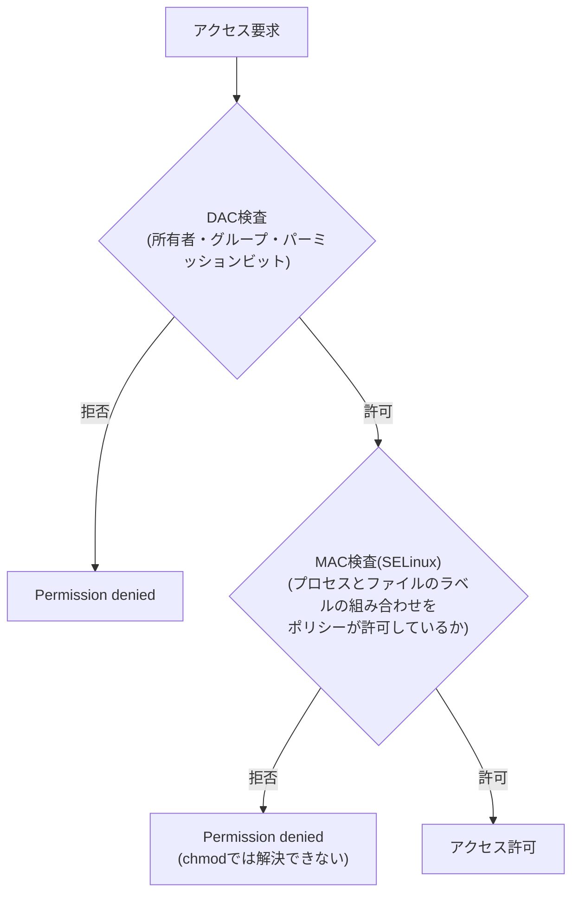

## はじめに

- **この記事で得られること**: [パーミッション(chmod)とは何か](/articles/linux-file-permissions-guide)で扱ったDAC(任意アクセス制御)の先にある、SELinuxという**MAC**(強制アクセス制御)の仕組みを体系的に理解します。
- **対象読者**: `chmod 777`にしてもアクセスできない現象に遭遇し、パーミッションの知識だけでは説明できず困った経験がある方を想定しています。
- **読むのにかかる想定時間**: 約17分

この記事は[『上位1%』シリーズ 全記事ガイド](/sitemap)の一部、[Linux/OS基礎シリーズ](/sitemap#シリーズ一覧)の4.05本目です。

## 前提知識

- [パーミッション(chmod)とは何か](/articles/linux-file-permissions-guide): DAC(任意アクセス制御)という、所有者・グループ・パーミッションビットに基づくアクセス制御の理解が前提になっています。

## 全体像をつかむ

**通常のLinuxパーミッション(chmod・所有者・グループ)は、DAC(Discretionary Access Control、任意アクセス制御)と呼ばれ、ファイルの所有者が、自分の裁量でアクセス権を決める仕組み**です。**SELinuxは、これとは完全に独立した、もう1段上の検査であるMAC(Mandatory Access Control、強制アクセス制御)を実装しており、プロセスとファイルのそれぞれに付与された『セキュリティコンテキスト(ラベル)』を基準に、ポリシーが許可するかどうかを、ファイルの所有者の意思とは無関係に、強制的に判定**します。**この2つの検査は、どちらも通らなければアクセスが許可されないため、`chmod 777`でDAC側を完全に開放しても、MAC側のポリシーが拒否していれば、アクセスは依然として拒否されたままになります。**

## 基礎から徹底解説

### 典型例:/var/www/html に置いた、ラベルの合っていないファイル

**よくある事例は、Apache(httpdプロセス)が、`httpd_t`というドメイン(プロセス側のラベル)で動作している中、`/var/www/html`配下に置いたファイルが、本来期待される`httpd_sys_content_t`ではなく、`user_home_t`のような、別のラベルを持ってしまっているケース**です。**`httpd_t`が`user_home_t`のファイルを読み取ることを許可するポリシールールが存在しないため、SELinuxはこのアクセスを拒否します。** **`ls -Z`コマンドで、ファイルに付与されているラベルを確認できます。**

### 原因の特定と、正しい修正方法

**SELinuxが原因かどうかを確認する最も簡単な方法は、`setenforce 0`で一時的にPermissiveモード(拒否はしないが記録だけする)へ切り替え、問題が解消するかどうかを見ること**です。**`sealert`コマンドは、生のAVC拒否ログを、人間が読める説明と推奨される対処法に翻訳**してくれます。**正しい修正は、ラベルを元のポリシーが期待する値へ戻す`restorecon`コマンド(例:`restorecon -Rv /var/www/html/`)であり、SELinux自体を無効化することは、推奨される対処法ではありません。**

補足:書き込み権限が必要な場合は、chcon/semanage fcontextを使う

**読み取り専用の既定のラベルではなく、書き込み権限を持つラベル(例:`httpd_sys_rw_content_t`)が必要な場合は、`chcon --type=httpd_sys_rw_content_t`コマンドで、一時的にラベルを変更**できます。**ただし`chcon`による変更は、`restorecon`の実行や再起動で元に戻ってしまうため、永続的な変更には、ポリシーのルール自体に登録する`semanage fcontext`コマンドを使う**必要があります。

## プロが見ている視点(上位1%の理解)

### 「パーミッションを広げても直らない」は、別のレイヤーを疑う合図

**DACとMACは、まったく独立した2段階の検査であり、片方を完全に開放しても、もう片方が拒否していれば、アクセスは許可されません。** **「パーミッションを777にしたのに、まだ拒否される」という現象に遭遇したら、DACをさらに広げようとするのではなく、「このシステムには、DACとは別のアクセス制御(MAC)が有効になっているのではないか」と、一段上のレイヤーを疑う**習慣が、上位1%のエンジニアの視点です。SELinuxを無効化することは、問題を消すのではなく、本来の防御そのものを消す対処であることも、忘れてはいけません。

## よくある誤解・つまずきポイント

- **誤解1: 「chmod 777にすれば、どんな環境でも必ずアクセスできるようになる」**
  SELinuxが有効な環境では、DACを完全に開放しても、MAC側のポリシーが拒否していればアクセスは許可されません。
- **誤解2: 「SELinuxで問題が起きたら、無効化するのが正しい対処法だ」**
  推奨される対処は、ラベルを正しい値に戻すrestorecon、または恒久的な例外をポリシーへ登録するsemanage fcontextです。無効化は防御そのものを失う対処です。
- **誤解3: 「chconで変更したラベルは、その後も永続的に保持される」**
  chconによる変更は一時的なものであり、restorecon実行後や再起動後には元に戻ります。永続化にはsemanage fcontextが必要です。

## 障害・トラブルシューティングの視点

1. **chmod 777にしても、Permission deniedが解消しない**: `getenforce`でSELinuxが有効かを確認し、`setenforce 0`で一時的に無効化して問題が解消するかを確認します。
2. **どのポリシールールが拒否しているのか分からない**: `sealert`コマンドで、AVC拒否ログを人間が読める形に翻訳し、推奨される対処法を確認します。
3. **ファイルを正しい場所に置いたのに、まだアクセスできない**: `ls -Z`でファイルの現在のラベルを確認し、期待されるラベルと異なっていれば`restorecon`で修正します。

## まとめ

- SELinuxは、DAC(パーミッション)とは完全に独立した、MAC(強制アクセス制御)という、もう1段のアクセス制御です。
- DAC・MACの両方の検査を通らなければ、アクセスは許可されません。
- SELinuxが原因かどうかは、setenforce 0で一時的に確認できます。
- 正しい対処はラベルを修正するrestorecon/semanage fcontextであり、SELinuxの無効化は推奨されません。

**今日から意識すべきこと**
1. 「パーミッションを広げても直らない」という現象に遭遇したら、SELinux/AppArmorのようなMACが有効になっていないかを、真っ先に確認しましょう。
2. SELinuxの問題を修正する際は、無効化ではなく、ラベルを正しい値に戻すことを優先しましょう。

## 参考文献

- [SELinux Troubleshooting | OneUptime](https://oneuptime.com/blog/post/2026-02-13-selinux-troubleshooting/view)
- [Data Directory Is Not Writable Even After chmod | Deskpro Support](https://support.deskpro.com/kb/articles/450)
