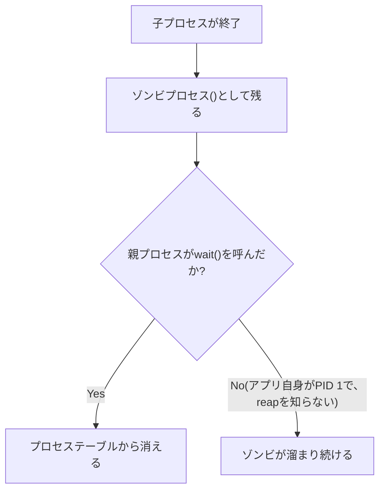

## はじめに

- **この記事で得られること**: [Linux Namespacesのハンズオン](/articles/linux-namespaces-handson-guide)で扱った、コンテナ内のプロセスがPID 1として振る舞う仕組みの先にある、**ゾンビプロセスと、PID 1特有の責務**という、実務で頻発する問題を、実際に手を動かして体系的に理解します。
- **対象読者**: `ps`コマンドで`<defunct>`という表示を見たことはあるものの、それが何を意味し、どうすれば解消できるのかを説明できない方を想定しています。
- **読むのにかかる想定時間**: 約25分(実際に構築しながら進める場合は40分程度を見込んでください)
- **ハンズオンの前提環境**: Dockerが動作するLinux環境

この記事は[『上位1%』シリーズ 全記事ガイド](/sitemap)の一部、[Linux基盤シリーズ](/sitemap#シリーズ一覧)の19.3本目です。

## 前提知識

- [Linux Namespacesのハンズオン](/articles/linux-namespaces-handson-guide): コンテナ内のプロセスが、独立したPIDネームスペースの中でPID 1として振る舞うという理解が前提になっています。

## 全体像をつかむ

**子プロセスが終了すると、その終了状態は、親プロセスが`wait()`(または`waitpid()`)を呼び出して「回収(reap)」するまで、プロセステーブルに残り続け**ます。**この回収されるのを待っている状態のプロセスを、ゾンビプロセス(`<defunct>`)と呼び**ます。**通常は、initプロセス(PID 1)が、親を失った孤児プロセスを引き継ぎ、代わりに`wait()`を呼び出してくれますが、コンテナの中では、アプリケーション自身がPID 1として動くことが多く、このreapの責務を、アプリケーション自身が担うことになり**ます。



## 基礎から徹底解説

### ハンズオン:ゾンビプロセスを自分の手で作り、kill -9が効かないことを確認する

1. **子プロセスを生成し、親プロセスが`wait()`を呼ばずに放置する、簡単なシェルスクリプトを用意**します。

```bash
#!/bin/bash
sleep 1 &
CHILD_PID=$!
sleep 30
```

2. **別のターミナルから、`ps aux`で、このスクリプトを実行し、子プロセスの状態を確認**します。`sleep 1 &`が終了した直後から、親の`sleep 30`が終わるまでの間、子プロセスは`STAT`列に`Z`(ゾンビ)と表示されます。

```bash
ps aux | grep sleep
# yourname  12345  ...  Z+   0:00 [sleep] <defunct>
```

3. **このゾンビプロセスに対して、`kill -9`を実行**してみます。

```bash
kill -9 12345
# エラーは出ないが、プロセスは消えない
```

**ゾンビプロセスは、すでに実行を終えたプロセスであり、シグナルを受け取って処理するコードそのものが、もはや存在しません。** **`kill -9`は、「死んでいるものを、もう一度殺す」ことはできず、唯一の解決策は、親プロセスが`wait()`を呼び出すか、親プロセス自身が終了して、ゾンビがPID 1へ引き継がれ、PID 1が代わりに回収することだけ**です。

### PID 1特有の、もう1つの責務:シグナルのデフォルト処理が適用されない

**通常のプロセスは、`SIGTERM`を受け取ると、ハンドラーを登録していなくても、カーネルが既定の動作(プロセスの終了)を適用**します。**しかし、PID 1だけは例外で、カーネルはこの既定の動作を適用せず、明示的にハンドラーを登録していない限り、`SIGTERM`を黙って無視し続け**ます。**これが、`docker stop`(内部的にはSIGTERMを送信)を実行しても、コンテナが終了せず、既定のタイムアウト後に、強制的な`SIGKILL`を待つしかなくなる、という実務上の症状の直接の原因**です。

<details>
<summary>解決策:tiniやdumb-initという、軽量なinitラッパーをENTRYPOINTにする</summary>

**`tini`や`dumb-init`は、コンテナのPID 1として動作し、ゾンビプロセスの回収と、シグナルの正しい転送という、通常のinitプロセスが担う2つの責務を代行する、軽量なラッパー**です。**DockerにはこれらをENTRYPOINTに自動的に挿入する`docker run --init`オプションや、Docker Composeの`init: true`設定も用意されており、アプリケーション自身を書き換えずに、この問題を解決**できます。

</details>

## プロが見ている視点(上位1%の理解)

### 「普通のプロセス」と「PID 1」は、カーネルから見ると、まったく別の扱いを受けている

**多くのアプリケーションは、自分が通常のプロセスとして動くことを前提に書かれており、PID 1特有の、reapとシグナル処理という2つの責務を、意識して実装していません。** **コンテナ環境でアプリケーションを動かす際、「このプロセスは、PID 1として動くことを想定して書かれているか」を問い直す**習慣が、ゾンビの蓄積や、`docker stop`が効かないという、原因不明に見えるトラブルを未然に防ぐための、上位1%のエンジニアの視点です。

## よくある誤解・つまずきポイント

- **誤解1: 「ゾンビプロセスは、`kill -9`で強制終了できる」**
  ゾンビプロセスは、すでに実行を終えたプロセスであり、シグナルを処理するコードが存在しないため、`kill -9`では消えません。
- **誤解2: 「PID 1も、他のプロセスと同じように、シグナルのデフォルト処理が適用される」**
  PID 1は例外であり、カーネルはシグナルのデフォルト処理を適用しないため、明示的なハンドラーを登録していない限り、SIGTERMのようなシグナルを黙って無視し続けます。
- **誤解3: 「ゾンビプロセスが1つでもあれば、システムに深刻な問題が起きている」**
  一時的なゾンビプロセスは正常な現象であり、問題になるのは、親プロセスが回収せずに蓄積し続け、プロセステーブルを圧迫する場合です。

## 障害・トラブルシューティングの視点

1. **`ps aux`で`<defunct>`のプロセスが増え続けている**: 親プロセスが子プロセスの終了を正しく`wait()`しているか、あるいはPID 1がreapの責務を果たしているかを確認します。
2. **`docker stop`を実行しても、コンテナがタイムアウトまで終了しない**: アプリケーション自身がPID 1としてSIGTERMに応答しているか、あるいはtini/dumb-initのようなinitラッパーを導入しているかを確認します。
3. **ゾンビプロセスを`kill -9`しても消えない**: ゾンビはすでに死んでいるプロセスであるため、親プロセスによる回収以外に解決策はありません。

## まとめ

- ゾンビプロセスは、子プロセスの終了状態が、親プロセスの`wait()`呼び出しを待っている間、プロセステーブルに残り続ける状態です。
- ゾンビプロセスは、`kill -9`では消えません。唯一の解決策は、親プロセスによる回収か、PID 1への引き継ぎです。
- PID 1だけは、カーネルがシグナルのデフォルト処理を適用しない例外であり、明示的なハンドラーがない限り、SIGTERMを無視し続けます。
- `tini`や`dumb-init`のような、軽量なinitラッパーをENTRYPOINTにすることで、アプリケーション自身を書き換えずに、この問題を解決できます。

**今日から意識すべきこと**
1. コンテナのアプリケーションがPID 1として動く際は、`tini`や`dumb-init`、あるいは`docker run --init`の導入を検討しましょう。
2. `docker stop`が効かないという症状に遭遇したら、まずPID 1のシグナル処理を疑いましょう。

## 参考文献

- [Docker and the PID 1 Zombie Reaping Problem | Phusion](https://blog.phusion.nl/docker-and-the-pid-1-zombie-reaping-problem/)
- [When Containers Kill Nodes: Understanding Zombie Processes and PID 1 | DEV Community](https://dev.to/shailendra_verma/when-containers-kill-nodes-understanding-zombie-processes-and-pid-1-3o7f)
