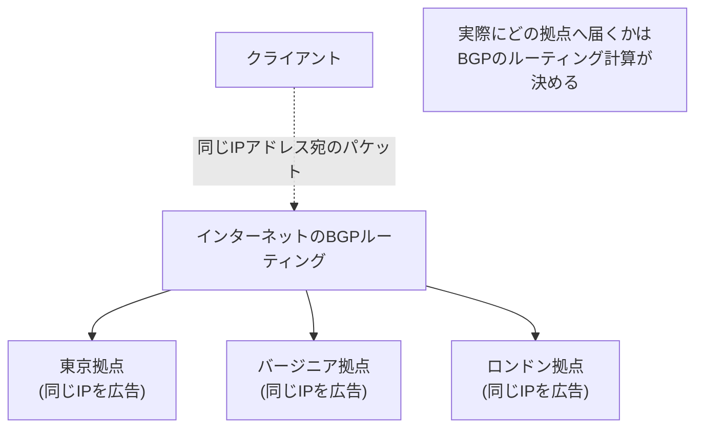

## はじめに

- **この記事で得られること**: [GSLB(グローバルサーバーロードバランシング)の仕組み](/articles/load-balancing-gslb-guide)で扱った、権威DNSサーバーが問い合わせ元に応じて異なるIPアドレスを返すという手法は、グローバル分散を実現する、1つの方法に過ぎません。この記事では、**Anycast**という、**まったく別のレイヤーで、同じ目的を実現する仕組み**を体系的に理解します。同じ1つのIPアドレスを、世界中の複数の拠点から同時にBGPで広告し、どの拠点へ実際に届くかをインターネットのルーティングそのものに決めさせる、という発想を扱います。
- **対象読者**: GSLBがDNSの応答を書き換えることで拠点振り分けを実現していることは理解しているものの、Anycastという、別の方式を説明できない方を想定しています。
- **読むのにかかる想定時間**: 約17分

この記事は[『上位1%』シリーズ 全記事ガイド](/sitemap)の一部、[ロードバランシング基礎シリーズ](/sitemap#シリーズ一覧)の6.1本目です。

## 前提知識

- [GSLB(グローバルサーバーロードバランシング)の仕組み](/articles/load-balancing-gslb-guide): 権威DNSサーバーが、問い合わせ元の状況に応じて異なるIPアドレスを返すという理解が前提になっています。

## 全体像をつかむ

**GSLBは、「どの拠点へ送るか」という判断を、DNSの名前解決という層で行っていました。** これに対し、**Anycastは、まったく異なる層——インターネットのルーティングそのものを担うBGP(Border Gateway Protocol)の層——で、同じ目的を実現します。** **Anycastでは、世界中に分散した複数の拠点のルーターが、まったく同じ1つのIPアドレス(プレフィックス)を、それぞれ独立してBGPで広告します。** クライアントから見ると、インターネット上には、同じIPアドレスを名乗る複数の拠点が存在していることになりますが、**クライアントが実際に送信したパケットは、BGPのルーティング計算の結果として、通常は、そのクライアントから見て経路的に最も近い(ASパスが最短の)拠点へ届きます。**

## 基礎から徹底解説

### GSLBとAnycastは、障害発生時の切り替え速度が根本的に異なる

**GSLBでの拠点切り替えは、DNSの応答を書き換えることで実現されるため、クライアント側やリゾルバ側にキャッシュされた、古いDNSレコードのTTLが切れるまで、切り替えが反映されません。** TTLの長さによっては、障害発生から実際の切り替えまでに、相応の時間差が生じる可能性があります。**一方、Anycastでの拠点切り替えは、障害が発生した拠点が、そのIPアドレスのBGP広告を停止するだけで、インターネットのルーティングテーブルが、残りの健全な拠点への経路を、通常は数秒から数十秒程度で再計算します。** **DNSキャッシュに依存しない、ネットワークそのものの再収束による切り替えであるため、Anycastの方が、一般的に高速な障害時の切り替えを実現できます。**

### Anycastの弱点:「近い」と「空いている」は、必ずしも一致しない

**Anycastが決めているのは、あくまでBGPのルーティング上の「近さ」(経路的な距離)であり、その拠点が現在どれだけ混雑しているか、処理能力に余裕があるかという「負荷」の状況は、まったく考慮されません。** **ある拠点が過負荷の状態にあっても、BGPのルーティングが変わらない限り、その拠点へのトラフィックの集中は止まりません。** これは、[GSLBがヘルスチェックの結果に基づいて、負荷の高い拠点を応答対象から外せる](/articles/load-balancing-gslb-guide)のとは対照的な、Anycastの構造的な制約です。

Anycastが、接続の状態を維持できないという、もう1つの弱点

**Anycastは、個々の接続(セッション)の状態を維持する仕組みを持ちません。** BGPのルーティングが、何らかの理由で変化すると、**同一の、継続中の接続であっても、途中から別の拠点へ届くようになってしまう**可能性があります。これは、TCP接続の文脈では致命的な問題になりえます。実務では、UDPベースの、ステートレスなトラフィック(DNSの問い合わせなど)や、短命なHTTPリクエストに対してAnycastを使い、**長時間の状態維持が必要な接続は、Anycastで最初の接続先を決めた後、その拠点の中でさらに個別のロードバランサーへ引き渡す**、という、複数の仕組みを組み合わせた構成が一般的です。

## プロが見ている視点(上位1%の理解)

### 実務では、GSLBとAnycastは、競合する選択肢ではなく、組み合わせて使われることが多い

**GSLBとAnycastは、「どちらを選ぶべきか」という二択の問題ではなく、実務では、両方を組み合わせて使われることが一般的です。** 例えば、[Cloudflareや、GoogleのパブリックDNS(8.8.8.8)のような大規模なサービス](https://developers.google.com/speed/public-dns)は、Anycastによって、世界中のどこからアクセスしても、物理的に近い拠点へ自動的にルーティングされる基盤を用意した上で、**各拠点の内部では、通常のロードバランサーやGSLB的な仕組みを使って、より細かい負荷分散の制御を行っています。** **Anycastは「大まかに、近い拠点へ振り分ける」ことには優れていますが、「その拠点の中で、どのサーバーへ、どういう条件で振り分けるか」という、きめ細かい制御には向いていません。** この2つの仕組みが、まったく異なる抽象度の問題を解決しているという理解が、実際のグローバル分散基盤を設計する際の土台になります。

## よくある誤解・つまずきポイント

- **誤解1: 「AnycastもGSLBも、結局は同じことをしている、ほぼ同じ仕組みだ」**
  GSLBはDNSの応答を書き換える仕組みであり、Anycastはルーティングそのものを使う、まったく異なる層の仕組みです。障害時の切り替え速度や、接続状態の維持可能性など、複数の点で性質が異なります。
- **誤解2: 「Anycastで『近い』拠点に届いているなら、その拠点は負荷も軽いはずだ」**
  Anycastが決めているのは経路的な近さだけであり、拠点の負荷状況は一切考慮されません。近い拠点が過負荷になっている可能性は、常にあります。
- **誤解3: 「Anycastは、長時間の接続にもそのまま安全に使える」**
  Anycastは個々の接続の状態を維持する仕組みを持たず、ルーティングの変化によって、同一の接続が途中で別の拠点へ届いてしまう可能性があります。

## 障害・トラブルシューティングの視点

1. **ある拠点に障害が起きても、トラフィックが引き続き集中している**: その拠点が、BGP広告を実際に停止しているかを確認します。広告が停止されない限り、Anycastによる自動的な切り替えは発生しません。
2. **特定の拠点だけ、他より明らかに混雑している**: Anycastだけに依存した構成の場合、BGPのルーティング上「近い」という理由だけで、特定拠点にトラフィックが集中している可能性があります。拠点内でのさらなる負荷分散の仕組みを検討します。
3. **長時間接続するアプリケーションで、通信が不安定になる**: Anycastの経路が、接続の途中で切り替わっていないかを確認し、必要であれば、Anycastの対象をステートレスな用途に限定する設計へ見直します。

## まとめ

- GSLBは、DNSの応答を書き換えることで拠点振り分けを実現しますが、Anycastは、同じIPアドレスを複数拠点からBGPで広告し、ルーティング自体に振り分けを委ねます。
- Anycastの障害時切り替えは、DNSキャッシュに依存しないため、一般的にGSLBより高速です。
- Anycastは、経路的な「近さ」しか考慮せず、拠点の「負荷」の状況は一切反映されません。
- Anycastは個々の接続の状態を維持できないため、実務では、ステートレスな用途、または拠点内でさらに別のロードバランサーと組み合わせて使われます。

**今日から意識すべきこと**
1. グローバル分散基盤を設計する際は、GSLBとAnycastを対立する選択肢として捉えず、それぞれが解決する問題の抽象度の違いを意識して組み合わせましょう。
2. Anycastを採用する場合は、「近い」ことと「空いている」ことが別問題であるという前提で、拠点内の負荷分散を別途設計しましょう。

## 参考文献

- [What is global server load balancing (GSLB)? | Gcore](https://gcore.com/learning/what-is-global-server-load-balancing)
- [Google Public DNS | Google for Developers](https://developers.google.com/speed/public-dns)
