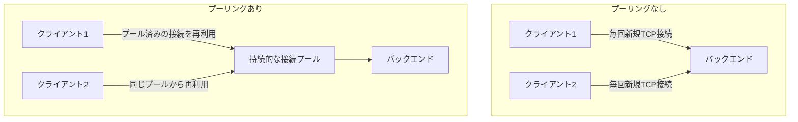

## はじめに

- **この記事で得られること**: [コネクションドレインの仕組み](/articles/load-balancing-connection-draining-guide)で扱った、バックエンドとの接続の扱いの先にある、**コネクションプーリング**という、バックエンドへの接続を再利用する性能最適化の仕組みを体系的に理解します。
- **対象読者**: ロードバランサーが、クライアントとの接続と、バックエンドとの接続を、それぞれ別々に管理していることは知っているものの、バックエンドとの接続が、どのように再利用されているのかを説明できない方を想定しています。
- **読むのにかかる想定時間**: 約18分

この記事は[『上位1%』シリーズ 全記事ガイド](/sitemap)の一部、[ロードバランシング基礎シリーズ](/sitemap#シリーズ一覧)の4.2本目です。

## 前提知識

- [コネクションドレインの仕組み](/articles/load-balancing-connection-draining-guide): ロードバランサーとバックエンドの間の接続という概念の理解が前提になっています。

## 全体像をつかむ

**ロードバランサーが、個々のクライアントのリクエストごとに、バックエンドへ新しいTCP接続を開いていたら、そのたびにTCPハンドシェイク(そして暗号化通信ならTLSハンドシェイクも)のオーバーヘッドが発生**します。**このオーバーヘッドは、バックエンドの応答自体が速い場合、相対的に非常に大きな比重を占めてしまい**ます。**コネクションプーリングは、バックエンドへの持続的な接続を、あらかじめ確立してプールしておき、複数の異なるクライアントのリクエストにわたって、その接続を順番に再利用する**仕組みです。

## 基礎から徹底解説

### Nginxでの落とし穴:keepaliveを設定するだけでは不十分

**Nginxでは、`upstream`ブロックに`keepalive`を設定するだけでは、バックエンドとの接続は再利用されません。** **Nginxは既定でバックエンドとHTTP/1.0で通信するため、持続的な接続自体がそもそも成立せず、`proxy_http_version 1.1;`の設定と、クライアントから転送された`Connection`ヘッダーを明示的にクリアすることが、追加で必要**です。**そして、`keepalive`で指定する数値は、ワーカープロセスごとの上限であるため、複数のワーカープロセスを持つ構成では、想定より多くの接続がバックエンドに対して保持される**ことになります。

### この性能最適化が、HTTPリクエストスマグリングの前提条件になる

**[HTTPリクエストスマグリングのハンズオン](/articles/load-balancing-request-smuggling-handson-guide)で扱った攻撃は、ロードバランサーとバックエンドが、リクエストの境界を異なる方法で解釈することを悪用するものでしたが、この攻撃が、別の無関係なクライアントのリクエストに影響を与えてしまうのは、まさに、持続的な接続が複数のクライアントのリクエストにわたって再利用されているから**です。**接続プーリングを有効にする際は、バックエンド側が、ロードバランサーと同じ基準でリクエストの境界を解釈しているかどうかを、特に高いセキュリティ要件を持つ環境では、確認する必要**があります。

診断の手がかり:upstream_connect_timeがゼロなら、再利用されている

**接続が実際に再利用されているかどうかは、`$upstream_connect_time`という変数で確認**できます。**この値がゼロであれば、既存の接続が再利用されたことを意味し、ゼロでない値であれば、新しいハンドシェイクが発生したことを意味**します。

## プロが見ている視点(上位1%の理解)

### 1つの性能最適化が、まったく別のセキュリティ上の前提条件にもなっている

**コネクションプーリングは、純粋な性能最適化として導入されることが多いですが、この同じ仕組みが、HTTPリクエストスマグリングという攻撃が成立するための、必須の前提条件にもなっています。** **ある仕組みを、その仕組みが導入された目的(ここでは性能)だけで評価せず、「この仕組みが、他にどんな前提条件を生み出しているか」を一段掘り下げて考える**習慣が、上位1%のエンジニアの視点です。

## よくある誤解・つまずきポイント

- **誤解1: 「upstreamブロックにkeepaliveを設定すれば、それだけでバックエンドとの接続が再利用される」**
  Nginxは既定でHTTP/1.0で通信するため、proxy_http_version 1.1の設定と、Connectionヘッダーのクリアが、追加で必要です。
- **誤解2: 「keepaliveで指定する数値は、ロードバランサー全体での、バックエンドへの接続数の上限だ」**
  keepaliveの数値は、ワーカープロセスごとの上限であり、複数のワーカープロセスがあれば、合計の接続数はその数値より多くなります。
- **誤解3: 「コネクションプーリングは、性能だけに関係する機能であり、セキュリティとは無関係だ」**
  持続的な接続の再利用は、HTTPリクエストスマグリングという攻撃が、別の無関係なクライアントに影響を与えてしまう、直接の前提条件になっています。

## 障害・トラブルシューティングの視点

1. **Nginxでkeepaliveを設定したのに、接続が再利用されない**: proxy_http_version 1.1の設定と、Connectionヘッダーのクリアが、両方とも行われているかを確認します。
2. **バックエンドへの接続数が、想定より多い**: keepaliveの数値がワーカープロセスごとの上限であることを踏まえ、ワーカープロセスの数との積で、実際の上限を再計算します。
3. **接続プーリングを導入する前に、セキュリティ上のリスクを評価したい**: バックエンド側のリクエスト境界の解釈が、ロードバランサー側と一致しているかを確認します。

## まとめ

- コネクションプーリングは、バックエンドへの持続的な接続をプールしておき、複数のクライアントのリクエストにわたって再利用する、性能最適化の仕組みです。
- Nginxでは、keepaliveの設定に加え、proxy_http_version 1.1の設定とConnectionヘッダーのクリアが必要です。
- keepaliveの数値は、ワーカープロセスごとの上限であることに注意が必要です。
- 持続的な接続の再利用は、HTTPリクエストスマグリングという攻撃の、直接の前提条件にもなっています。

**今日から意識すべきこと**
1. バックエンドへのコネクションプーリングを導入する際は、性能面の設定だけでなく、リクエストスマグリングへの耐性も、合わせて確認しましょう。
2. ある性能最適化を導入したら、「この仕組みが、他にどんな前提条件を生み出しているか」を一段掘り下げて考えましょう。

## 参考文献

- [NGINX Upstream Keepalive: Eliminating Per-Request TCP and TLS Overhead | Netdata](https://www.netdata.cloud/guides/nginx/nginx-upstream-keepalive/)
- [Enable Keepalive Connections in Nginx Upstream Proxy Configurations | ma.ttias.be](https://ma.ttias.be/enable-keepalive-connections-in-nginx-upstream-proxy-configurations/)
