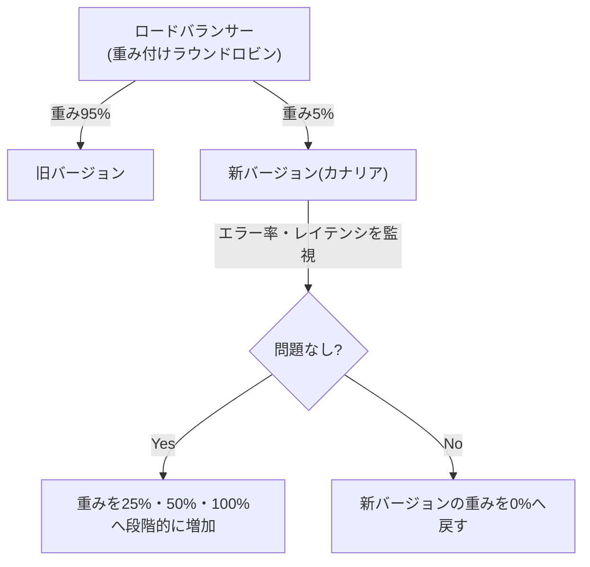

## はじめに

- **この記事で得られること**: [ロードバランシングのアルゴリズムとヘルスチェックの仕組み](/articles/load-balancing-algorithms-guide)で扱った重み付けラウンドロビンは、サーバーの性能差を調整する仕組みとして紹介されました。この記事では、**この同じ仕組みが、新バージョンへのトラフィックを段階的に増やしていく、カナリアデプロイというリリース戦略に転用される**様子を体系的に理解します。
- **対象読者**: 重み付けラウンドロビンという仕組み自体は理解しているものの、それがリリース戦略としても使われることを知らない方を想定しています。
- **読むのにかかる想定時間**: 約18分

この記事は[『上位1%』シリーズ 全記事ガイド](/sitemap)の一部、[ロードバランシング基礎シリーズ](/sitemap#シリーズ一覧)の2.2本目です。

## 前提知識

- [ロードバランシングのアルゴリズムとヘルスチェックの仕組み](/articles/load-balancing-algorithms-guide): 重み付けラウンドロビンという仕組み自体の理解が前提になっています。

## 全体像をつかむ

**重み付けラウンドロビンは、サーバーごとに設定した重みの比率で、トラフィックを振り分ける仕組み**でした。**この同じ仕組みを、「性能の異なる複数のサーバーへの振り分け」ではなく、「新バージョンと旧バージョンという、2つの異なるコードへの振り分け」に使うと、カナリアデプロイという、安全なリリース戦略が実現**できます。**新バージョンへの重みを、5%→25%→50%→100%のように、段階的に増やしていき、各段階でエラー率やレイテンシを監視しながら、問題がなければ次の段階へ進む**のです。

## 基礎から徹底解説

### カナリアデプロイとブルーグリーンデプロイの違い

**ブルーグリーンデプロイは、新旧2つの、完全に独立した環境を用意し、ロードバランサーの切り替え設定を変更するだけで、全トラフィックを一瞬で新環境へ切り替える**手法です。切り戻しも、設定を元に戻すだけで即座に行えますが、**2つの環境を同時に維持する必要があるため、インフラコストが実質的に倍になる**というトレードオフがあります。**カナリアデプロイは、1つの環境を共有しながら、重みの比率だけを段階的に変えていく**ため、インフラコストの増加を抑えつつ、問題を早期に、限定的な範囲で検知できます。

### スティッキーセッションが、カナリアデプロイの重みの比率を歪めることがある

**[ロードバランシングのアルゴリズム](/articles/load-balancing-algorithms-guide)で扱った、セッション永続化(スティッキーセッション)が有効になっていると、すでに旧バージョンへ固定されているクライアントは、重みの比率を変更しても、旧バージョンへの接続を継続**してしまいます。**これにより、設定した重みの比率と、実際に観測される新バージョンへのトラフィックの割合が、一致しなくなる**ことがあります。カナリアデプロイを実施する際は、この点も踏まえた監視が必要です。

段階ごとの監視と、自動ロールバックの組み合わせ

**実務でのカナリアデプロイは、各段階で、エラー率・レイテンシといったメトリクスを監視し、あらかじめ定めた基準を超えた場合に、新バージョンへの重みを自動的に0%へ戻す、自動ロールバックの仕組みと組み合わせる**ことが推奨されています。人間が常に監視し続けるのではなく、メトリクスに基づいた、機械的な判断で、安全な昇格・ロールバックを行うという設計です。

## プロが見ている視点(上位1%の理解)

### 同じ技術的な仕組みが、まったく異なる目的のために転用されることがある

**重み付けラウンドロビンという、1つの技術的な仕組みは、「サーバーの性能差を調整する」という、静的な負荷分散の目的でも、「新バージョンへの移行を安全に進める」という、動的なリリース戦略の目的でも、同じように使うことができます。** **技術の仕組みそのものを理解するだけでなく、その仕組みが、どんな目的のために、どう転用できるのかを、一段掘り下げて考える**習慣が、上位1%のエンジニアが持っている視点です。

## よくある誤解・つまずきポイント

- **誤解1: 「カナリアデプロイとブルーグリーンデプロイは、同じ手法の別名だ」**
  ブルーグリーンデプロイは2つの独立した環境間の瞬時の全面切り替え、カナリアデプロイは1つの環境を共有した段階的な重みの変更という、異なる手法です。
- **誤解2: 「重み付けラウンドロビンは、サーバーの性能差調整にしか使えない」**
  同じ仕組みは、新旧バージョン間のトラフィック配分を制御する、カナリアデプロイのリリース戦略にも使えます。
- **誤解3: 「スティッキーセッションは、カナリアデプロイに一切影響しない」**
  スティッキーセッションが有効な場合、すでに旧バージョンへ固定されたクライアントは、重みの比率を変更しても旧バージョンへの接続を継続するため、観測される比率が歪むことがあります。

## 障害・トラブルシューティングの視点

1. **カナリアデプロイで設定した重みの比率と、実際のトラフィックの割合が一致しない**: スティッキーセッションが有効になっていないかを確認します。
2. **新バージョンへの重みを増やした直後に、エラー率が急増した**: 自動ロールバックの仕組みが正しく機能し、重みが0%へ戻っているかを確認します。
3. **カナリアデプロイとブルーグリーンデプロイ、どちらを選ぶべきか迷う**: インフラコストの制約と、問題検知の早期性のどちらを優先するかで判断します。

## まとめ

- 重み付けラウンドロビンは、サーバーの性能差調整だけでなく、カナリアデプロイというリリース戦略にも転用できます。
- ブルーグリーンデプロイは2つの独立した環境間の瞬時の全面切り替え、カナリアデプロイは1つの環境を共有した段階的な重みの変更です。
- スティッキーセッションが有効な場合、カナリアデプロイで観測される比率が、設定した重みと一致しなくなることがあります。
- 各段階でのメトリクス監視と、自動ロールバックの仕組みを組み合わせることが、実務では推奨されています。

**今日から意識すべきこと**
1. 新しい技術的な仕組みを学んだら、それが元の目的以外にも転用できないかを、一段掘り下げて考えましょう。
2. カナリアデプロイを実施する際は、スティッキーセッションの設定状況を、必ず確認しましょう。

## 参考文献

- [Blue-Green vs Canary vs Rolling Deployments in Kubernetes | CloudOptimo](https://cloudoptimo.com/blog/blue-green-vs-canary-vs-rolling-deployments-in-kubernetes-how-to-choose-the-right-one/)
- [Blue-Green Deployments With Application Load Balancer | AWS DevOps Blog](https://aws.amazon.com/blogs/devops/blue-green-deployments-with-application-load-balancer/)
