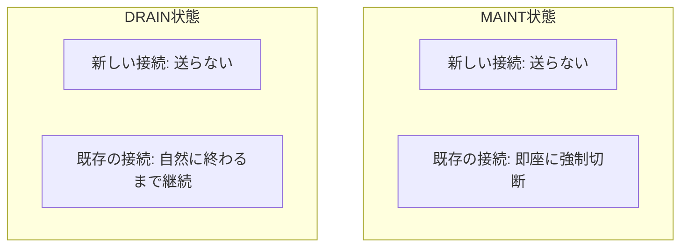

## はじめに

- **この記事で得られること**: [HAProxyでL7ロードバランサーを構築するハンズオン](/articles/load-balancing-haproxy-handson-guide)を終えた後、実務で必ず遭遇する場面があります。デプロイやメンテナンスのために、バックエンドサーバーを1台、ロードバランサーのローテーションから安全に外したい。この記事では、**既存の接続は自然に終わらせつつ、新しい接続だけを止める**、コネクションドレイン(DRAIN)という仕組みと、**即座に切断するMAINT状態**との決定的な違いを体系的に理解します。
- **対象読者**: HAProxyでロードバランサーを構築したことはあるものの、稼働中のバックエンドサーバーを安全にメンテナンスへ入れる具体的な手順を説明できない方を想定しています。
- **読むのにかかる想定時間**: 約16分

この記事は[『上位1%』シリーズ 全記事ガイド](/sitemap)の一部、[ロードバランシング基礎シリーズ](/sitemap#シリーズ一覧)の4.1本目です。

## 前提知識

- [HAProxyでL7ロードバランサーを構築するハンズオン](/articles/load-balancing-haproxy-handson-guide): HAProxyが複数のバックエンドサーバーへリクエストを振り分ける基本動作が前提になっています。
- [ロードバランシングのアルゴリズムとヘルスチェックの仕組み](/articles/load-balancing-algorithms-guide): セッション永続化(スティッキーセッション)の基本が前提になっています。

## 全体像をつかむ

バックエンドサーバーをロードバランサーのローテーションから外す方法として、**設定ファイルからそのサーバーの記述を削除し、リロードする**という方法を思いつく人は多いでしょう。しかし、この方法では、**そのサーバーが処理中の、まだ応答を返していないリクエストが、問答無用で強制的に切断されます。** ユーザーからは、処理中だったはずのリクエストが突然失敗する、という体験になります。**この問題を避けるために存在するのが、コネクションドレイン(DRAIN)という仕組みです。** DRAINは、「新しい接続は、このサーバーへ送らない」が「すでに確立されている接続上のやり取りは、自然に終わるまで続けさせる」という、2つの異なる挙動を組み合わせた状態です。



## 基礎から徹底解説

### MAINT状態:即座に、問答無用で切断する

**MAINT(メンテナンス)状態は、そのサーバーへのヘルスチェックを停止し、新しい接続も既存の接続も、すべて即座に遮断します。** ハードウェア障害が発生し、今すぐそのサーバーへの通信をすべて止めなければならない、という緊急の場面では適切な選択ですが、**計画的なメンテナンスやデプロイのために使うと、処理中だったリクエストがすべて強制的に失敗することになります。**

### DRAIN状態:新規接続だけを止め、既存の接続は見届ける

**DRAIN状態は、そのサーバーを振り分け候補から除外し、新しい接続を一切送らなくなりますが、すでにそのサーバーへ接続済みのクライアントについては、その接続上でのやり取りを、自然に終わるまで継続させます。** HAProxyでは、Runtime API(統計ソケット)経由で、次のようにDRAIN状態を設定します。

```bash
# 対象サーバーをDRAIN状態にする(統計ソケット経由)
echo "set server backend_name/server_name state drain" | socat stdio /var/run/haproxy.sock

# 現在のセッション数を確認し、0になるまで待つ
echo "show stat" | socat stdio /var/run/haproxy.sock | grep server_name
```

**セッション数が0になったことを確認してから、そのサーバーを実際に停止・メンテナンスへ入れる**、という順序を徹底することで、処理中のリクエストを一切失わずに、安全な切り離しが実現できます。

<details>
<summary>なぜ「設定ファイルを書き換えてリロード」では不十分なのか</summary>

HAProxyの設定ファイルを書き換えてリロードする方法は、**リロードの瞬間に新しいプロセスへ切り替わる**ため、リロード前のプロセスが保持していた既存の接続の扱いが、リロードの実装や設定に依存して不安定になりえます。**Runtime APIによるDRAIN状態への変更は、プロセスの再起動を伴わず、実行中のHAProxyプロセスの内部状態を動的に書き換えるだけ**であるため、既存の接続の継続性が、より確実に保証されます。計画的なメンテナンスでは、設定ファイルの変更とリロードではなく、Runtime APIによる状態変更を使うことが、実務では強く推奨されます。

</details>

## プロが見ている視点(上位1%の理解)

### 「コネクションドレイン」は、ロードバランサーの実装ごとに名前が違う、共通の概念

**DRAINという言葉自体はHAProxy固有の用語ですが、「新しい接続は止め、既存の接続は自然に終わらせる」という概念そのものは、ロードバランサーの実装を問わず広く使われています。** AWSのELB/ALBでは、この仕組みを「**登録解除の遅延**(Deregistration Delay)」と呼び、登録解除されたターゲットに対して、設定した秒数の間だけ、既存の接続への応答を許容します。GCPのロードバランサーでは「**コネクションドレインタイムアウト**」という名前です。Kubernetesでは、専用の「DRAIN状態」という機能名はありませんが、**Readinessプローブが失敗したPodをServiceのエンドポイントから除外し、同時に`terminationGracePeriodSeconds`で設定された時間だけ、Pod自体の終了を遅らせる**という、2つの機能の組み合わせによって、実質的に同じ効果を実現しています。**名前は実装ごとに異なりますが、「新規流入の停止」と「既存処理の完了待ち」という2つの要素を分離するという設計思想は、驚くほど共通しています。** この共通性を理解していると、新しいロードバランサー製品やクラウドサービスに触れたときも、「このサービスでのDRAINに相当する機能は何か」という問いから、素早く本質を掘り下げられます。

## よくある誤解・つまずきポイント

- **誤解1: 「サーバーをメンテナンスへ入れる前に、設定ファイルからそのサーバーを削除してリロードすれば十分だ」**
  この方法では、処理中のリクエストが強制的に切断される可能性があります。DRAIN状態への変更と、セッション数が0になるまでの待機を徹底する必要があります。
- **誤解2: 「MAINTとDRAINは、同じことを表す別名に過ぎない」**
  MAINTは既存の接続も即座に切断するのに対し、DRAINは既存の接続を自然に終わるまで継続させる、まったく異なる挙動です。
- **誤解3: 「コネクションドレインという仕組みは、HAProxy特有のものだ」**
  同じ概念は、AWSの「登録解除の遅延」、GCPの「コネクションドレインタイムアウト」、Kubernetesの Readinessプローブと`terminationGracePeriodSeconds`の組み合わせなど、実装ごとに異なる名前で広く存在します。

## 障害・トラブルシューティングの視点

1. **メンテナンス作業中に、ユーザーからエラー報告が届く**: サーバーをMAINT状態で即座に止めていないか、DRAIN状態への変更とセッション数の確認を徹底していたかを確認します。
2. **DRAIN状態にしたはずなのに、セッション数がなかなか0にならない**: WebSocketや長時間接続を維持するAPIなど、接続が長時間保持される種類のトラフィックが存在しないかを確認します。
3. **クラウドのロードバランサーで、似た問題が起きた**: そのサービスにおける「コネクションドレイン」に相当する設定項目(登録解除の遅延など)が、適切な秒数に設定されているかを確認します。

## まとめ

- MAINT状態は、新しい接続も既存の接続も即座に遮断する、緊急時向けの状態です。
- DRAIN状態は、新しい接続だけを止め、既存の接続は自然に終わるまで継続させる、計画的なメンテナンス向けの状態です。
- 計画的なメンテナンスでは、DRAIN状態への変更後、セッション数が0になったことを確認してから、サーバーを実際に停止するという順序を徹底します。
- 「新規流入の停止」と「既存処理の完了待ち」を分離するという設計思想は、HAProxy・AWS・GCP・Kubernetesなど、実装ごとに名前は異なるものの、広く共通しています。

**今日から意識すべきこと**
1. バックエンドサーバーを計画的にメンテナンスへ入れる際は、設定ファイルの削除・リロードではなく、DRAIN状態への変更を使いましょう。
2. 新しいロードバランサー製品やクラウドサービスに触れたときは、「このサービスでのDRAINに相当する機能は何か」を最初に確認する習慣をつけましょう。

## 参考文献

- [HAProxy Management Guide | HAProxy Technologies](https://www.haproxy.com/documentation/haproxy-configuration-manual/latest/)
- [Deregistration delay for your target groups | AWS Documentation](https://docs.aws.amazon.com/elasticloadbalancing/latest/application/target-group-health-checks.html)
