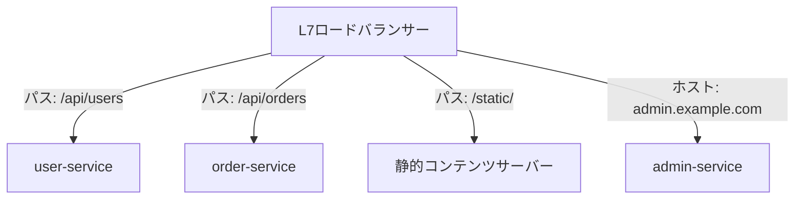

## はじめに

- **この記事で得られること**: [ロードバランシングのアルゴリズムとヘルスチェック](/articles/load-balancing-algorithms-guide)で扱った、L4とL7が見ている情報の違いの先にある、**L7ロードバランサーが、URLのパスやホスト名を見て、実際にどうやって異なるバックエンドへ振り分けているのか**を体系的に理解します。
- **対象読者**: L4とL7の違いは理解しているものの、L7が具体的にどんなルールでバックエンドを選んでいるのかを説明できない方を想定しています。
- **読むのにかかる想定時間**: 約18分

この記事は[『上位1%』シリーズ 全記事ガイド](/sitemap)の一部、[ロードバランシング基礎シリーズ](/sitemap#シリーズ一覧)の3.1本目です。

## 前提知識

- [ロードバランシングのアルゴリズムとヘルスチェック](/articles/load-balancing-algorithms-guide): L4とL7が見ている情報の違いの理解が前提になっています。

## 全体像をつかむ

**ホストベースルーティングは、`app.example.com`と`admin.example.com`のように、異なるホスト名を、それぞれ異なるバックエンドのプールへ振り分け**ます。**パスベースルーティングは、`/api/`と`/static/`のように、URLパスの先頭部分(プレフィックス)を見て、異なるバックエンドへ振り分け**ます。**マイクロサービスの構成では、`/api/users`をuser-serviceへ、`/api/orders`をorder-serviceへ、というように、1つのロードバランサーの背後に、複数の独立したサービスを束ねる、という使い方が一般的**です。

## 基礎から徹底解説

### ルールは上から評価され、最初にマッチしたものが勝つ

**パスベース/ホストベースのルールは、通常、上から順に評価され、最初にマッチしたルールが適用**されます。**この評価順序が、重なり合うパスのプレフィックスを扱う際の、典型的な落とし穴**になります。**例えば、`/api/`へのルールを、より具体的な`/api/admin/`へのルールより先に配置すると、`/api/admin/`宛のリクエストが、意図せず`/api/`のルールにマッチしてしまい**ます。**より具体的なルールを、より一般的なルールより先に配置するという、ルールの並び順の設計そのものが、正しい振り分けを実現するための前提条件**です。

### 複数の条件を、1つのルールの中で組み合わせることができる

**パス・ホスト名に加えて、HTTPメソッドや送信元IPアドレス、クエリパラメータといった、複数の条件を、1つの振り分けルールの中で組み合わせることも**できます。**これにより、「特定のパスへの、特定のHTTPメソッドによるリクエストだけを、特定のバックエンドへ送る」といった、きめ細かい振り分けが可能**になります。

L4では、そもそもこの振り分けができない

**L4ロードバランサーは、TCP/UDPヘッダーのIPアドレスとポート番号だけを見るため、HTTPリクエストの内容であるパスやホスト名を、そもそも参照することができません。** **パスベース/ホストベースルーティングが実現できることそのものが、L7ロードバランサーが、HTTPリクエストの内容まで読み取れることの、直接的な証拠**です。

## プロが見ている視点(上位1%の理解)

### 「ルールが複数存在する」ことと、「ルールの並び順が、動作を決定する」ことは、別の理解である

**パスベース/ホストベースルーティングのルールを設定する際、個々のルールが正しく書けているかどうかだけに注意が向きがちですが、実際の動作を決定しているのは、ルールの内容そのものに加えて、ルールが並んでいる順序でもあります。** **新しいルールを追加するたびに、「この新しいルールは、既存のどのルールより先に、あるいは後に評価されるべきか」を問い直す**習慣が、上位1%のエンジニアの視点です。

## よくある誤解・つまずきポイント

- **誤解1: 「パスベースルーティングのルールは、順序に関係なく、最も具体的なものが自動的に優先される」**
  多くの実装では、ルールは単純に上から評価され、最初にマッチしたものが適用されるため、具体的なルールを先に配置する必要があります。
- **誤解2: 「L4ロードバランサーでも、設定次第でパスベースルーティングができる」**
  L4はTCP/UDPヘッダーしか見ないため、HTTPリクエストの内容であるパスを、そもそも参照できません。
- **誤解3: 「1つの振り分けルールには、1つの条件しか指定できない」**
  パス・ホスト名・HTTPメソッド・送信元IPアドレスなど、複数の条件を1つのルールの中で組み合わせることができます。

## 障害・トラブルシューティングの視点

1. **特定のパスへのリクエストが、意図しないバックエンドへ振り分けられている**: より一般的なパスのルールが、より具体的なルールより先に配置されていないかを確認します。
2. **L4ロードバランサーで、パスベースのルーティングを試みているが機能しない**: L4はHTTPリクエストの内容を参照できないため、L7ロードバランサーへの切り替えが必要です。
3. **新しいルーティングルールを追加した後、既存のルーティングが変化した**: 新しいルールが、既存のルールより先に評価される位置に挿入され、意図せず既存のリクエストを横取りしていないかを確認します。

## まとめ

- ホストベースルーティングは異なるホスト名を、パスベースルーティングは異なるURLパスのプレフィックスを見て、それぞれ異なるバックエンドへ振り分けます。
- ルールは通常上から評価され、最初にマッチしたルールが適用されるため、具体的なルールを一般的なルールより先に配置する必要があります。
- パス・ホスト名・HTTPメソッド・送信元IPアドレスなど、複数の条件を1つのルールの中で組み合わせることができます。
- L4ロードバランサーは、HTTPリクエストの内容であるパスやホスト名を、そもそも参照できません。

**今日から意識すべきこと**
1. パスベース/ホストベースルーティングのルールを追加する際は、既存のルールとの評価順序を必ず確認しましょう。
2. 重なり合うパスのプレフィックスを扱う際は、より具体的なルールを先に配置しましょう。

## 参考文献

- [What You Need to Know About AWS Application Load Balancer | CloudOptimo](https://cloudoptimo.com/blog/what-you-need-to-know-about-aws-application-load-balancer/)
- [ACL Routing Rules (ALB) | E2E Networks](https://docs.e2enetworks.com/docs/myaccount/load-balancer/manage/acl/)
