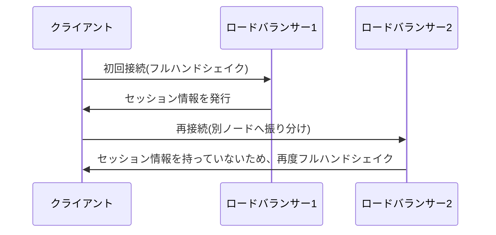

## はじめに

- **この記事で得られること**: [SSLターミネーションとSSLパススルーの違い](/articles/load-balancing-ssl-termination-guide)の先にある、**TLSセッション再開**という仕組みと、ロードバランサーが複数台構成になった場合に、これがどう崩れるのかを体系的に理解します。
- **対象読者**: SSLターミネーションの仕組みは理解しているものの、ロードバランサーを冗長化した途端にTLSの接続確立コストが上がった経験があり、理由を説明できない方を想定しています。
- **読むのにかかる想定時間**: 約16分

この記事は[『上位1%』シリーズ 全記事ガイド](/sitemap)の一部、[ロードバランシング基礎シリーズ](/sitemap#シリーズ一覧)の3.05本目です。

## 前提知識

- [SSLターミネーションとSSLパススルーの違い](/articles/load-balancing-ssl-termination-guide): ロードバランサーがTLSの終端点になるという概念の理解が前提になっています。

## 全体像をつかむ

**TLSの新規接続では、鍵交換を含む「フルハンドシェイク」という、比較的重い処理が必要**です。**TLSセッション再開は、以前確立したセッションの情報(セッションIDまたはセッションチケット)を再利用することで、この重い処理を省略し、短縮された「アブリビエイテッド・ハンドシェイク」で再接続を完了させる仕組み**です。**しかし、ロードバランサーが複数台構成の場合、あるノードで確立したセッション情報は、既定では他のノードと共有されません。クライアントが再接続した際に、以前とは別のノードへ振り分けられると、そのノードはセッション情報を持っていないため、再開は失敗し、結局フルハンドシェイクが発生**します。

## 基礎から徹底解説

### セッションIDとセッションチケット、それぞれの「共有」の中身

**セッションIDによる再開は、サーバー側がセッション情報を保持するキャッシュを基準にするため、複数台構成では、このキャッシュ自体をノード間で共有する必要**があります。**セッションチケットによる再開は、サーバー側にセッション情報を保持せず、暗号化したチケットをクライアント側に預ける方式ですが、この場合は、チケットを暗号化・復号するための鍵自体を、すべてのノードで一致させておく必要**があります。**どちらの方式でも、「何かを複数ノード間で揃えておく」という前提を満たさない限り、複数台構成ではセッション再開が機能しません。**

### キャッシュが静かに溢れると、気づかれないまま性能が劣化する

**セッションキャッシュが満杯になると、古いセッションから静かに退避(エビクション)されていき、再開の成功率が徐々に下がり、CPU使用率だけが上昇していく**という、見えにくい劣化が発生します。**健全な本番環境では、セッション再開の成功率を90%以上に維持することが、1つの目安として挙げられています。**

補足:TLS 1.3では、チケット方式が唯一の選択肢になる

**TLS 1.3では、従来のセッションID方式が廃止され、セッション再開はチケット方式のみで行われるようになりました。** **そのため、TLS 1.3環境でチケット機能を無効化すると、セッション再開という機能そのものが完全に失われます。**

## プロが見ている視点(上位1%の理解)

### 冗長化は、可用性を高める一方で、別の前提を静かに壊すことがある

**ロードバランサーを複数台構成にする冗長化は、可用性という観点では正しい判断ですが、TLSセッション再開という、別の仕組みが暗黙に前提としていた「同じノードに戻ってくる」という条件を、静かに壊してしまいます。** **「冗長化した」という事実だけで満足せず、「この冗長化によって、暗黙に前提としていた別の仕組みが壊れていないか」を、必ず確認する**習慣が、上位1%のエンジニアの視点です。

## よくある誤解・つまずきポイント

- **誤解1: 「ロードバランサーを冗長化しても、TLSセッション再開には何の影響もない」**
  セッション情報がノード間で共有されていない限り、別のノードへ振り分けられた瞬間に再開は失敗し、フルハンドシェイクが発生します。
- **誤解2: 「セッションチケット方式を使えば、サーバー側で何も共有する必要がない」**
  サーバー側にセッション情報自体は保持しませんが、チケットを暗号化・復号するための鍵を、すべてのノードで一致させる必要があります。
- **誤解3: 「セッションキャッシュが溢れても、エラーとして明確に検知できる」**
  キャッシュの溢れは、多くの場合明示的なエラーを出さず、再開成功率の低下とCPU使用率の上昇という、見えにくい形で現れます。

## 障害・トラブルシューティングの視点

1. **ロードバランサーを複数台構成にした後、TLSのハンドシェイクに伴うCPU使用率が上昇した**: セッションキャッシュ(またはチケット鍵)が、ノード間で共有されているかを確認します。
2. **クライアントの再接続が、毎回フルハンドシェイクになってしまう**: ロードバランサーがスティッキールーティングを行っているか、あるいはセッション情報を共有する仕組みが構成されているかを確認します。
3. **TLS 1.3へ移行した後、セッション再開が機能しなくなった**: チケット機能が無効化されていないかを確認します。TLS 1.3では、セッションID方式自体が存在しません。

## まとめ

- TLSセッション再開は、以前確立したセッション情報を再利用し、重いフルハンドシェイクを省略する仕組みです。
- ロードバランサーが複数台構成の場合、セッション情報をノード間で共有しない限り、再開は機能しません。
- セッションID方式は共有キャッシュ、チケット方式は共有する暗号鍵が必要です。
- キャッシュの溢れは、明確なエラーではなく、性能劣化という見えにくい形で現れます。

**今日から意識すべきこと**
1. ロードバランサーを冗長化する際は、TLSセッション情報(キャッシュまたはチケット鍵)の共有方法も、必ず設計に含めましょう。
2. TLSのCPU使用率が高いと感じたら、セッション再開の成功率を確認しましょう。

## 参考文献

- [Speeding up TLS: Enabling Session Reuse | Vincent Bernat](https://vincent.bernat.ch/en/blog/2011-ssl-session-reuse-rfc5077)
- [NGINX SSL Session Cache: Improving TLS Resumption and Cutting CPU | Netdata](https://www.netdata.cloud/guides/nginx/nginx-ssl-session-cache/)
