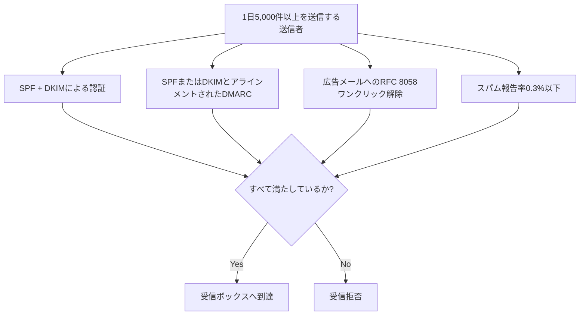

## はじめに

- **この記事で得られること**: [SPF/DKIM/DMARCの仕組み](/articles/mail-spf-dkim-dmarc-guide)で扱ったこれらの仕組みは、もともとなりすまし対策として紹介されました。この記事では、**GoogleとYahooが2024年に義務化した、一括送信者向けの複数の要件のセット**を体系的に理解し、SPF/DKIM/DMARCという既存の知識が、どのように「必須ゲート」として再定義されたのかを理解します。
- **対象読者**: SPF/DKIM/DMARCの基本的な仕組みは理解しているものの、GoogleやYahooの一括送信者要件が、具体的に何を義務化しているのかを説明できない方を想定しています。
- **読むのにかかる想定時間**: 約18分

この記事は[『上位1%』シリーズ 全記事ガイド](/sitemap)の一部、[メール基盤シリーズ](/sitemap#シリーズ一覧)の4.3本目です。

## 前提知識

- [SPF/DKIM/DMARCの仕組み](/articles/mail-spf-dkim-dmarc-guide): SPF・DKIM・DMARCという3つの仕組みの基本的な理解が前提になっています。

## 全体像をつかむ

**2024年、GoogleとYahooは、1日あたり5,000件以上のメールを送信する「一括送信者」に対して、複数の要件をセットで義務化**しました。**この要件は、(1)SPFとDKIMによる認証、(2)SPFまたはDKIMのいずれかと整合した(アラインメントされた)DMARCレコードの設定、(3)広告・マーケティングメールへの、RFC 8058に準拠したワンクリック解除機能の実装、(4)0.3%以下のスパム報告率の維持という、4つの柱**から成ります。**これらの要件を満たさない送信者のメールは、Gmail・Yahoo Mailへの到達そのものが拒否されるようになり**ました。

## 基礎から徹底解説

### RFC 8058のワンクリック解除:List-UnsubscribeとList-Unsubscribe-Postの組み合わせ

**RFC 8058が定めるワンクリック解除は、`List-Unsubscribe`ヘッダーと、`List-Unsubscribe-Post: List-Unsubscribe=One-Click`という、もう1つのヘッダーを組み合わせて実現**します。**この2つのヘッダーが揃っていることで、メールクライアント側は、利用者をログインページやランディングページへ一切誘導せずに、「配信停止」ボタン1つだけで、即座に配信停止処理を完了**させることができます。**この解除リクエストは、48時間以内に実際に処理する必要がある**とされています。

### なぜ「トランザクションメール」は、この要件の対象外なのか

**パスワードリセットや注文確認のような、利用者からのアクションに対する直接の応答であるトランザクションメールは、ワンクリック解除要件の対象外**です。**しかし、GoogleやYahooが、送信者のメールを自動的に「トランザクション」と「広告・マーケティング」に分類してくれるわけではなく、どちらに該当するかを判断する責任は、送信者自身にあり**ます。**この自己判断を誤り、実質的に広告メールであるものを、ワンクリック解除なしで送り続けると、要件違反とみなされるリスクがあり**ます。

「一括送信者」という分類は、一度付与されると、永続的に残る

**GoogleやYahooに、いったん「一括送信者」として分類されると、その後、送信量を減らしたとしても、この分類は永続的に残る**とされています。**送信規模を増やす計画がある場合は、規模が小さいうちから、これらの要件を満たす体制を整えておくことが、現実的な対策**になります。

## プロが見ている視点(上位1%の理解)

### 「なりすまし対策」として学んだ仕組みが、「配信を許可されるための条件」に変わることがある

**SPF/DKIM/DMARCは、もともと、なりすましメールを防ぐための、送信者側の自衛的な仕組みとして理解されることが多いですが、現在では、大手プロバイダーへのメール到達そのものを許可されるための、必須の前提条件に変わっています。** **ある技術の仕組みを理解するだけでなく、その技術が置かれている位置づけが、時間とともに「推奨」から「必須」へと変化していないかを定期的に確認する**習慣が、上位1%のエンジニアの視点です。

## よくある誤解・つまずきポイント

- **誤解1: 「SPF/DKIM/DMARCを設定していれば、GoogleとYahooの一括送信者要件はすべて満たせる」**
  SPF/DKIM/DMARCの認証に加えて、ワンクリック解除機能の実装と、スパム報告率の維持という、別の2つの要件も満たす必要があります。
- **誤解2: 「ワンクリック解除は、すべての送信メールに実装する必要がある」**
  トランザクションメールは対象外ですが、広告・マーケティングメールとの分類は、送信者自身が責任を持って判断する必要があります。
- **誤解3: 「一括送信者の分類は、送信量を減らせば解除される」**
  一度「一括送信者」として分類されると、その後の送信量にかかわらず、この分類は永続的に残るとされています。

## 障害・トラブルシューティングの視点

1. **Gmail・Yahoo Mailへのメール到達率が、急に低下した**: SPF/DKIM/DMARCの認証状況、ワンクリック解除ヘッダーの実装状況、スパム報告率の3つを、それぞれ個別に確認します。
2. **自社が「一括送信者」に該当するかどうかを判断したい**: Gmailへの1日あたりの送信件数が5,000件を超えているかどうかを確認します。
3. **スパム報告率の管理方法が分からない**: GmailはGoogle Postmaster Tools、YahooはComplaint Feedback Loopという、それぞれの監視ツールを導入します。

## まとめ

- GoogleとYahooは2024年、1日5,000件以上を送信する一括送信者に対し、SPF/DKIM/DMARC認証・ワンクリック解除・0.3%以下のスパム報告率という、複数の要件をセットで義務化しました。
- ワンクリック解除は、List-UnsubscribeとList-Unsubscribe-Postという2つのヘッダーの組み合わせで実現され、48時間以内の処理が求められます。
- トランザクションメールはワンクリック解除の対象外ですが、分類の責任は送信者自身にあります。
- 一度「一括送信者」として分類されると、その後の送信量にかかわらず、分類は永続的に残ります。

**今日から意識すべきこと**
1. 自社の送信量が、GoogleやYahooの一括送信者要件の対象に入っていないかを確認しましょう。
2. SPF/DKIM/DMARCの設定を、「なりすまし対策」だけでなく「配信許可の前提条件」としても、定期的に見直しましょう。

## 参考文献

- [Requirements for Bulk Email Senders | Close](https://help.close.com/technical-support/email-deliverability/requirements-for-bulk-email-senders)
- [New Google Rules for Bulk Email Senders | Sender](https://www.sender.net/blog/new-google-rules-for-bulk-email-senders/)
