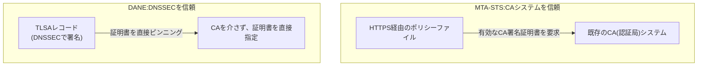

## はじめに

- **この記事で得られること**: [MTA-STSの仕組み](/articles/mail-tls-encryption-guide)は、日和見暗号化の弱点を、DNSとHTTPSを組み合わせて補強する仕組みでした。この記事では、同じ「送信先サーバーのTLS証明書を、どうやって信頼するか」という問題に対する、**まったく別の答え**である、DANE(**DNS-based Authentication of Named Entities**)を体系的に理解します。
- **対象読者**: MTA-STSの仕組みは理解しているものの、DANEという、もう1つの解決策があることを知らない方を想定しています。
- **読むのにかかる想定時間**: 約18分

この記事は[『上位1%』シリーズ 全記事ガイド](/sitemap)の一部、[メール基盤シリーズ](/sitemap#シリーズ一覧)の6.2本目です。

## 前提知識

- [MTA-STSの仕組み](/articles/mail-tls-encryption-guide): 日和見暗号化の弱点と、それを補強するもう1つの仕組みの理解が前提になっています。
- [DNSSECの仕組み](/articles/dns-dnssec-fundamentals-guide): DANEが土台として使う、DNS応答の真正性を証明する仕組みの理解があると、より深く理解できます。

## 全体像をつかむ

**MTA-STSは、HTTPS経由で配布するポリシーファイルを通じて、既存のCA(認証局)システムを信頼の土台**にしていました。**DANEは、これとはまったく異なる、DNSSECを信頼の土台とする仕組み**です。**送信元ドメインは、`TLSA`レコードという形で、「このドメイン宛のメールサーバーが提示すべき、正しい証明書(または公開鍵)はこれだ」と、DNSSECで署名されたDNSレコードの中に、直接宣言します。** これにより、**CAという仲介者を一切介さずに、証明書そのものを、DNS自身の中でピンニング(固定)できる**のです。

## 基礎から徹底解説

### TLSAレコード:証明書そのものを、DNSの中で直接指定する

**TLSAレコードは、SMTPサーバーが提示すべき証明書(または、その公開鍵)のハッシュ値を、DNS上に直接記載**します。SMTP向けに推奨されるプロファイルは、「DANE-EE(エンドエンティティ証明書そのものを指定)・SPKI(公開鍵情報)・SHA-256」の組み合わせです。**この仕組みが機能するには、TLSAレコード自体がDNSSECで署名されており、受信側がその署名を検証できることが、絶対的な前提条件**になります。DNSSECが導入されていないゾーンでは、TLSAレコードは、準拠した実装によって無視されます。

### 2つの仕組みの、決定的な弱点の違い

**DANEの弱点は、DNSSECが、送信元から受信先まで、ゾーン全体にわたって正しく導入されていることに、完全に依存している**ことです。**MTA-STSの弱点は、ポリシーファイルをまだキャッシュしていない、最初の接続(初回接触、TOFU)の際には、まだ保護が効いていない**ことです。

両方を組み合わせて使うことが、現実的に推奨されている

**DANEとMTA-STSは、競合する選択肢ではなく、互いの弱点を補い合う、補完的な仕組みとして、両方を導入することが推奨**されています。**DANEはDNSSECが導入されたドメインを、MTA-STSはDNSSECが導入されていないドメインを、それぞれカバー**できます。両方が導入されている場合、MTA-STSのポリシー検証は、DANEの検証結果が失敗していても、それを上書きして通信を許可してはならない、というルールもあります。Microsoftは2024年7月に、受信SMTPにおけるDANEサポートを発表しており、大手プロバイダーでの採用も進んでいます。

## プロが見ている視点(上位1%の理解)

### 「誰を信頼するか」という、根本的な前提の違いに気づく

**MTA-STSとDANEは、どちらも「日和見暗号化の弱点を補強する」という、同じ目的を持っていますが、その実現方法の根底には、「CAという、既存の第三者システムを信頼するか」「DNSSECという、DNS自身の階層構造を信頼するか」という、根本的に異なる前提の違いがあります。** **1つの問題に対して、まったく異なる信頼モデルに基づく、複数の解決策が並行して存在する**ことがある、という視点は、技術選定の際に、どちらか一方だけで満足せず、両方の前提を理解した上で判断する、という姿勢につながります。

## よくある誤解・つまずきポイント

- **誤解1: 「DANEとMTA-STSは、どちらか1つを選べば十分だ」**
  2つは互いの弱点を補い合う補完的な仕組みであり、両方を導入することが、現実的に推奨されています。
- **誤解2: 「DANEは、DNSSECを導入していなくても機能する」**
  DANEは、TLSAレコード自体がDNSSECで署名されていることが絶対的な前提条件であり、DNSSECが導入されていないゾーンでは機能しません。
- **誤解3: 「MTA-STSには、DANEのような弱点は一切ない」**
  MTA-STSにも、ポリシーファイルをまだキャッシュしていない最初の接続時には、保護が効いていないという弱点があります。

## 障害・トラブルシューティングの視点

1. **TLSAレコードを設定したのに、送信元が検証に失敗する**: そのゾーン自体がDNSSECで正しく署名されているかを確認します。
2. **DANEとMTA-STSの両方を導入しているのに、挙動が矛盾する**: DANEの検証結果が、MTA-STSのポリシーによって上書きされていないかを確認します。
3. **どちらの仕組みを先に導入すべきか判断できない**: DNSSECが既に導入済みであればDANEを、まだ導入していなければMTA-STSを、まず検討します。

## まとめ

- MTA-STSは、既存のCA(認証局)システムを信頼の土台とする仕組みです。
- DANEは、DNSSECを信頼の土台とし、TLSAレコードで証明書を直接ピンニングする、まったく別の仕組みです。
- DANEはDNSSEC全体への完全な依存、MTA-STSは初回接触時の保護の欠如という、異なる弱点を抱えています。
- 両方を組み合わせて導入することが、現実的に推奨されています。

**今日から意識すべきこと**
1. MTA-STSを導入済みのドメインでも、DNSSECが導入されていれば、DANEの追加導入を検討しましょう。
2. 「誰を信頼するか」という、技術選定の根本的な前提の違いを、常に意識しましょう。

## 参考文献

- [DANE for Email: Making SMTP TLS Actually Trustworthy | Unione](https://unione.io/en/blog/what-is-dane/)
- [MTA-STS vs DANE: Which Protocol to Choose for Securing Email Transport? | CaptainDNS](https://www.captaindns.com/en/blog/mta-sts-vs-dane)
