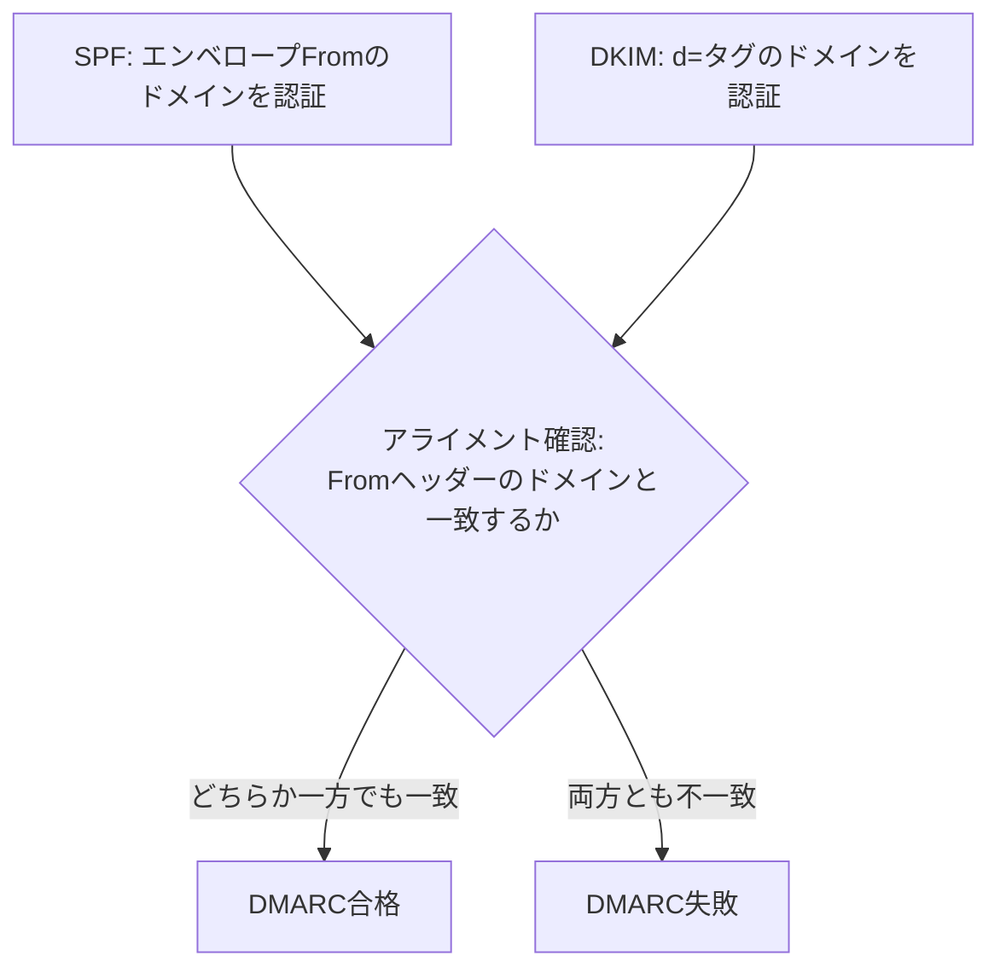

## はじめに

- **この記事で得られること**: [SPF・DKIM・DMARCの仕組み](/articles/mail-spf-dkim-dmarc-guide)の先にある、DMARCが実際に何を基準に合否を判定しているのかという、**アライメント**(整合性)の仕組みを体系的に理解します。
- **対象読者**: SPFとDKIMが両方「合格」と表示されているのに、DMARCだけが失敗する現象に遭遇し、理由を説明できない方を想定しています。
- **読むのにかかる想定時間**: 約16分

この記事は[『上位1%』シリーズ 全記事ガイド](/sitemap)の一部、[メール基盤シリーズ](/sitemap#シリーズ一覧)の4.05本目です。

## 前提知識

- [SPF・DKIM・DMARCの仕組み](/articles/mail-spf-dkim-dmarc-guide): SPFがエンベロープ送信者を、DKIMが署名ドメインを、それぞれ個別に認証する仕組みであることの理解が前提になっています。

## 全体像をつかむ

**SPFとDKIMは、それぞれ独立したドメインを認証します。SPFはエンベロープFrom(Return-Path)のドメインを、DKIMは署名(`d=`タグ)のドメインを、それぞれ個別に認証**します。**しかし、受信者が実際に目にする送信元は、画面に表示される`From`ヘッダーのドメインです。DMARCのアライメントとは、SPF・DKIMが認証したドメインと、この表示用`From`ヘッダーのドメインが、一致しているかどうかを確認する仕組み**です。**DMARCは、SPFとDKIMのどちらか一方でもアライメントされていれば合格とする、OR条件で判定**します。

## 基礎から徹底解説

### リラックスモードとストリクトモードという、2つの一致基準

**アライメントの一致基準には、`aspf`(SPF用)と`adkim`(DKIM用)というタグで指定する、リラックスモードとストリクトモードの2種類**があります。**リラックスモード(既定値)は、組織ドメイン(オーガニゼーショナルドメイン、実質的にはレジストリに登録されたルート部分)が一致していればよく、`mail.example.com`と`example.com`は一致と判定されます。** **ストリクトモードは完全一致を要求し、`mail.example.com`と`example.com`は、同じ組織ドメインに属していても不一致と判定されます。**

### SPFが「合格」と表示されても、DMARCは失敗し得る

**メール配信サービス(ESP)経由での送信などで、SPFがエンベロープFromのドメイン(例:`bounce.esp-service.com`)を正しく認証していても、そのドメインが、画面に表示される`From`ヘッダーのドメイン(例:`example.com`)と、アライメントの基準で一致していなければ、SPF単体では「合格」であっても、DMARCとしては、そのSPFの合格はカウントされません。** **この場合、DKIMの署名ドメインが`From`ヘッダーのドメインとアライメントされていれば、DMARCはDKIM側の合格によって、全体としては合格できます。**

補足:転送がアライメントを崩す理由

**メールが第三者によって転送される際、SPFは送信元IPアドレスが変わることでほぼ必ず失敗し、DKIMも、転送時に本文やヘッダーが変更されると、署名自体が無効になる**ことがあります。**このため、転送されたメールは、SPF・DKIMのどちらのアライメントも失敗し、DMARCとして不合格になりやすい、という構造的な弱点を抱えています。**

## プロが見ている視点(上位1%の理解)

### 「個々の検証に合格した」ことと、「全体として一致している」ことは別の階層の話

**SPFとDKIMは、それぞれ独立したドメインを個別に認証する仕組みですが、DMARCは、その認証結果を、受信者が実際に目にする`From`ヘッダーのドメインと紐付け直す、1段上のレイヤーの仕組みです。** **「SPFは合格しているのに、なぜDMARCは失敗するのか」という障害に遭遇したときに、SPF・DKIMという個々の検証結果だけでなく、「そのドメインは、Fromヘッダーのドメインとアライメントされているか」という、もう1段上の一致判定を確認する**習慣が、上位1%のエンジニアの視点です。

## よくある誤解・つまずきポイント

- **誤解1: 「SPFとDKIMが両方合格すれば、DMARCも自動的に合格する」**
  SPF・DKIMの合格は、それぞれ認証したドメインが、Fromヘッダーのドメインとアライメントされていて初めて、DMARCの合格として数えられます。
- **誤解2: 「DMARCに合格するには、SPFとDKIMの両方がアライメントされる必要がある」**
  DMARCは、SPFとDKIMのどちらか一方でもアライメントされていれば合格とする、OR条件で判定されます。
- **誤解3: 「リラックスモードとストリクトモードに、実質的な違いはない」**
  リラックスモードは組織ドメインの一致で合格しますが、ストリクトモードは完全一致を要求するため、サブドメイン経由の送信で結果が変わります。

## 障害・トラブルシューティングの視点

1. **SPFとDKIMの両方が「合格」と表示されているのに、DMARCが失敗する**: それぞれが認証したドメインが、Fromヘッダーのドメインと、組織ドメインレベルで一致しているかを確認します。
2. **第三者からの転送メールだけが、DMARCで不合格になる**: 転送によってSPFが失敗し、本文・ヘッダーの変更によってDKIM署名も無効化されていないかを確認します。
3. **ストリクトモードへ切り替えた途端、正規のメールまで不合格になる**: サブドメインから送信している正規の送信元が、組織ドメインとの完全一致を満たしていないことが原因である可能性を確認します。

## まとめ

- DMARCのアライメントは、SPF・DKIMが認証したドメインと、表示用Fromヘッダーのドメインが一致しているかを確認する仕組みです。
- DMARCは、SPFとDKIMのどちらか一方でもアライメントされていれば合格する、OR条件です。
- リラックスモード(既定)は組織ドメインの一致で、ストリクトモードは完全一致を要求します。
- メール転送は、SPF・DKIM両方のアライメントを崩しやすい、構造的な弱点を抱えています。

**今日から意識すべきこと**
1. 「SPFは合格なのにDMARCが失敗する」という障害に遭遇したら、まずアライメントの一致基準を確認しましょう。
2. ストリクトモードへの切り替えを検討する際は、サブドメイン経由の正規の送信元が存在しないかを、事前に確認しましょう。

## 参考文献

- [DMARC Alignment | PowerDMARC](https://powerdmarc.com/dmarc-alignment/)
- [DMARC Relaxed vs Strict Alignment | DuoCircle](https://www.duocircle.com/dmarc/dmarc-relaxed-vs-strict-alignment)
