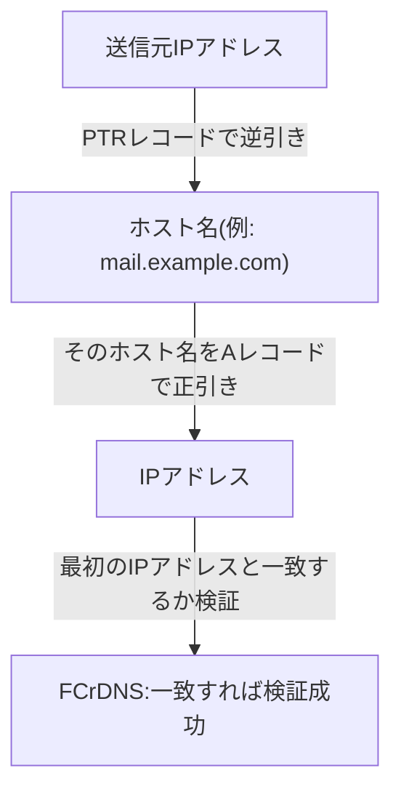

## はじめに

- **この記事で得られること**: [PostfixとDovecotでメールサーバーを構築するハンズオン](/articles/mail-server-handson-guide)を終え、[SPF・DKIM・DMARC](/articles/mail-spf-dkim-dmarc-guide)まで正しく設定したのに、**Gmailなどの大手プロバイダーへのメールが届かない、あるいは迷惑メールフォルダへ振り分けられる**ことがあります。この記事では、その原因の多くが、**送信元IPアドレスのPTRレコード(逆引きDNS)が設定されていないこと**にあるという実態を理解します。SPF・DKIM・DMARCが**ドメインレベルの認証**であるのに対し、**PTRとFCrDNS(正引き一致検証)は、接続してきたIPアドレス自身の身元を確認する、まったく別の階層の検証**であることを体系的に理解します。
- **対象読者**: SPF・DKIM・DMARCを正しく設定したはずなのに、自分で構築したメールサーバーから送ったメールが、大手プロバイダー宛てに届きにくいという現象に遭遇したことのある方を想定しています。
- **読むのにかかる想定時間**: 約17分

この記事は[『上位1%』シリーズ 全記事ガイド](/sitemap)の一部、[メール基盤シリーズ](/sitemap#シリーズ一覧)の4.2本目です。

## 前提知識

- [PostfixとDovecotでメールサーバーを構築するハンズオン](/articles/mail-server-handson-guide): メールサーバーが、他のメールサーバーへ直接SMTP接続を行うという基本が前提になっています。
- [SPF・DKIM・DMARCの仕組み](/articles/mail-spf-dkim-dmarc-guide): これらがドメイン単位の送信者認証であるという理解が前提になっています。

## 全体像をつかむ

**PTRレコードは、Aレコード(ホスト名→IPアドレス)とは逆方向に、IPアドレスからホスト名を導く、「逆引き」のためのDNSレコードです。** 多くのメール受信サーバーは、SMTP接続を受け付けた直後、**まず接続元のIPアドレスにPTRレコードが存在するかどうかを確認**します。**PTRレコードがまったく存在しない送信元IPアドレスは、スパム送信や、適切に管理されていないサーバーの典型的な特徴とみなされ、それだけで接続を拒否、あるいは迷惑メール判定の大きな加点要素**になります。**この検証は、SPF・DKIM・DMARCのようなドメインレベルの仕組みとは完全に独立しており、ドメイン側の設定がすべて正しくても、PTRレコードがなければ、その時点で弾かれてしまう**可能性があります。

## 基礎から徹底解説

### PTRレコードが存在しないことが、なぜ危険信号として扱われるのか

**正当な理由を持つ組織が運用するメールサーバーは、そのIPアドレスに対して、通常はきちんとPTRレコードが設定されています。** 一方、**スパム送信者は、一時的に乗っ取った、あるいは動的に割り当てられた、無数のIPアドレスから大量のメールを送信する**ことが多く、こうしたIPアドレスには、まともなPTRレコードが設定されていないことがほとんどです。**この経験的な傾向から、「PTRレコードがない送信元は、まず疑うべき」という判断基準が、業界全体で広く採用されている**のです。実際、**2025年11月以降、Gmailは、PTRレコードを持たない送信元からのメールについて、一時的な保留(デファー)ではなく、永続的な拒否(550エラー)へと、取り扱いを強化しました。**

### FCrDNS:逆引きだけでは不十分な理由

**PTRレコードが存在するだけでは、まだ十分な検証とは言えません。** なぜなら、**PTRレコード自体は、IPアドレスの管理者(多くの場合、クラウドプロバイダーやISP)側の設定であり、送信者が自分の都合の良いホスト名を、見た目だけ整えて設定することも、理論上は可能**だからです。この問題に対応するため、より厳格な検証を行うメールサーバーは、**FCrDNS**(Forward-Confirmed reverse DNS、正引き一致検証)という、2段階の検証を行います。

1. **逆引き**: 接続元IPアドレスのPTRレコードから、ホスト名を取得する。
2. **正引き**: 取得したホスト名を、今度はAレコードとして正引きし、得られたIPアドレスが、**最初の接続元IPアドレスと一致するか**を検証する。

**この往復の一致を要求することで、「PTRレコードの設定」と「対応するAレコードの設定」の両方を、実際に正しく管理している組織でなければ、検証を通過できない**という、より信頼性の高い確認が実現されます。

AWS EC2環境でPTRレコードを設定する際の、実務上の注意点

AWSのEC2インスタンスでは、Elastic IPアドレスに対するPTRレコードは、**既定では設定されておらず、AWS自身が管理しているため、自分のDNSサーバー側だけでは設定できません。** PTRレコードを設定したい場合、**AWSのサポートセンター経由で、変更をリクエストする必要があります。** さらに、**AWSはPTRレコードを設定する前に、そのPTRレコードが指すホスト名について、対応するAレコード(正引き)が、既にそのElastic IPアドレスを指す形で、実際に設定済みであることを要求します。** つまり、**正引きのAレコードを先に用意してからでなければ、PTRレコードの設定自体をAWSに依頼できない**という、順序の制約があることに注意が必要です。

## プロが見ている視点(上位1%の理解)

### PTR/FCrDNSは「IPアドレスの身元確認」、SPF/DKIM/DMARCは「ドメインの身元確認」

**この2つの検証の階層の違いを整理すると、PTR/FCrDNSは「この接続は、本当に、名乗っているホスト名の持ち主からの接続なのか」というIPアドレス自身の身元確認であり、SPF/DKIM/DMARCは「このメールの送信元として名乗っているドメインは、本当にそのドメインの管理者が許可した送信元なのか」というドメインの身元確認**です。**両方の検証を独立して通過してはじめて、送信元として十分に信頼できると判断される**のが、現代の大手メールプロバイダーの基本的な設計です。**自分でメールサーバーを構築する際は、SPF・DKIM・DMARCの設定だけに注目しがちですが、まずクラウドプロバイダーやISPの側で、PTRレコードを正しく設定できる(あるいはすでに適切なPTRレコードが割り当てられている)環境かどうかを、最初に確認しておくべき**です。

## よくある誤解・つまずきポイント

- **誤解1: 「SPF・DKIM・DMARCをすべて正しく設定すれば、メールの到達性は保証される」**
  PTR/FCrDNSは、SPF・DKIM・DMARCとは独立した、IPアドレス自身の身元確認です。これが欠けていると、ドメイン側の設定が正しくても、メールが拒否される可能性があります。
- **誤解2: 「PTRレコードが1つでも設定されていれば、十分な検証を通過できる」**
  厳格な検証を行うメールサーバーは、PTRレコードの逆引きだけでなく、そのホスト名の正引きが元のIPアドレスと一致するかまで確認する、FCrDNSという2段階の検証を行います。
- **誤解3: 「自分のDNSサーバーにPTRレコードを登録すれば、どのIPアドレスでも設定できる」**
  PTRレコードは、そのIPアドレスを管理している組織(クラウドプロバイダーやISP)側の権限で設定されるものであり、自分のDNSサーバー側だけでは設定できません。

## 障害・トラブルシューティングの視点

1. **自分で構築したメールサーバーから送ったメールが、Gmailなどへ届かない、または迷惑メールに振り分けられる**: 送信元IPアドレスに対して、`dig -x <IPアドレス>`などでPTRレコードが設定されているかを確認します。
2. **PTRレコードは設定されているはずなのに、一部の厳格な受信側でまだ拒否される**: PTRレコードが返すホスト名を、今度は正引き(Aレコード)で確認し、元のIPアドレスと一致しているか(FCrDNS)を確認します。
3. **クラウド環境でPTRレコードを設定したい**: そのクラウドプロバイダーが、PTRレコードの変更をどのような手順(サポートチケット、専用API)で受け付けているかを、事前に確認します。

## まとめ

- PTRレコードは、IPアドレスからホスト名を導く逆引きのためのDNSレコードであり、多くのメール受信サーバーが、送信元IPアドレスにこれが存在するかを確認します。
- PTRレコードがない送信元は、スパムの典型的な特徴とみなされ、接続拒否や迷惑メール判定の大きな要因になります。
- FCrDNS(正引き一致検証)は、逆引きで得たホスト名を正引きし、元のIPアドレスと一致するかまで確認する、より厳格な2段階の検証です。
- PTR/FCrDNSはIPアドレス自身の身元確認であり、SPF/DKIM/DMARCというドメインの身元確認とは、独立した別の階層の仕組みです。

**今日から意識すべきこと**
1. 自分でメールサーバーを構築する際は、SPF・DKIM・DMARCの設定と同じくらいの優先度で、送信元IPアドレスのPTRレコードが正しく設定されているかを確認しましょう。
2. クラウド環境でメールサーバーを構築する場合は、そのプロバイダーがPTRレコードの変更をどう受け付けているかを、構築前に必ず確認しましょう。

## 参考文献

- [Create a reverse DNS record for email on Amazon EC2 | AWS Documentation](https://docs.aws.amazon.com/AWSEC2/latest/UserGuide/Using_Elastic_Addressing_Reverse_DNS.html)
- [Forward-confirmed reverse DNS | Wikipedia](https://en.wikipedia.org/wiki/Forward-confirmed_reverse_DNS)
