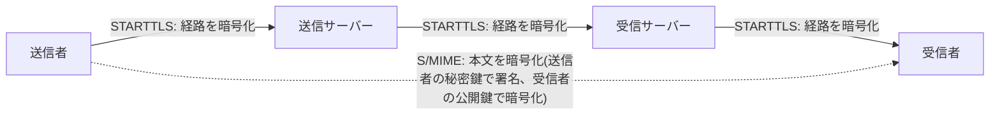

## はじめに

- **この記事で得られること**: [SMTPにおけるSTARTTLSの仕組み](/articles/mail-tls-encryption-guide)は、メールサーバー間の**通信経路**を暗号化する仕組みでした。この記事では、S/MIME(**Secure/Multipurpose Internet Mail Extensions**)という、メールの本文そのものを暗号化する、まったく異なるレイヤーの仕組みを体系的に理解します。「メールは暗号化されている」という一言が、実際には、守っている対象がまったく違う2つの仕組みのどちらを指しているのかを、正確に切り分けられるようになります。
- **対象読者**: STARTTLSによるメールサーバー間の暗号化は理解しているものの、S/MIMEという言葉を聞いたことがない、あるいは、STARTTLSとの違いを説明できない方を想定しています。
- **読むのにかかる想定時間**: 約18分

この記事は[『上位1%』シリーズ 全記事ガイド](/sitemap)の一部、[メール基盤シリーズ](/sitemap#シリーズ一覧)の6.1本目です。

## 前提知識

- [SMTPにおけるSTARTTLSの仕組み](/articles/mail-tls-encryption-guide): 通信経路の暗号化という、別のレイヤーの仕組みの理解があると、2つの違いがより明確になります。

## 全体像をつかむ

**STARTTLSによって、メールサーバー間の通信経路は暗号化されます。しかし、これは「経路」の暗号化であって、「本文」の暗号化ではありません。** **STARTTLSが完璧に機能していても、メールを中継するサーバーは、受信した時点で復号された本文を、そのまま読むことができます。** これは欠陥ではなく、STARTTLSがそもそも「サーバー間の通信を盗聴から守る」ことだけを目的とした、**サーバー対サーバー**(ホップバイホップ)の仕組みだからです。**S/MIMEは、送信者の秘密鍵と受信者の公開鍵を使い、メールの本文そのものを暗号化する、エンドツーエンド**の仕組みです。本文は、どのサーバーを経由しても、意図した受信者だけが復号できる形で保護されます。

## 基礎から徹底解説

### STARTTLSは「サーバー証明書」、S/MIMEは「メール証明書」を使う

**STARTTLSは、通信先のサーバーの正体を証明する、サーバー証明書を使います。** これは、HTTPSで使われる証明書と同じ種類のものです。**S/MIMEは、特定のメールアドレスに紐づく、メール証明書(個人向けの電子証明書)を使います。** この証明書は、認証局(CA)から発行され、送信者はこの証明書に対応する秘密鍵を使ってメールにデジタル署名し、受信者は自分の公開鍵を含む証明書を事前に送信者へ渡しておくことで、暗号化されたメールを受け取れるようになります。

### STARTTLSが守れないものを、S/MIMEが守る

**STARTTLSが完璧に機能していても、メールを中継するサーバーの運用者(自組織のメールサーバー管理者や、クラウドメールサービスの提供者)は、復号された本文をそのまま読むことができます。** これは、STARTTLSの暗号化が、あくまで通信経路上の盗聴者からの保護だけを目的としているためです。**S/MIMEで暗号化されたメールは、中継するサーバーが本文を復号する鍵を持っていないため、意図した受信者以外には、本文の内容を読むことができません。**

STARTTLSにも、S/MIMEにもできないことがある

**S/MIMEで暗号化されたメールでも、件名(Subject)などの一部のヘッダー情報は、暗号化の対象外のまま、平文で送られます。** この部分を保護するのは、STARTTLSによる通信経路全体の暗号化の役割です。**つまり、本文の内容を守るS/MIMEと、件名を含む通信経路全体を守るSTARTTLSは、互いに排他的な選択肢ではなく、組み合わせて使うことで、それぞれが守れない範囲を補い合う関係**にあります。また、STARTTLSの実装の多くは、サーバー証明書を正しく検証していないという、別の実務上の弱点も抱えており、ダウングレード攻撃のリスクが残ることも、あわせて知っておいてください。

## プロが見ている視点(上位1%の理解)

### 「メールは暗号化されている」という一言は、どちらのレイヤーを指しているのかを常に確認する

**実務で「このメールは暗号化されているから安全だ」という一言を聞いたとき、それがSTARTTLSによる経路の暗号化を指しているのか、S/MIMEによる本文の暗号化を指しているのかは、まったく別の意味**です。**前者は、中継するメールサーバーの運用者からは本文を一切保護しません。後者は、中継するメールサーバーの運用者からも本文を保護しますが、件名などの一部のヘッダーまでは保護しません。** 「暗号化されている」という言葉だけで安心するのではなく、**「誰から、何を」守っているのかを、常に具体的に確認する**習慣が、この分野の会話を正確に理解するための、実務上の防御策になります。

## よくある誤解・つまずきポイント

- **誤解1: 「STARTTLSが有効なら、メールの本文は誰にも読まれない」**
  STARTTLSが完璧に機能していても、メールを中継するサーバーの運用者は、復号された本文をそのまま読むことができます。
- **誤解2: 「S/MIMEとSTARTTLSは、どちらか1つを選べばよい」**
  2つは守っている対象(本文か、通信経路全体か)が異なるため、組み合わせて使うことで、それぞれが守れない範囲を補い合う関係にあります。
- **誤解3: 「S/MIMEで暗号化すれば、件名も含めてすべてが保護される」**
  件名などの一部のヘッダー情報は、S/MIMEの暗号化の対象外のまま、平文で送られます。

## 障害・トラブルシューティングの視点

1. **受信者がS/MIME暗号化メールを復号できない**: 受信者の公開鍵を含む証明書を、事前に送信者が受け取っているかを確認します。
2. **S/MIMEで暗号化しているのに、件名から内容が推測されてしまう**: 件名はS/MIMEの暗号化対象外であるため、件名に機密情報を含めない運用を徹底します。
3. **STARTTLSが有効なのに、通信内容が盗聴されるリスクが残っている**: サーバー証明書の検証が正しく行われているか、ダウングレード攻撃への対策が取られているかを確認します。

## まとめ

- STARTTLSは、メールサーバー間の通信経路を暗号化する、サーバー対サーバーの仕組みです。
- S/MIMEは、送信者の秘密鍵と受信者の公開鍵を使い、メールの本文そのものを暗号化する、エンドツーエンドの仕組みです。
- STARTTLSが完璧に機能していても、中継するメールサーバーの運用者は復号された本文を読めますが、S/MIMEで暗号化された本文は読めません。
- 件名などの一部のヘッダーはS/MIMEの暗号化対象外であり、2つの仕組みは組み合わせて使うことで補い合います。

**今日から意識すべきこと**
1. 「メールは暗号化されている」という言葉を聞いたら、それがどちらのレイヤーを指しているのかを確認する習慣をつけましょう。
2. 本当に機密性の高いメールを送る際は、件名に内容を推測させる情報を含めないようにしましょう。

## 参考文献

- [Technical deep dive: STARTTLS Everywhere | EFF](https://www.eff.org/deeplinks/2018/06/technical-deep-dive-starttls-everywhere)
- [Email encryption | Wikipedia](https://en.wikipedia.org/wiki/Email_encryption)
