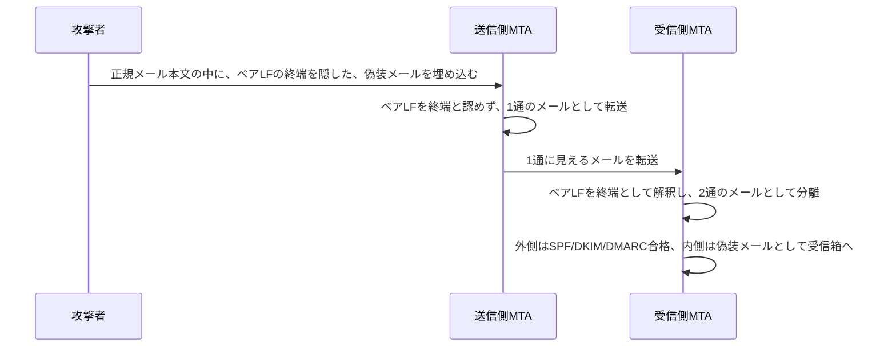

## はじめに

- **この記事で得られること**: [SPF/DKIM/DMARCの仕組み](/articles/mail-spf-dkim-dmarc-guide)で扱った認証が、実は「メールの外側の封筒」だけを検証しているという前提を悪用する、**SMTPスマグリング**という攻撃手法を体系的に理解します。
- **対象読者**: SPF/DKIM/DMARCの基本的な仕組みは理解しているものの、これらすべてに合格したメールが、なぜなりすましメールになり得るのかを説明できない方を想定しています。
- **読むのにかかる想定時間**: 約20分

この記事は[『上位1%』シリーズ 全記事ガイド](/sitemap)の一部、[メール基盤シリーズ](/sitemap#シリーズ一覧)の4.4本目です。

## 前提知識

- [SPF/DKIM/DMARCの仕組み](/articles/mail-spf-dkim-dmarc-guide): SPF・DKIM・DMARCという3つの仕組みの基本的な理解が前提になっています。

## 全体像をつかむ

**SMTPのメール本文は、`<CR><LF>.<CR><LF>`(改行+ピリオド+改行)という、決まった終端シーケンスで終わる**ことになっています。**SMTPスマグリングは、送信側のMTAと、受信側のMTAが、この終端シーケンスの、わずかな表記の違い(例えば、CRを伴わないベアLFだけの`.`を、終端として認めるかどうか)を、それぞれ異なる基準で解釈してしまうことを悪用**します。**この解釈の不一致を使い、正規の1通のメールの本文の中に、まったく別の、送信元を偽装した、もう1通のメールを隠し込む**ことができます。

## 基礎から徹底解説

### なぜ、SPF/DKIM/DMARCがすべて合格してしまうのか

**SPF/DKIM/DMARCが検証しているのは、実際に正規の接続を通じて送られてきた、外側の封筒**(エンベロープ)です。**この外側の封筒自体は、本当に正規の送信元から、正規の認証情報とともに送られてきているため、SPF/DKIM/DMARCのすべての検証に、正しく合格**します。**しかし、その内側に隠されていた、偽装されたメールは、受信側のMTAが独自に「別のメールだ」と解釈した結果であり、SPF/DKIM/DMARCという、エンベロープ単位の検証の対象から、そもそも外れてしまい**ます。

### 実際に発見された脆弱性:Postfix・Sendmail・Exim

**この攻撃手法は、2023年、Postfix(CVE-2023-51764)・Sendmail(CVE-2023-51765)・Exim(CVE-2023-51766)という、複数の主要なMTAソフトウェアに対して、実際に成立することが確認**されました。**Postfixでは、`smtpd_forbid_bare_newline=yes`という設定を有効にすることで、CRを伴わないベアLFを、終端シーケンスの構成要素として認めないようにし、この解釈の不一致そのものを塞ぐ**という対策が提供されています。

HTTPリクエストスマグリングと、まったく同じ構造を持つ攻撃

**この攻撃は、[ロードバランシング学科で扱ったHTTPリクエストスマグリング](/articles/load-balancing-request-smuggling-handson-guide)と、まったく同じ構造の問題**です。**どちらも、「1つのメッセージの境界線が、どこにあるか」について、2つの異なる実装が、異なる解釈を持ってしまうことを悪用する、同じ種類のバグ**です。**プロトコルがHTTPかSMTPかという違いはあっても、「境界線の解釈を、複数の実装の間で一致させる」という、より一般的な設計課題が、形を変えて現れている**と理解できます。

## プロが見ている視点(上位1%の理解)

### 「認証に合格した」ことは、「そのメッセージの境界が正しく解釈されている」ことまでは保証しない

**SPF/DKIM/DMARCという認証の仕組みは、「このエンベロープは、本当に正規の送信元から来たものか」を検証するものであり、「このメッセージの境界が、すべての中継者の間で、一致して解釈されているか」までは、検証の対象にしていません。** **ある検証が、具体的に何を検証対象としているのかを、その検証の範囲外にあるものと、明確に区別して理解する**習慣が、上位1%のエンジニアの視点です。

## よくある誤解・つまずきポイント

- **誤解1: 「SPF/DKIM/DMARCにすべて合格したメールは、なりすましメールではあり得ない」**
  SMTPスマグリングのような手法を使えば、外側の封筒だけがこれらの検証に合格し、内側に隠された偽装メールが、警告なしに受信箱へ届くことがあります。
- **誤解2: 「この攻撃は、特定の1つのMTAソフトウェアだけに存在する、特殊な欠陥だ」**
  Postfix・Sendmail・Eximという、複数の主要なMTAソフトウェアで、実際に成立することが確認されています。
- **誤解3: 「SMTPスマグリングは、HTTPリクエストスマグリングとは、まったく無関係な、別の種類の問題だ」**
  両者は、メッセージの境界線の解釈について、複数の実装が異なる基準を持つことを悪用する、まったく同じ構造の問題です。

## 障害・トラブルシューティングの視点

1. **SPF/DKIM/DMARCにすべて合格しているのに、なりすましメールが届く**: SMTPスマグリングのような、メッセージの境界線の解釈の不一致を悪用する手法が使われていないかを確認します。
2. **自組織のMTAが、この攻撃に対して脆弱かどうかを確認したい**: 使用しているMTAソフトウェアのバージョンと、該当するCVE、そして推奨される設定変更を確認します。
3. **Postfixで、この攻撃への対策を講じたい**: `smtpd_forbid_bare_newline=yes`を設定し、ベアLFを終端シーケンスの構成要素として認めないようにします。

## まとめ

- SMTPスマグリングは、送信側と受信側のMTAが、メールの終端シーケンスの解釈で意見が分かれることを悪用し、1通の中にもう1通の偽装メールを隠し込む攻撃です。
- 外側の封筒はSPF/DKIM/DMARCすべてに合格するため、内側に隠された偽装メールは、警告なしに受信箱へ届きます。
- Postfix・Sendmail・Eximという、複数の主要なMTAソフトウェアで、実際に成立することが確認されています。
- この攻撃は、HTTPリクエストスマグリングと、メッセージ境界の解釈不一致という、まったく同じ構造を持っています。

**今日から意識すべきこと**
1. 自組織のMTAソフトウェアが、SMTPスマグリングに対する既知の対策を適用済みかを確認しましょう。
2. 「認証に合格した」という事実が、具体的に何を検証対象としているのかを、常に一段掘り下げて確認しましょう。

## 参考文献

- [SMTP Smuggling Enables Email Spoofing While Passing Security Checks | CSO Online](https://www.csoonline.com/article/1269779/smtp-smuggling-enables-email-spoofing-while-passing-security-checks.html)
- [Explained: SMTP Smuggling | ThreatDown](https://www.threatdown.com/blog/explained-smtp-smuggling/)
