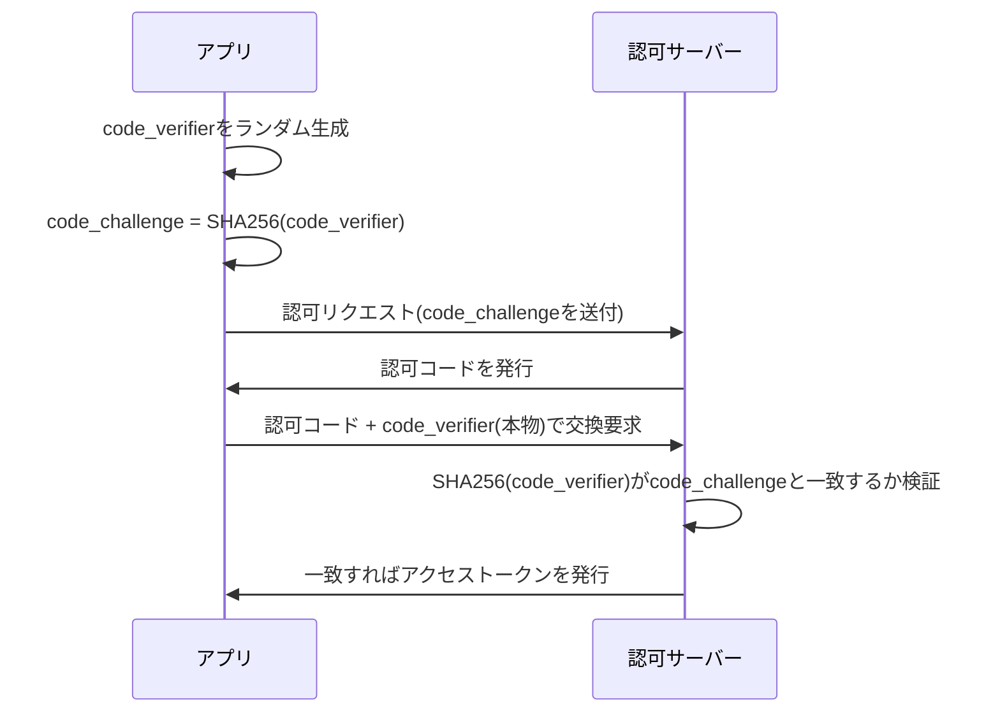

## はじめに

- **この記事で得られること**: [OAuth 2.0の仕組み](/articles/oauth2-guide)で扱った、クライアントシークレットという合言葉は、「アプリのサーバー側だけが知っている秘密」でした。この記事では、**サーバー側を持たないモバイルアプリやSPAが、クライアントシークレットなしで、どうやって認可コードの不正利用を防ぐのか**という、**PKCE**(Proof Key for Code Exchange)の仕組みを体系的に理解します。
- **対象読者**: OAuth 2.0の認可コードフローとクライアントシークレットの役割は理解しているものの、PKCEが何を解決しているのかを説明できない方を想定しています。
- **読むのにかかる想定時間**: 約18分

この記事は[『上位1%』シリーズ 全記事ガイド](/sitemap)の一部、[Web/APIシリーズ](/sitemap#シリーズ一覧)の4.1本目です。

## 前提知識

- [OAuth 2.0の仕組み](/articles/oauth2-guide): 認可コードフローと、クライアントシークレットの役割の理解が前提になっています。

## 全体像をつかむ

**クライアントシークレットは、アプリのサーバー側だけが知っている秘密を提示することで、「この認可コードを使おうとしているのは、正規のアプリ自身だ」と証明する合言葉**でした。**しかし、モバイルアプリやSPAには、そもそも「サーバー側」という、秘密を安全に保管できる場所自体が存在しません。** アプリのバイナリやJavaScriptコードの中にシークレットを埋め込んでも、リバースエンジニアリングで簡単に取り出されてしまいます。**このような、クライアントシークレットを安全に保持できないアプリを「パブリッククライアント」と呼び、PKCEは、このパブリッククライアント向けに、クライアントシークレットなしで、認可コードの横取り攻撃を防ぐ、OAuth 2.0の拡張仕様**(RFC 7636)です。

## 基礎から徹底解説

### 認可コードの横取り攻撃:同じデバイス上の悪意あるアプリが、認可コードを奪う

**モバイルOSでは、カスタムURLスキームを使ったリダイレクトを、複数のアプリが同じスキーム名で登録できてしまう**ことがあります。**悪意のあるアプリが、正規のアプリと同じリダイレクトURLを登録していれば、認可サーバーから返される認可コードを、正規のアプリより先に横取りできてしまう**可能性があります。**クライアントシークレットが存在しないパブリッククライアントでは、横取りした認可コードさえあれば、攻撃者はそのままアクセストークンへの交換要求を送れてしまい**ます。

### PKCEの仕組み:code_verifierとcode_challengeという、2つの値のペア

**アプリは、認可リクエストを送る前に、`code_verifier`という、高いエントロピーを持つランダムな文字列を、自分だけの秘密として生成**します。**そして、この`code_verifier`をSHA-256でハッシュ化した`code_challenge`だけを、最初の認可リクエストに含めて送信**します。**認可コードの交換時には、ハッシュ化前の`code_verifier`そのものを送信し、認可サーバー側が、受け取った`code_verifier`を自分でハッシュ化し、最初に受け取っていた`code_challenge`と一致するかどうかを検証**します。

認可コードを横取りしても、PKCEがあれば交換要求は失敗する

**攻撃者が認可コードそのものを横取りできても、`code_verifier`は、正規のアプリのメモリの中だけに存在し、ネットワーク上を一度も流れていません。** **攻撃者が横取りした認可コードだけで交換要求を送っても、正しい`code_verifier`を持っていないため、ハッシュ値が一致せず、認可サーバーに拒否**されます。

### OAuth 2.1では、すべてのクライアントにPKCEが必須になる

**PKCEは、もともとパブリッククライアント向けの拡張仕様でしたが、OAuth 2.1という、OAuth 2.0の仕様を整理・統合する動きの中では、クライアントシークレットを持つ、サーバー側のアプリ(コンフィデンシャルクライアント)も含めて、すべてのクライアントに対してPKCEの利用が必須**とされています。**クライアントシークレットという1つの防御だけに頼らず、PKCEによる多層防御を、すべてのクライアントに適用するという考え方**への移行です。

## プロが見ている視点(上位1%の理解)

### 「クライアントの種類によって、守るべき対象も、守る手段も変わる」という前提を持つ

**サーバー側を持つアプリと、持たないアプリでは、安全に保管できる秘密の種類そのものが異なります。** **「このクライアントは、本当に秘密を安全に保持できる環境なのか」を、認証・認可の仕組みを設計するたびに問い直す**習慣が、クライアントシークレットという、1つの防御手段を無条件に適用してしまう失敗を避けるための、上位1%のエンジニアの視点です。

## よくある誤解・つまずきポイント

- **誤解1: 「モバイルアプリやSPAも、クライアントシークレットを安全に使える」**
  アプリのバイナリやJavaScriptコードに埋め込んだシークレットは、リバースエンジニアリングで簡単に取り出されてしまうため、安全に保持できません。
- **誤解2: 「PKCEは、クライアントシークレットの代わりに、別の固定された秘密を使うだけの仕組みだ」**
  PKCEは、リクエストごとにランダムに生成される`code_verifier`を使い、認可コードの横取り攻撃そのものを無効化する仕組みです。
- **誤解3: 「PKCEは、パブリッククライアントだけが使うべき、特殊な仕組みだ」**
  OAuth 2.1では、クライアントシークレットを持つコンフィデンシャルクライアントも含めて、すべてのクライアントへのPKCEの利用が必須とされています。

## 障害・トラブルシューティングの視点

1. **認可コードの交換時に「invalid_grant」のようなエラーが発生する**: `code_verifier`が、最初の認可リクエストで送った`code_challenge`の元になった値と、正確に一致しているかを確認します。
2. **モバイルアプリで、認可コードの横取りが懸念される**: カスタムURLスキームの代わりに、OSレベルで保護されたリダイレクト方式(Android App LinksやiOSのUniversal Links)の利用も検討します。
3. **既存のサーバー側アプリに、PKCEを追加導入すべきか迷う**: OAuth 2.1の方向性を踏まえ、クライアントシークレットとの多層防御として、導入を検討します。

## まとめ

- クライアントシークレットを安全に保持できないモバイルアプリやSPAは、パブリッククライアントと呼ばれます。
- PKCEは、`code_verifier`と、そのハッシュ値である`code_challenge`のペアを使い、クライアントシークレットなしで認可コードの横取り攻撃を防ぐ、OAuth 2.0の拡張仕様です。
- 攻撃者が認可コードを横取りできても、正規のアプリだけが持つ`code_verifier`がなければ、交換要求は認可サーバーに拒否されます。
- OAuth 2.1では、パブリッククライアントだけでなく、すべてのクライアントへのPKCEの利用が必須とされています。

**今日から意識すべきこと**
1. 新しい認証・認可の仕組みを設計する際は、「このクライアントは、本当に秘密を安全に保持できるのか」を、必ず問い直しましょう。
2. モバイルアプリやSPAでOAuth 2.0を実装する際は、PKCEの実装を省略できないか、ではなく、どう正しく実装するかを検討しましょう。

## 参考文献

- [OAuth Proof Key for Code Exchange (PKCE) | Gravitee](https://documentation.gravitee.io/am/guides/auth-protocols/oauth-2.0/proof-key-for-code-exchange-pkce)
- [OAuth2 and PKCE: Enhancing Security for Public Clients | DEV Community](https://dev.to/igventurelli/oauth2-and-pkce-enhancing-security-for-public-clients-3bo)
