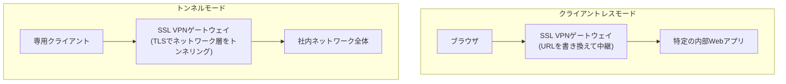

## はじめに

- **この記事で得られること**: [L2TP/IPsecと現代的なVPNプロトコルの比較](/articles/vpn-protocols-comparison-guide)で扱わなかった、「**SSL VPN**」という言葉があります。この言葉は、**1つの明確な技術を指しているわけではありません。** ベンダーのカタログで同じ「SSL VPN」という言葉で説明されている機能には、ブラウザだけで特定の内部Webアプリへアクセスできる「**クライアントレスモード**」と、専用クライアントをインストールして本格的なネットワーク層のトンネルを確立する「**トンネルモード**」という、**構造的にまったく異なる、2つの実体**が存在することを体系的に理解します。
- **対象読者**: 「SSL VPN」という言葉を、製品カタログなどで見かけたことはあるものの、それが具体的にどのような仕組みで動いているのかを説明できない方を想定しています。
- **読むのにかかる想定時間**: 約17分

この記事は[『上位1%』シリーズ 全記事ガイド](/sitemap)の一部、[リモートアクセスVPN/L2TP・IPsecシリーズ](/sitemap#シリーズ一覧)の3.1本目です。

## 前提知識

- [L2TP/IPsecと現代的なVPNプロトコルの比較](/articles/vpn-protocols-comparison-guide): VPNプロトコルが、暗号化・認証・ルーティング情報の配布という、複数の要素を組み合わせて成立しているという理解が前提になっています。
- [フォワードプロキシとリバースプロキシの違い](/articles/forward-reverse-proxy-guide): リバースプロキシが、サーバーの代理として、クライアントからのアクセスを受け止める仕組みであるという理解があると、より深く理解できます。

## 全体像をつかむ

**「SSL VPN」という言葉は、Cisco・Palo Alto・Fortinetといった各ベンダーの製品カタログで広く使われていますが、1つの明確な技術仕様を指す言葉ではありません。** 実態としては、「**クライアントレスモード**」と「**トンネルモード**」という、**構造的にまったく異なる、2つの機能の総称**として使われています。この2つを混同してしまうと、「SSL VPNを導入したのに、思っていた機能が使えない」という、実務上の行き違いにつながります。

## 基礎から徹底解説

### クライアントレスモード:動作の実態は、リバースプロキシに近い

**クライアントレスモードは、専用クライアントを一切インストールせず、ブラウザだけで、特定の内部Webアプリケーションへアクセスできる機能です。** ユーザーがSSL VPNゲートウェイが提供するポータル画面にログインすると、ゲートウェイは、ユーザーがクリックしたリンク先の、内部Webアプリケーションへのリクエストを代理で中継し、応答をユーザーのブラウザへ返します。**この際、ゲートウェイは、内部アプリケーションが返すHTML内のリンクURLを、すべてゲートウェイ経由のURLへ書き換える**、という処理を行います。**[リバースプロキシ](/articles/forward-reverse-proxy-guide)が、サーバーの代理としてクライアントからのアクセスを受け止める仕組みだったことを思い出してください。クライアントレスモードは、まさにこの構造そのもの**であり、動作の実態としては、**ネットワーク層のトンネルを一切確立しない、リバースプロキシに近い仕組み**です。アクセスできる対象も、HTTP/HTTPSベースのWebアプリケーションや、一部のファイル共有・メールプロトコルなど、ゲートウェイが個別に対応している範囲に限られます。

### トンネルモード:OpenVPNと同じ系譜の、本格的なネットワーク層トンネリング

**トンネルモードは、ユーザーの端末に、ベンダー独自の専用クライアントソフトウェアをインストールし、TLSを使った、本格的なネットワーク層のトンネルを確立する機能です。** [OpenVPNの仕組み](/articles/openvpn-internals-guide)で扱った、TLSでIPパケットを暗号化して送るという発想と、構造的にほぼ同じ系譜に属します。**トンネルモードが確立されると、クライアント端末は、社内ネットワークに直接接続しているのと同等の、ネットワーク層でのアクセスを得る**ため、クライアントレスモードのような、Webアプリケーションへの限定的なアクセスとは、まったく異なる範囲のことができます。

同じベンダー、同じ製品名の中に、両方のモードが同居している

**実務でよくある混乱の原因は、Ciscoの旧AnyConnect(現Secure Client)のような、1つの製品名の中に、クライアントレスモードとトンネルモードの両方が、選択可能な機能として同居している**ことです。「AnyConnectを使っている」という1つの事実だけでは、**実際にネットワーク層のトンネルが確立されているのか、それとも、Webアプリケーションへの限定的な中継だけが行われているのか**を、判断できません。導入時に、どちらのモードを、どの用途のために有効化しているのかを、明確に区別して設計・ドキュメント化しておく必要があります。

## プロが見ている視点(上位1%の理解)

### 「SSL」という名前は、暗号化方式を指しているだけで、動作モードを決めているわけではない

**「SSL VPN」という名前は、TLS(歴史的な名称としてSSL)を使って暗号化しているという、暗号化方式の部分だけを指しており、クライアントレスモードかトンネルモードかという、動作モードそのものを決めている言葉ではありません。** この構造は、[Always On VPN](/articles/always-on-vpn-guide)という名前が、単一の機能ではなく、複数の要素を組み合わせた設計パターン全体を指していたのと、よく似た構図です。**「〇〇 VPN」という名前に出会ったら、それが暗号化方式を指しているのか、動作モードを指しているのか、それとも複数の要素を組み合わせた設計パターン全体を指しているのかを、まず切り分けて考える**習慣が、ベンダーのマーケティング用語に振り回されないための、実務上の防御策になります。

## よくある誤解・つまずきポイント

- **誤解1: 「SSL VPNは、L2TP/IPsecやOpenVPNと並ぶ、1つの明確なVPNプロトコルだ」**
  SSL VPNは、クライアントレスモードとトンネルモードという、構造的にまったく異なる2つの機能の総称であり、1つの明確なプロトコル仕様を指す言葉ではありません。
- **誤解2: 「クライアントレスモードでも、トンネルモードと同じようにネットワーク全体へアクセスできる」**
  クライアントレスモードは、ネットワーク層のトンネルを確立せず、ゲートウェイが個別に対応している、特定のWebアプリケーションなどへのアクセスに限定されます。
- **誤解3: 「同じ製品を使っているなら、どちらのモードを使っているかは重要ではない」**
  同じ製品名の中に両方のモードが同居していることが多いため、導入時にどちらを有効化し、どの用途のために使っているかを、明確に区別しておく必要があります。

## 障害・トラブルシューティングの視点

1. **SSL VPNを導入したのに、社内ネットワーク上の、特定のアプリケーション以外にアクセスできない**: クライアントレスモードが有効化されているだけで、トンネルモードが有効化されていない可能性を確認します。
2. **一部のユーザーだけ、専用クライアントのインストールを求められる**: そのユーザーに対して、トンネルモードが有効化されている設定になっているかを確認します。
3. **クライアントレスモードで、特定のWebアプリケーションのリンクが正しく動作しない**: ゲートウェイによるURLの書き換え処理が、そのアプリケーションの構造(JavaScriptによる動的なURL生成など)に対応していない可能性を確認します。

## まとめ

- 「SSL VPN」は、1つの明確な技術を指す言葉ではなく、クライアントレスモードとトンネルモードという、構造的にまったく異なる2つの機能の総称です。
- クライアントレスモードは、動作の実態としては、ネットワーク層のトンネルを確立しない、リバースプロキシに近い仕組みです。
- トンネルモードは、OpenVPNと同じ系譜に属する、TLSを使った本格的なネットワーク層のトンネリングです。
- 「SSL」という名前は暗号化方式だけを指しており、どちらの動作モードなのかは、別途確認する必要があります。

**今日から意識すべきこと**
1. 「SSL VPN」という言葉に出会ったら、それがクライアントレスモードかトンネルモードかを、まず確認する習慣をつけましょう。
2. SSL VPNを導入・設計する際は、どちらのモードを、どの用途のために有効化しているのかを、明確にドキュメント化しましょう。

## 参考文献

- [Clientless SSL VPN vs AnyConnect VPN | Cisco Community](https://community.cisco.com/t5/vpn/clientless-ssl-vpn-vs-anyconnect-vpn/td-p/1066012)
- [Cisco ASA Anyconnect Remote Access VPN | NetworkLessons](https://networklessons.com/cisco/asa-firewall/cisco-asa-anyconnect-remote-access-vpn)
