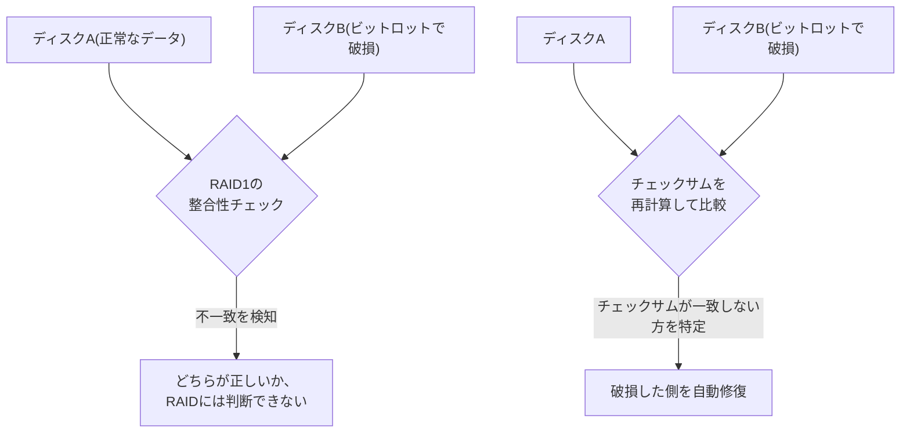

## はじめに

- **この記事で得られること**: [RAID5とRAID6のパリティ計算の仕組み](/articles/raid5-parity-guide)と[mdadmでRAID1を構築するハンズオン](/articles/mdadm-raid-handson-guide)で経験したのは、**ディスクが完全に故障したときに、データを復元する仕組み**でした。この記事では、ディスクが「故障」を報告せずに、静かに1ビットだけ違うデータを返してしまう**ビットロット**(bit rot、サイレント・データ破損)という現象、そしてZFSやBtrfsが、**チェックサム**という仕組みを使って、この現象から自動的に復旧する方法を体系的に理解します。
- **対象読者**: RAID1やRAID5によるディスク故障への対策は理解しているものの、「RAIDを組んでいるから、データの破損は絶対に起きない」と考えている方を想定しています。
- **読むのにかかる想定時間**: 約18分

この記事は[『上位1%』シリーズ 全記事ガイド](/sitemap)の一部、[ストレージ基礎シリーズ](/sitemap#シリーズ一覧)の6.1本目です。

## 前提知識

- [RAID5とRAID6のパリティ計算の仕組み](/articles/raid5-parity-guide): パリティによるデータ復元という、別の種類の障害対策の理解が前提になっています。

## 全体像をつかむ

**従来のRAID(RAID1のミラーリングや、RAID5/6のパリティ)が対処できるのは、ディスクが完全に故障し、読み取りエラーを報告するケースです。** しかし、**ディスクが、エラーを報告せずに、静かに(サイレントに)、1ビットだけ異なるデータを返してしまう**ことがあります。これが**ビットロット**(bit rot)です。**RAIDコントローラーは、ミラーの2台のデータが一致しないことを検知できても、「どちらが正しいデータか」を判断する手段を、そもそも持っていません。**

## 基礎から徹底解説

### チェックサムは、データとは別の場所に、独立して保存されている

**ZFSのようなファイルシステムは、データブロックごとに、そのデータの内容から計算したチェックサムを、データ本体とは別の場所(ZFSの場合、親のブロックポインタ)に保存**します。**データを読み取るたびに、その内容からチェックサムを再計算し、保存されているチェックサムと比較**します。一致しなければ、「このコピーは破損している」と確実に判断でき、ミラーのもう一方や、パリティから、正しいデータを復元し、破損していた側を自動的に上書き修復します。

### スクラブという、能動的な全体検査

**「スクラブ(scrub)」とは、普段は読み取られないパリティブロックまで含めて、ストレージ全体のデータを定期的に読み取り、チェックサムを検証する処理**です。ディスクが実際に故障する前に、静かに進行していたビットロットを、事前に発見し、修復する機会を作ります。**冗長性(ミラーやパリティ)が十分に残っている限り、スクラブは破損を自動的に修復しますが、冗長性が不足している状態で破損を検出した場合、ZFSは、破損したデータをそのまま返すのではなく、エラーとして報告**します。

従来のRAIDのミラー不一致は、多くの場合「片方で上書き」してしまう

**チェックサムを持たない、従来のRAID1(mdadmや多くのハードウェアRAID)で、整合性チェック中にミラーの不一致を検出した場合、どちらが正しいかを判断する手段がないまま、片方の内容で、もう片方を上書きしてしまう**という挙動がよく見られます。**この上書きが、たまたま破損した側の内容で、正常だった側を上書きしてしまうと、破損がむしろ拡大する**という、直感に反する結果につながることがあります。これが、チェックサムを持つファイルシステムとの、決定的な違いです。

## プロが見ている視点(上位1%の理解)

### 「RAIDを組んでいる」ことと、「データの整合性が保証されている」ことは、別の階層の話

**「RAIDを組んでいるから、データは安全だ」という考え方は、ディスクの完全な故障という、1種類の障害にしか対処していません。** **ビットロットという、もう1種類の障害に対処するには、RAID自体とは別の階層にある、チェックサムとスクラブという仕組みが必要**です。**信頼性を議論する際は、「どの種類の障害に対して、何が守ってくれているのか」を、階層ごとに分けて考える**ことが、上位1%のエンジニアが持っている視点です。

## よくある誤解・つまずきポイント

- **誤解1: 「RAIDを組んでいれば、データの破損は絶対に起きない」**
  従来のRAIDは、ディスクの完全な故障には対処できますが、エラーを報告しない静かなデータ破損(ビットロット)には対処できません。
- **誤解2: 「RAID1のミラー不一致は、常に正しく修復される」**
  チェックサムを持たない従来のRAID1では、どちらが正しいかを判断する手段がなく、破損した側で正常な側を上書きしてしまうことがあります。
- **誤解3: 「チェックサムとRAIDは、同じ目的のための、競合する技術だ」**
  2つは対処する障害の種類が異なり、RAID(冗長性)とチェックサム(破損の検出)を組み合わせることで、初めてビットロットから自動的に復旧できます。

## 障害・トラブルシューティングの視点

1. **ディスクは正常に動いているのに、特定のファイルだけが時々壊れている**: ビットロットの可能性を考え、チェックサム機能を持つファイルシステム(ZFS・Btrfs)への移行を検討します。
2. **RAID1の整合性チェックで、ミラー不一致の警告が出た**: どちらのディスクが正しいデータを持っているかを、チェックサムなしでは判断できないことを前提に、バックアップからの復旧も検討します。
3. **ZFSのスクラブでエラーが報告された**: 冗長性が不足している可能性があり、該当するディスクの状態を優先的に確認します。

## まとめ

- ビットロットは、ディスクがエラーを報告せずに、静かに1ビットだけ異なるデータを返してしまう現象です。
- 従来のRAIDは、ディスクの完全な故障には対処できますが、ビットロットには無力です。
- ZFSやBtrfsは、データとは別の場所に保存したチェックサムを使い、どちらのコピーが破損しているかを判定し、自動的に修復します。
- スクラブという定期検査が、ディスク故障の前に、静かな破損を発見する機会を作ります。

**今日から意識すべきこと**
1. 「RAIDを組んでいるから安全だ」という言葉を聞いたら、それがどの種類の障害に対する安全なのかを確認しましょう。
2. 本当にデータの整合性を重視するなら、チェックサム機能を持つファイルシステムの採用を検討しましょう。

## 参考文献

- [ZFS mirror vs traditional HW RAID 1 | TrueNAS Community](https://www.truenas.com/community/threads/zfs-mirror-vs-traditional-hw-raid-1.40966/)
- [ZFS silent data corruption | Netdata](https://www.netdata.cloud/guides/zfs/zfs-silent-data-corruption/)
