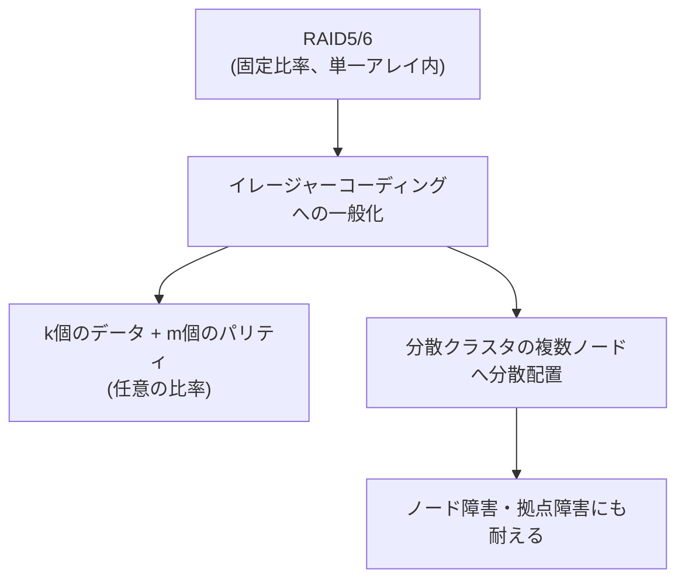

## はじめに

- **この記事で得られること**: [RAID5とRAID6のパリティ計算の仕組み](/articles/raid5-parity-guide)で扱った、パリティによる故障耐性という発想が、**イレージャーコーディング**という、より自由な比率で、複数ノードへ分散配置される仕組みへと一般化される様子を体系的に理解します。
- **対象読者**: RAID5/RAID6のパリティの仕組みは理解しているものの、イレージャーコーディングが、それと何が違うのかを説明できない方を想定しています。
- **読むのにかかる想定時間**: 約18分

この記事は[『上位1%』シリーズ 全記事ガイド](/sitemap)の一部、[ストレージシリーズ](/sitemap#シリーズ一覧)の6.2本目です。

## 前提知識

- [RAID5とRAID6のパリティ計算の仕組み](/articles/raid5-parity-guide): パリティによって、ディスク故障からデータを復元する基本的な仕組みの理解が前提になっています。

## 全体像をつかむ

**RAID5は1個のパリティ、RAID6は2個のパリティという、固定された比率で、1台または2台のディスク故障に耐えます。** **イレージャーコーディングは、この「データとパリティの比率」を、k個のデータチャンクとm個のパリティチャンクという、任意の比率に一般化**します。**例えば、RS(10,4)という構成では、10個のデータチャンクと4個のパリティチャンクの、合計14個の中から、任意の4個が失われても、元のデータを復元**できます。**そして、RAIDが単一のディスクアレイの中で完結していたのに対し、イレージャーコーディングは、分散クラスタの複数ノードへチャンクを分散配置する**ことが一般的です。

## 基礎から徹底解説

### なぜ、イレージャーコーディングは、複製よりも容量効率が良いのか

**同じデータを3つのノードへ単純に複製する3重複製は、2台分の故障に耐えるために、元データの3倍の容量を必要**とします。**同等の耐久性を持つイレージャーコーディングの構成であれば、必要な容量は、元データの1.4倍から1.6倍程度に収まることが多く**、クラウドのオブジェクトストレージ(S3型のストレージなど)で、イレージャーコーディングが広く採用されている理由の1つです。

### Reed-Solomon符号:イレージャーコーディングで最も広く使われているアルゴリズム

**イレージャーコーディングの実装で最も広く使われているのが、Reed-Solomon符号**です。**Cephのデフォルトのイレージャープラグインも、このReed-Solomon符号を使用**しています。**MinIOのようなオブジェクトストレージでは、オブジェクト単位でイレージャーコーディングが適用され、これは、オブジェクトが一度書き込まれたら読み取り専用になる、不変のデータとして扱われることと、相性が良い**ためです。

トレードオフ:復旧(リビルド)が遅く、CPU負荷が高い

**イレージャーコーディングは、容量効率に優れる一方で、故障からの復旧(リビルド)処理が、単純な複製のコピー操作や、RAIDの単純な再構築に比べて、より多くの計算(数学的な復号処理)を必要とし、遅く、CPU負荷も高くなり**ます。**レイテンシに敏感なワークロードでは、依然として複製方式が選ばれることが多い**理由です。

## プロが見ている視点(上位1%の理解)

### RAIDの「比率を固定する」という制約は、本質的な制約ではなかった

**RAID5やRAID6のパリティ比率が固定されているのは、単一のディスクアレイという、物理的な制約の中で設計されたからであり、この比率を固定する制約そのものは、イレージャーコーディングという、より一般化された枠組みでは、本質的な制約ではないことが分かります。** **ある仕組みの「当たり前に思える制約」が、本当に本質的な制約なのか、それとも、その仕組みが生まれた文脈特有の、偶然の制約にすぎないのかを、一段掘り下げて考える**習慣が、上位1%のエンジニアの視点です。

## よくある誤解・つまずきポイント

- **誤解1: 「イレージャーコーディングは、RAID5/6とまったく異なる、別物の技術だ」**
  イレージャーコーディングは、RAID5/6のパリティという発想を、より自由な比率と、複数ノードへの分散配置へ一般化したものです。
- **誤解2: 「イレージャーコーディングは、複製方式より常に優れている」**
  イレージャーコーディングは容量効率に優れますが、復旧処理が遅くCPU負荷も高いため、レイテンシに敏感なワークロードでは複製方式が選ばれることもあります。
- **誤解3: 「RAIDは、複数のサーバーに分散配置することもできる」**
  RAIDは、単一のディスクアレイの中で完結する仕組みであり、複数ノードへの分散配置は、イレージャーコーディングの特徴です。

## 障害・トラブルシューティングの視点

1. **オブジェクトストレージの容量効率を改善したい**: 複製方式からイレージャーコーディングへの切り替えを検討します。
2. **イレージャーコーディングを採用した後、復旧処理が遅いと感じる**: これはトレードオフとして想定された挙動であり、CPU負荷の高い復号処理が発生していることを確認します。
3. **レイテンシに敏感なワークロードで、どちらを採用すべきか迷う**: 復旧速度とCPU負荷を優先するなら複製方式、容量効率を優先するならイレージャーコーディングを検討します。

## まとめ

- イレージャーコーディングは、RAID5/6のパリティという発想を、k個のデータチャンクとm個のパリティチャンクという、任意の比率に一般化したものです。
- RAIDが単一のディスクアレイ内で完結するのに対し、イレージャーコーディングは、分散クラスタの複数ノードへチャンクを分散配置します。
- Reed-Solomon符号が、イレージャーコーディングの実装で最も広く使われているアルゴリズムです。
- イレージャーコーディングは容量効率に優れますが、復旧処理が遅くCPU負荷も高いというトレードオフがあります。

**今日から意識すべきこと**
1. ストレージの冗長化方式を検討する際は、容量効率と復旧速度のどちらを優先するかを、明確に意識しましょう。
2. ある仕組みの制約が、本質的な制約なのか、文脈特有の偶然の制約なのかを、一段掘り下げて考えましょう。

## 参考文献

- [Object Storage Erasure Coding vs. Block Storage RAID | MinIO](https://www.min.io/blog/erasure-coding-vs-raid)
- [A Guide to RAID Pt. 4: RAID vs Erasure Coding, What's the Difference? | Xinnor](https://xinnor.io/blog/a-guide-to-raid-pt-4-raid-vs-erasure-coding-whats-the-difference/)
