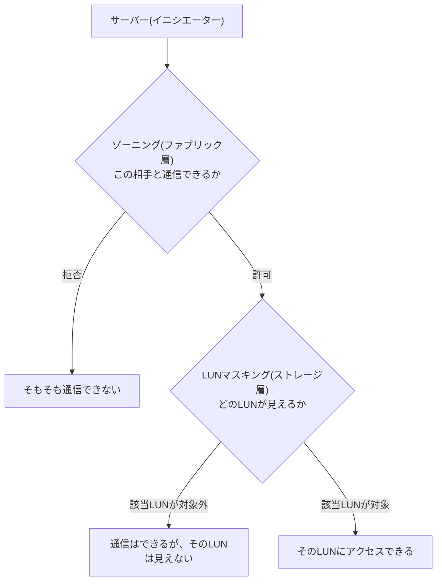

## はじめに

- **この記事で得られること**: [FCケーブル接続とLANケーブル接続の違い](/articles/fc-san-fundamentals-guide)で扱ったゾーニングの先にある、**LUNマスキング**という、もう1つの独立したアクセス制御の仕組みを体系的に理解します。
- **対象読者**: ゾーニングの仕組みは理解しているものの、ゾーニングだけでSANのアクセス制御が完結すると思い込んでいる方を想定しています。
- **読むのにかかる想定時間**: 約16分

この記事は[『上位1%』シリーズ 全記事ガイド](/sitemap)の一部、[ストレージ基礎シリーズ](/sitemap#シリーズ一覧)の2.1本目です。

## 前提知識

- [FCケーブル接続とLANケーブル接続の違い](/articles/fc-san-fundamentals-guide): ゾーニング・WWN・ファブリックという概念の理解が前提になっています。

## 全体像をつかむ

**ゾーニングは、FCスイッチ(ファブリック)のレベルで動作し、「どのイニシエーター(サーバー)が、どのターゲット(ストレージ装置のポート)と通信できるか」を制限**します。**LUNマスキングは、これとは完全に別の場所、つまりストレージ装置自身(あるいはホスト側のアダプター)で動作し、「通信が許可された相手の中から、さらにどのLUNを見せるか」を制限**します。**ゾーニングを『廊下への立ち入り許可』、LUNマスキングを『廊下の先にある、個別の部屋の鍵』と考えると、この2つがまったく別の関所だと理解しやすくなります。**

## 基礎から徹底解説

### ゾーニングを通過しても、LUNマスキングでさらに絞られる

**ゾーニングによって、あるサーバーが、あるストレージ装置のポートと通信できるようになったとしても、そのストレージ装置が公開しているすべてのLUNが、そのサーバーに見えるわけではありません。** **LUNマスキングは、同じストレージ装置のポートを複数のサーバーが共有している環境で、各サーバーに「自分に割り当てられたLUNだけ」を見せ、他のサーバー用のLUNを隠すために使われます。** **この2つの仕組みは、どちらか一方だけでは不十分で、実務ではゾーニングとLUNマスキングを両方組み合わせて使うのが基本**です。

### どちらで実装されるかは、ベンダーや構成によって異なる

**LUNマスキングは、一般的にはストレージコントローラー側(あるいはホストのアダプター側)で実装されますが、一部のFCスイッチは、LUN単位でのゾーニングを可能にする機能を持っており、スイッチ側でLUNマスキングに相当する制御を行うこともできます。** **このため、実務で「LUNマスキング」という言葉と「ゾーニング」という言葉が、やや混同して使われる場面があることも、知っておく必要があります。**

補足:WWN偽装(WWNスプーフィング)への耐性の違い

**WWNベースのゾーニングは、WWNという識別子そのものが偽装(スプーフィング)される可能性を抱えています。** **LUNマスキングも、最終的にはWWNやイニシエーターIDを基準に判断するため、この種の偽装に対する根本的な防御にはならず、物理的なセキュリティやポートベースのゾーニングといった、別の対策と組み合わせる必要**があります。

## プロが見ている視点(上位1%の理解)

### 「通信できる」ことと「見える」ことは、別のレイヤーの話

**ゾーニングとLUNマスキングは、どちらも『アクセス制御』という同じ目的を持っているように見えますが、ゾーニングはファブリック層での到達性の制御、LUNマスキングはストレージ層での可視性の制御という、まったく異なるレイヤーで動作しています。** **「サーバーからストレージが見えない」という障害に遭遇したときに、ゾーニングだけを確認して満足せず、「ゾーニングは通過しているが、LUNマスキングでさらに絞られていないか」を、必ずもう1段確認する**習慣が、上位1%のエンジニアの視点です。

## よくある誤解・つまずきポイント

- **誤解1: 「ゾーニングを正しく設定すれば、それだけでアクセス制御は完結する」**
  ゾーニングは通信の到達性を制御するだけで、見えるLUNを個別に制限するLUNマスキングとは、別の仕組みです。
  両方を組み合わせて使う必要があります。
- **誤解2: 「LUNマスキングは、必ずストレージ装置側で設定する」**
  一部のFCスイッチは、LUN単位のゾーニングでLUNマスキングに相当する制御を行えるため、実装される場所はベンダーや構成によって異なります。
- **誤解3: 「WWNベースのゾーニングとLUNマスキングを設定すれば、なりすましへの対策は完璧だ」**
  どちらも最終的にはWWNやイニシエーターIDを基準にするため、WWN偽装への根本的な防御にはなりません。

## 障害・トラブルシューティングの視点

1. **ゾーニングは正しく設定されているはずなのに、サーバーから特定のLUNが見えない**: そのストレージ装置側のLUNマスキング設定で、そのサーバーのWWN(またはイニシエーターID)が、対象LUNへのアクセス対象に含まれているかを確認します。
2. **複数のサーバーが同じストレージポートを共有していて、意図しないLUNが見えてしまう**: LUNマスキングの設定漏れを疑い、各サーバーに割り当てるべきLUNの一覧を再確認します。
3. **ゾーニングとLUNマスキングのどちらで制御すべきか判断できない**: ファブリック全体に関わる広い制御はゾーニングで、個々のサーバーとLUNの対応関係はLUNマスキングで行う、という役割分担を基準に判断します。

## まとめ

- ゾーニングはファブリック層での到達性の制御、LUNマスキングはストレージ層での可視性の制御という、別々の仕組みです。
- ゾーニングを通過しても、LUNマスキングでさらにLUNの可視性が絞られます。
- 実務では、両方を組み合わせて使うのが基本です。
- どちらで実装されるかは、ベンダーや構成によって異なります。

**今日から意識すべきこと**
1. 「ストレージが見えない」という障害では、ゾーニングとLUNマスキングの両方を、別々に確認しましょう。
2. SAN環境を設計する際は、ゾーニングとLUNマスキングの役割分担を明確にしておきましょう。

## 参考文献

- [LUN Masking vs Zoning | theITHollow](https://theithollow.com/2012/03/12/lun-masking-vs-zoning/)
- [What Is LUN Masking? | ITU Online IT Training](https://ituonline.com/tech-definitions/what-is-lun-masking)
