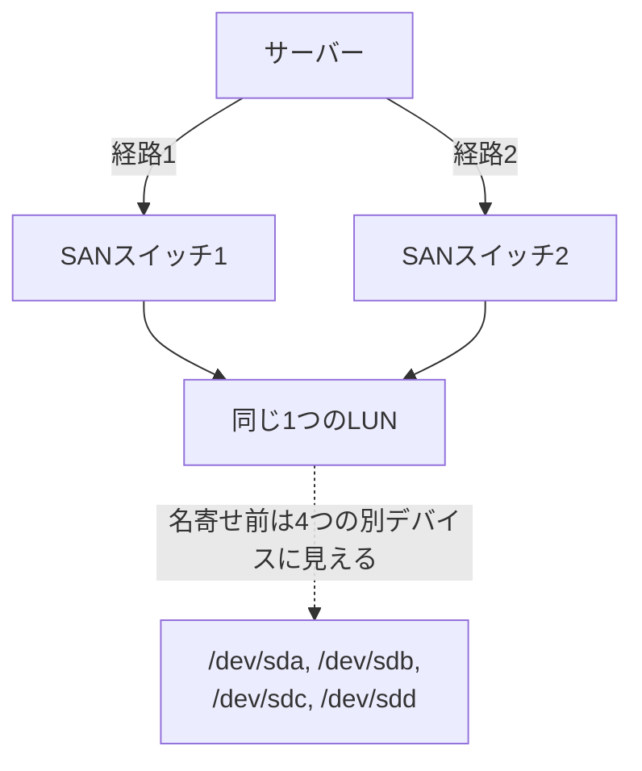

## はじめに

- **この記事で得られること**: [iSCSIの仕組み](/articles/iscsi-guide)や[FCケーブル接続](/articles/fc-san-fundamentals-guide)で扱った、SAN環境でのLUNへの接続は、実務では冗長化のために、複数の物理パスを経由して行われます。しかし、**何も対処しないと、サーバーのOSからは、本来1本のはずのLUNが、まるで複数の別々のディスクとして見えてしまう**という、不思議な現象が起こります。この記事では、**マルチパスI/O**(MPIO)が、各ディスクが共通して持つ**WWID**という一意な識別子を使い、「これらは実は同じLUNへの別経路に過ぎない」と判断して、1つの論理デバイスへ名寄せする仕組みを体系的に理解します。
- **対象読者**: iSCSIやFCの基本的な接続は理解しているものの、冗長化された環境で、同じ容量の見覚えのないディスクが複数表示される現象に遭遇し、その正体を説明できない方を想定しています。
- **読むのにかかる想定時間**: 約17分

この記事は[『上位1%』シリーズ 全記事ガイド](/sitemap)の一部、[ストレージ基礎シリーズ](/sitemap#シリーズ一覧)の7.1本目です。

## 前提知識

- [iSCSIの仕組み](/articles/iscsi-guide): サーバーがSAN上のLUNへ、ネットワーク経由で接続するという基本が前提になっています。
- [FCケーブル接続とLANケーブル接続の違い](/articles/fc-san-fundamentals-guide): FC-SAN環境における、冗長化された接続経路の存在が前提になっています。

## 全体像をつかむ

**可用性を高めるため、SAN環境では、1台のサーバーと1つのストレージ装置の間に、複数の物理的な経路(パス)を用意するのが一般的です。** 例えば、サーバー側に2枚のHBA(ホストバスアダプタ)、ストレージ側に2台のSANスイッチを経由する構成であれば、合計4本の独立した経路で同じLUNへ到達できます。**ところが、何も対処しなければ、OSは、この4本の経路それぞれを、まったく別のディスクとして認識してしまいます。** `/dev/sda`、`/dev/sdb`、`/dev/sdc`、`/dev/sdd`という、見た目は4台の異なるディスクが、実際には、たった1つのLUNへの、4つの異なる入口に過ぎないのです。

## 基礎から徹底解説

### WWID:同じLUNであることを証明する、一意な識別子

**この問題を解決する鍵となるのが、WWID(World Wide Identifier)です。** WWIDは、ストレージ装置自身が、個々のLUNに対して割り振る、一意で永続的な識別子であり、**どの経路を経由してアクセスしても、同じLUNであれば、まったく同じWWIDが返されます。** **マルチパスI/O(MPIO)ソフトウェア**(Linuxでは`device-mapper-multipath`、Windowsでは標準のMPIO機能)は、OSが認識しているすべてのブロックデバイスのWWIDを調べ、**同じWWIDを持つ複数のデバイスを、1つの論理的なマルチパスデバイスへまとめ直します。** Linuxでは、この結果が`/dev/mapper/mpathX`のような、新しいデバイス名として現れます。アプリケーションやファイルシステムは、個々の`/dev/sdX`を直接使うのではなく、**この名寄せ後のマルチパスデバイスを使うことが、実務上の鉄則**です。`/dev/sdX`という名前は、OSの再起動のたびに、認識順序が変わって一致しなくなることがあるためです。

RAIDとマルチパスは、方向性が正反対の統合である

[mdadmでRAID1を構築するハンズオン](/articles/mdadm-raid-handson-guide)で扱ったRAIDは、**複数の、物理的に別々のディスクを、1つの論理ディスクへまとめる**仕組みでした。一方、**マルチパスI/Oが統合しているのは、ディスクそのものではなく、1つの同じディスク(LUN)へ到達するための、複数の経路**です。**見た目の操作(「複数を1つにまとめる」)は似ていますが、統合している対象がまったく異なる**ことを、はっきり区別しておく必要があります。

### マルチパスI/Oが提供する、2つの機能:フェイルオーバーとロードバランシング

マルチパスI/Oが果たす役割は、大きく2つあります。**フェイルオーバー**は、使用中の経路に障害(ケーブルの切断、HBAの故障、スイッチの停止など)が発生した場合に、残っている健全な経路へ、I/Oを自動的に切り替える機能です。**ロードバランシング**は、複数の経路を同時に能動的に使い、I/Oを分散させることで、1本の経路だけを使う場合よりも高いスループットを実現する機能です。**すべての経路を同時に使うアクティブ/アクティブ方式と、通常は1本だけを使い残りを待機させておくアクティブ/パッシブ方式があり、どちらが適切かは、ストレージ装置自体の対応状況によって決まります。**

## プロが見ている視点(上位1%の理解)

### 「見覚えのない同容量のディスクが複数表示される」は、マルチパス未設定の典型的な症状

実務でよく遭遇する場面として、**SANに新しく接続したサーバーで、`lsblk`や`ディスクの管理`を開くと、まったく同じ容量のディスクが、2台・4台といった具合に複数表示される**ことがあります。**これを見て、「ストレージ側で何か設定を誤り、同じLUNを複数回マッピングしてしまったのではないか」と誤解してしまうことがありますが、多くの場合、原因はストレージ側ではなく、サーバー側でマルチパスI/Oソフトウェアが未設定、または正しく動作していないことにあります。** マルチパスソフトウェアを正しく設定すれば、**これらの複数のデバイスは、1つのマルチパスデバイスへ統合され、見た目の数が正しく1つに戻ります。** この現象に遭遇したら、まず疑うべきは、ストレージ側の設定ではなく、サーバー側のマルチパス設定です。

## よくある誤解・つまずきポイント

- **誤解1: 「同じ容量のディスクが複数表示されるのは、ストレージ側の設定ミスだ」**
  多くの場合、原因はサーバー側でマルチパスI/Oソフトウェアが未設定であることにあり、ストレージ側のLUNマッピング自体は正しいことがほとんどです。
- **誤解2: 「マルチパスI/Oは、RAIDと同じように、複数の物理ディスクを1つにまとめる仕組みだ」**
  マルチパスI/Oが統合しているのは、1つの同じLUNへ到達するための複数の経路であり、複数の物理的に別々のディスクではありません。
- **誤解3: 「`/dev/sda`のような個々のデバイス名を直接使っても、マルチパスデバイスを使うのと変わらない」**
  個々の`/dev/sdX`は、OSの再起動のたびに認識順序が変わる可能性があり、アプリケーションやファイルシステムは、名寄せ後のマルチパスデバイスを使うべきです。

## 障害・トラブルシューティングの視点

1. **新しく接続したSANのLUNが、同じ容量のディスクとして複数表示される**: マルチパスI/Oソフトウェア(Linuxでは`multipathd`、Windowsでは MPIO機能)が、インストール・有効化されているかを確認します。
2. **一部の経路に障害が発生したのに、I/Oが継続している**: フェイルオーバーが正しく機能している証拠であり、マルチパスの状態確認コマンド(`multipath -ll`など)で、どの経路がダウンしているかを確認します。
3. **期待したスループットが得られない**: ロードバランシングの方式(アクティブ/アクティブかアクティブ/パッシブか)が、ストレージ装置の対応状況と一致しているかを確認します。

## まとめ

- SAN環境では、冗長化のために複数の物理パスが用意されるのが一般的ですが、何も対処しないと、OSは各パスを別々のディスクとして認識してしまいます。
- WWIDは、ストレージ装置が個々のLUNに割り振る一意な識別子であり、どの経路を経由してもLUNごとに同じ値が返されます。
- マルチパスI/Oソフトウェアは、同じWWIDを持つ複数のデバイスを、1つの論理的なマルチパスデバイスへ名寄せします。
- マルチパスI/Oは、フェイルオーバー(障害時の経路切替)とロードバランシング(複数経路での分散)という、2つの機能を提供します。

**今日から意識すべきこと**
1. 同じ容量のディスクが複数表示される現象に遭遇したら、まずサーバー側のマルチパスI/O設定を確認しましょう。
2. SAN上のLUNを使う際は、個々の`/dev/sdX`ではなく、名寄せ後のマルチパスデバイスを使いましょう。

## 参考文献

- [Configuring device mapper multipath | Red Hat Documentation](https://docs.redhat.com/en/documentation/red_hat_enterprise_linux/8/html-single/configuring_device_mapper_multipath/index)
- [Managing multipath I/O for devices | SUSE Documentation](https://documentation.suse.com/sles/15-SP7/html/SLES-all/cha-multipath.html)
