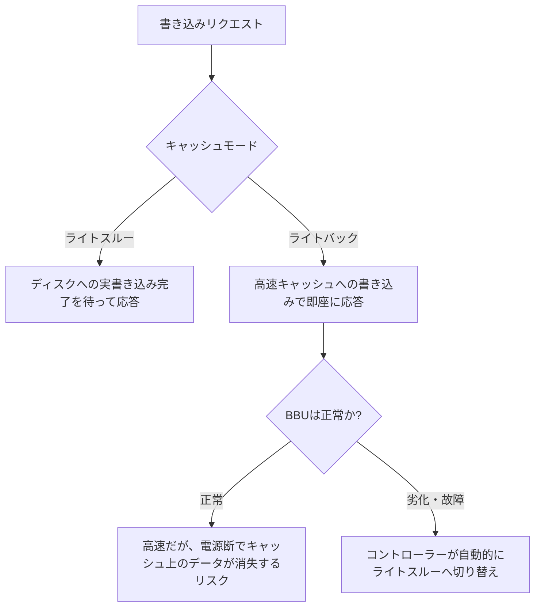

## はじめに

- **この記事で得られること**: [RAID5とRAID6のパリティ計算の仕組み](/articles/raid5-parity-guide)で扱った、ディスク故障時の復元とは別の軸である、**書き込み1回がいつ「完了した」と見なされるのか**という、ライトバック/ライトスルーという、RAIDコントローラーのキャッシュ戦略を体系的に理解します。
- **対象読者**: RAIDコントローラーの設定画面で「Write-Back」や「Write-Through」という項目を見たことはあるものの、それぞれの違いと、バッテリーとの関係を説明できない方を想定しています。
- **読むのにかかる想定時間**: 約18分

この記事は[『上位1%』シリーズ 全記事ガイド](/sitemap)の一部、[ストレージシリーズ](/sitemap#シリーズ一覧)の6.3本目です。

## 前提知識

- [RAID5とRAID6のパリティ計算の仕組み](/articles/raid5-parity-guide): RAIDコントローラーの基本的な役割の理解が前提になっています。

## 全体像をつかむ

**ライトスルーは、実際にディスクへの書き込みが完了するまで、ホスト側へ「書き込み完了」の応答を返さない、安全だが低速な方式**です。**ライトバックは、RAIDコントローラー上の高速なキャッシュ(DRAM)へ書き込んだ時点で、即座に「書き込み完了」と応答する、高速だが、キャッシュ上のデータがまだディスクへ反映されていない間に電源が落ちると、データが失われるリスクを持つ方式**です。**しかも、このデータ損失は、ホスト側のアプリケーションが一切気づかないまま発生**します。ホストは、すでに「完了した」という応答を受け取ってしまっているためです。

## 基礎から徹底解説

### BBU(バッテリーバックアップユニット):キャッシュを保護するが、充電量には限界がある

**ライトバックのリスクに対処するため、多くのRAIDコントローラーは、BBU(Battery Backup Unit)というバッテリーを備え、電源断の間もキャッシュのDRAMへ給電を続け、電源復旧後にキャッシュの内容をディスクへ書き出せるようにし**ます。**しかし、BBUの充電量には限界があり、一般的には24時間から48時間程度しかキャッシュを保護できず、それを超えて電源が復旧しない場合は、結局データが失われ**ます。

### コントローラーの自動フォールバック:バッテリーの劣化を検知すると、黙ってライトスルーへ切り替わる

**多くのRAIDコントローラーは、BBUの劣化や故障を検知すると、管理者による操作なしに、自動的にライトバックからライトスルーへ切り替え**ます。**これは、「ある日突然、書き込み性能が低下した」という、原因不明に見える症状の、典型的な原因**です。**コントローラー自身が、信頼できなくなったバッテリーのもとで、データの安全性を優先した結果**なのです。

絶対にやってはいけないこと:劣化したバッテリーの状態で、ライトバックを手動で強制する

**バッテリーが劣化・故障していると表示されているにもかかわらず、管理者が手動でライトバックへ強制的に戻してしまうと、通常であれば単なる電源障害で済んだはずの出来事が、本当のデータ損失事故に変わってしまい**ます。**この自動フォールバックは、コントローラーが提供してくれている、最後の安全装置だと理解する**必要があります。

## プロが見ている視点(上位1%の理解)

### 「性能が落ちた」という症状の裏側に、安全のための自動的な判断が隠れていることがある

**「性能が落ちた」という症状を見ると、故障や設定ミスを疑いがちですが、実際には、システム自身が、より重要な価値(データの安全性)を優先して、意図的に性能を犠牲にした結果であることがあります。** **性能低下の症状に遭遇したら、「これは故障なのか、それとも、何らかの安全装置が意図的に働いた結果なのか」を、一段掘り下げて確認する**習慣が、上位1%のエンジニアの視点です。

## よくある誤解・つまずきポイント

- **誤解1: 「ライトバックを有効にしておけば、常に高速に書き込める」**
  BBUが劣化・故障すると、コントローラーが自動的にライトスルーへ切り替わり、性能が低下することがあります。
- **誤解2: 「BBUがあれば、電源断が何日続いても、キャッシュのデータは安全だ」**
  BBUの充電量には限界があり、一般的には24時間から48時間程度しかキャッシュを保護できません。
- **誤解3: 「バッテリーが劣化していても、手動でライトバックへ戻せば、性能を回復できて問題ない」**
  劣化したバッテリーの状態でライトバックを手動で強制すると、通常の電源障害が、本当のデータ損失事故に変わってしまう危険があります。

## 障害・トラブルシューティングの視点

1. **ある日突然、書き込み性能が低下した**: RAIDコントローラーの管理ツールで、BBUの状態と、現在のキャッシュモード(ライトバックかライトスルーか)を確認します。
2. **BBUが劣化・故障と表示されている**: 手動でライトバックへ戻すのではなく、まずBBU自体の交換を検討します。
3. **電源断からの復旧後、データの整合性を確認したい**: BBUの充電量が、電源断の時間をカバーできていたかを確認します。

## まとめ

- ライトスルーはディスクへの実書き込み完了を待つ安全な方式、ライトバックはキャッシュへの書き込みで即座に完了と応答する高速な方式です。
- BBUはライトバックのキャッシュを保護しますが、充電量には24〜48時間程度の限界があります。
- 多くのRAIDコントローラーは、BBUの劣化を検知すると、自動的にライトスルーへ切り替え、これが原因不明に見える性能低下の典型的な原因です。
- 劣化したバッテリーの状態でライトバックを手動で強制することは、絶対に避けるべきです。

**今日から意識すべきこと**
1. 原因不明の性能低下に遭遇したら、まずBBUの状態とキャッシュモードを確認しましょう。
2. BBUの劣化が検知された場合は、手動でライトバックへ戻すのではなく、バッテリー自体の交換を優先しましょう。

## 参考文献

- [Write-Back Caching | Alteeve](https://alteeve.com/w/Write-back)
- [Battery Backup Unit (BBU/BBM) Maintenance for RAID Controllers | Thomas-Krenn](https://www.thomas-krenn.com/en/wiki/Battery_Backup_Unit_%28BBU/BBM%29_Maintenance_for_RAID_Controllers)
