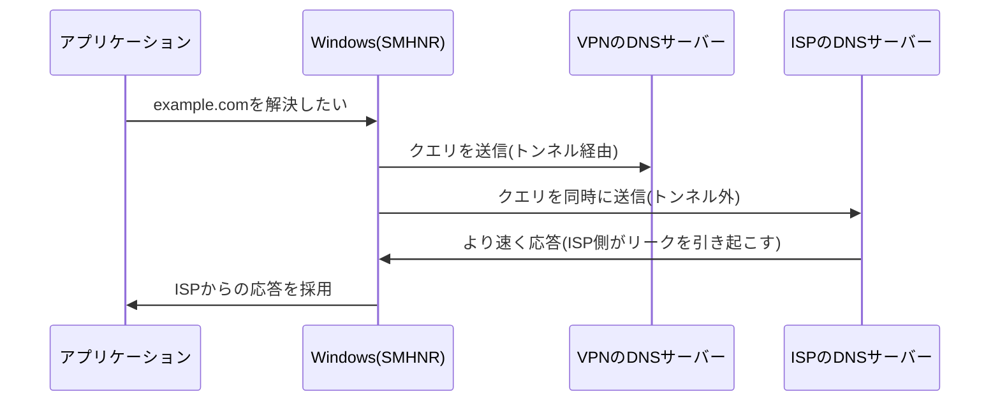

## はじめに

- **この記事で得られること**: [VPNのキルスイッチ](/articles/vpn-kill-switch-guide)で扱った、接続切断時のリークとは別の、**DNSリーク**という、VPNが完全に「接続済み」であっても発生し得る、まったく異なる種類の漏洩を体系的に理解します。
- **対象読者**: キルスイッチの仕組みは理解しているものの、DNSリークという、別の種類の漏洩がなぜ発生するのかを説明できない方を想定しています。
- **読むのにかかる想定時間**: 約18分

この記事は[『上位1%』シリーズ 全記事ガイド](/sitemap)の一部、[VPN学科(現代的VPNプロトコルシリーズ)](/sitemap#シリーズ一覧)の4.2本目です。

## 前提知識

- [VPNのキルスイッチ](/articles/vpn-kill-switch-guide): 「VPNが接続済みである」ことと、「すべての通信が保護されている」ことが、別々の保証であるという理解が前提になっています。

## 全体像をつかむ

**DNSリークは、VPNトンネルが完全に「接続済み」の状態であっても、DNSクエリだけが、トンネルの外にある別のDNSサーバー(多くの場合、ISPのDNSサーバー)へ漏れ続けてしまう現象**です。**キルスイッチが対処する「接続が切断された際のリーク」とは異なり、DNSリークは、接続が正常に機能している、まさにその最中に発生**します。**Windowsには、Smart Multi-Homed Name Resolutionという機能があり、利用可能なすべてのネットワークインターフェースへ、DNSクエリを同時に送信し、最も速く返ってきた応答を採用する、という設計になっており、これが意図的にこの漏洩を引き起こしてしまい**ます。

## 基礎から徹底解説

### なぜ、ISPのDNSサーバーの方が「速く」応答してしまうのか

**多くの場合、ISPのDNSサーバーは、物理的に近い場所にあり、暗号化やトンネリングのオーバーヘッドも一切発生しないため、VPNトンネル経由のDNSサーバーよりも、応答が速くなりがち**です。**Smart Multi-Homed Name Resolutionは、「速い方を使う」という、純粋な性能最適化の設計判断に基づいているため、VPNの存在を特別に考慮しているわけではなく、結果として、ほぼ確実にISP側の応答が採用されてしまい**ます。

### 対策:機能を無効化する、またはすべてのインターフェースに同じDNS設定を強制する

**Smart Multi-Homed Name Resolutionを無効化するには、グループポリシーで「スマートマルチホームネームレゾリューションを無効にする」を有効に設定する方法と、レジストリで`DisableSmartNameResolution`を1に設定する方法**があります(**どちらもWindows Home Editionでは利用できない機能がある**ことに注意してください)。**もう1つの対策は、すべてのネットワークインターフェースに対して、明示的に同じDNSサーバーを設定しておき、どちらが先に応答しても、結果が変わらないようにしておく**ことです。

この問題は、VPNソフトウェアの欠陥ではなく、OS自身の設計判断である

**DNSリークの原因は、多くの場合、VPNソフトウェア自体の欠陥ではなく、OSが持つ、パフォーマンス最適化のための、既存の設計判断**です。**VPN製品を選定・導入する際は、その製品自体のセキュリティだけでなく、動作するOS側に、この種の既存の挙動が存在しないかどうかも、合わせて確認する**必要があります。

## プロが見ている視点(上位1%の理解)

### 「接続されている」という状態には、複数の、独立した保護範囲が存在する

**VPNのキルスイッチの記事で扱った通り、「接続されている」ことと「保護されている」ことは別の話ですが、DNSリークは、さらにその一歩先で、「保護されている通信」の範囲そのものが、思っているより狭いことがある、という教訓**を示しています。**「このVPNは、具体的に、どの種類の通信を保護しているのか」を、一段掘り下げて、DNSクエリも含めて確認する**習慣が、上位1%のエンジニアの視点です。

## よくある誤解・つまずきポイント

- **誤解1: 「VPNが接続済みと表示されていれば、DNSクエリも含めて、すべての通信が保護されている」**
  WindowsのSmart Multi-Homed Name Resolutionのような機能により、DNSクエリだけが、トンネルの外へ漏れ続けることがあります。
- **誤解2: 「DNSリークは、VPNソフトウェア自体の欠陥が原因だ」**
  多くの場合、原因はVPNソフトウェア自体の欠陥ではなく、OSが持つ、パフォーマンス最適化のための既存の設計判断です。
- **誤解3: 「DNSリークとキルスイッチが対処する漏洩は、同じ種類の問題だ」**
  キルスイッチは接続切断時のリークに対処し、DNSリークは接続が正常に機能している最中に発生する、まったく異なる種類の漏洩です。

## 障害・トラブルシューティングの視点

1. **VPNが接続済みなのに、訪問したサイトがISP側に把握されている可能性がある**: DNSリークテストツールを使い、実際にどのDNSサーバーが応答しているかを確認します。
2. **WindowsでDNSリークを防ぎたい**: Smart Multi-Homed Name Resolutionを無効化するか、すべてのネットワークインターフェースに同じDNSサーバーを設定します。
3. **VPN製品を選定している**: その製品自体のセキュリティだけでなく、動作するOS側のDNS解決の挙動も、合わせて確認します。

## まとめ

- DNSリークは、VPNトンネルが完全に接続済みの状態であっても、DNSクエリだけがトンネルの外へ漏れてしまう現象です。
- WindowsのSmart Multi-Homed Name Resolutionは、すべてのネットワークインターフェースへ同時にDNSクエリを送り、最も速い応答を採用するため、意図的にこの漏洩を引き起こします。
- 対策には、この機能自体の無効化と、すべてのインターフェースへの同じDNS設定の強制という、2つの方法があります。
- この問題は、多くの場合、VPNソフトウェア自体の欠陥ではなく、OS側の既存の設計判断が原因です。

**今日から意識すべきこと**
1. VPN接続時は、DNSリークテストツールを使い、実際にDNSクエリが正しくトンネル経由になっているかを定期的に確認しましょう。
2. 「接続済み」という表示だけで安心せず、具体的にどの種類の通信が保護されているのかを、一段掘り下げて確認しましょう。

## 参考文献

- [DNS Leak | Wikipedia](https://en.wikipedia.org/wiki/DNS_leak)
- [Deactivate Smart Multi-Homed Name Resolution in Windows 8, 8.1, and 10 | OVPN](https://www.ovpn.com/en/blog/deactivate-smart-multi-homed-name-resolution-in-windows-8-8-1-and-10)
