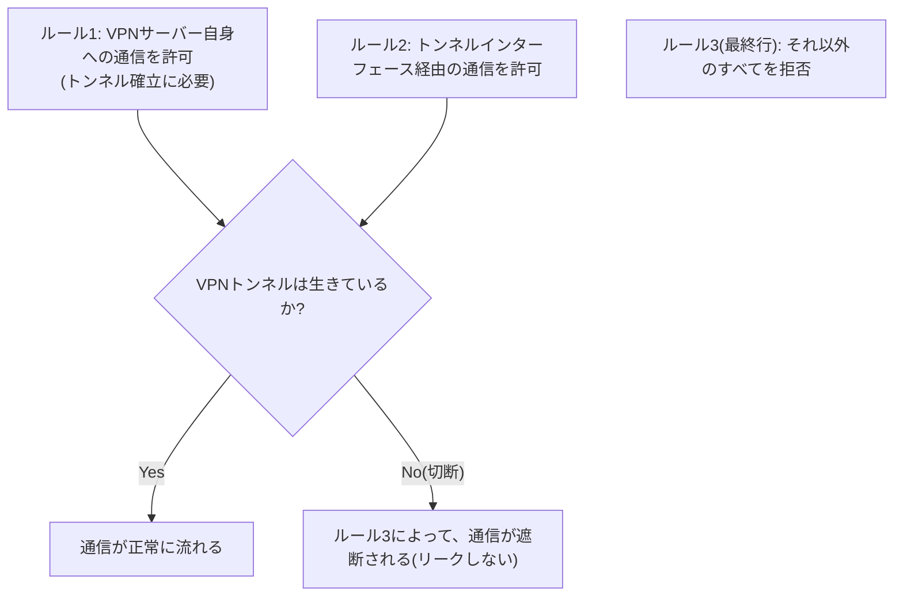

## はじめに

- **この記事で得られること**: VPN接続が予期せず切断されたときに通信が漏れることを防ぐ、**キルスイッチ**という機能が、実際には**VPNプロトコル自体の機能ではなく、ただのファイアウォールポリシーである**という正体を体系的に理解します。
- **対象読者**: VPNクライアントの「キルスイッチ」設定を見たことはあるものの、それが具体的にどういう仕組みで実現されているのかを説明できない方を想定しています。
- **読むのにかかる想定時間**: 約18分

この記事は[『上位1%』シリーズ 全記事ガイド](/sitemap)の一部、[VPN学科(現代的VPNプロトコルシリーズ)](/sitemap#シリーズ一覧)の4.1本目です。

## 全体像をつかむ

**キルスイッチは、VPN接続が予期せず切断されたときに、通信が暗号化されていない生のインターネット接続へこぼれ落ちてしまう「リーク」を防ぐための機能**です。**しかし、これはVPNプロトコル自体が持つ特別な機能ではなく、「VPNトンネル経由以外のすべての通信を、既定で拒否する」という、ごく普通のファイアウォールポリシーにすぎません。**

## 基礎から徹底解説

### キルスイッチの実体:3つのファイアウォールルールの組み合わせ

**キルスイッチを自分で構築する場合、典型的には、(1)VPNサーバー自身の宛先への通信を許可(トンネルの再確立に必要)、(2)トンネルインターフェース経由の通信を許可、(3)それ以外のすべてを拒否、という3つのルールの組み合わせ**になります。**トンネルが切断されると、通信は既定のルート(生のインターネット接続)を試みますが、ルール3によって、この試みそのものが遮断されます。**

### ルールの順序が、実際の動作を左右する

**ファイアウォールのルールは、多くの場合、上から順に評価され、最初にマッチしたルールが適用**されます。**「それ以外をすべて拒否」という最終ルールが、他の緩い許可ルールよりも下(後)に配置されていると、そちらが先にマッチしてしまい、拒否ルールが一切機能しない**ことがあります。**実際のトラブル報告でも、拒否ルールの位置そのものが原因だったケースが報告されて**います。

実際のテストでは、多くのキルスイッチが「失敗したら閉じる」を守れていない

**あるテストでは、VPNクライアントのプロセスをクラッシュさせる、ネットワークの切断・再接続、再起動といった、現実的な失敗シナリオの下で、組み込みのキルスイッチが、ほぼ常に、本来の役割を果たせていないことが確認**されました。**特に、OSのネットワークインターフェースが起動してから、VPNトンネルが確立するまでの、起動時の時間差の間にリークが発生する、というパターンが典型的な失敗要因**です。**キルスイッチをテストする際は、VPN接続を正常に切断するのではなく、あえてプロセスを強制終了させることが推奨されています。**

## プロが見ている視点(上位1%の理解)

### 「特別な機能に見えるもの」が、実際には「既存の仕組みの組み合わせ」であることがある

**キルスイッチという名前は、まるでVPN固有の特別な技術を想像させますが、実際には、ファイアウォールという、はるか以前から存在する、ごく普通の仕組みの組み合わせにすぎません。** **製品の機能名に引っ張られず、「これは実際には、どの既存の仕組みの組み合わせで実現されているのか」を一段掘り下げて確認する**習慣が、上位1%のエンジニアの視点です。

## よくある誤解・つまずきポイント

- **誤解1: 「キルスイッチは、VPNプロトコル自体に組み込まれた、特別な暗号機能だ」**
  キルスイッチは、VPNトンネル経由以外の通信を既定で拒否する、ごく普通のファイアウォールポリシーにすぎません。
- **誤解2: 「キルスイッチ機能を有効にしておけば、どんな状況でも確実にリークを防げる」**
  実際のテストでは、プロセスのクラッシュや再起動時に、多くの実装がリークを防げていないことが確認されています。
- **誤解3: 「VPN接続を正常に切断してテストすれば、キルスイッチの動作を正しく検証できる」**
  正常な切断では、クライアントが適切な後処理を行ってしまうため、実際のクラッシュを想定した、プロセスの強制終了によるテストが推奨されています。

## 障害・トラブルシューティングの視点

1. **キルスイッチを設定したはずなのに、VPN切断時に通信が漏れる**: 拒否ルールが、他の許可ルールより後(下)に配置されていないかを確認します。
2. **キルスイッチの動作を正しく検証したい**: 自分のパブリックIPアドレスを継続的に確認しながら、VPNプロセスを正常に切断するのではなく、強制終了させて挙動を確認します。
3. **再起動直後に、短時間だけ通信が漏れる**: OSのネットワークインターフェースが起動してからVPNトンネルが確立するまでの、起動時の時間差が原因である可能性があります。

## まとめ

- キルスイッチは、VPNプロトコル自体の機能ではなく、トンネル経由以外の通信を既定で拒否する、ファイアウォールポリシーです。
- 典型的には、VPNサーバーへの通信の許可、トンネル経由の通信の許可、それ以外すべての拒否という、3つのルールの組み合わせで実現されます。
- 拒否ルールの配置順序を誤ると、キルスイッチが実際には機能しなくなることがあります。
- 実際のテストでは、プロセスクラッシュや再起動時に、多くの実装がリークを防げていないことが確認されています。

**今日から意識すべきこと**
1. キルスイッチを導入する際は、実際にプロセスを強制終了させるテストで、動作を検証しましょう。
2. 製品の機能名に引っ張られず、「これは実際には、どの既存の仕組みで実現されているのか」を一段掘り下げて確認しましょう。

## 参考文献

- [VPN Kill Switch: What It Is, How It Works, and Why a Firewall Is Better | Windscribe](https://windscribe.com/blog/vpn-kill-switch/)
- [How to Test Your VPN Kill Switch | ipconfig.io](https://docs.ipconfig.io/guides/how-to-test-your-vpn-kill-switch)
