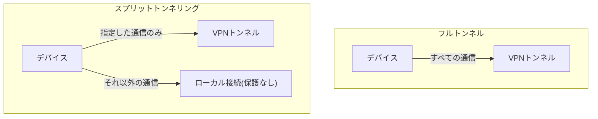

## はじめに

- **この記事で得られること**: [VPNのDNSリーク](/articles/vpn-dns-leak-guide)の先にある、**スプリットトンネリング**という、意図的に通信を切り分ける設定の仕組みと、そのトレードオフを体系的に理解します。
- **対象読者**: VPNに接続すると、通常はすべての通信がトンネルを通ると思っているものの、「スプリットトンネリング」という言葉を聞いたことがあり、その実態を説明できない方を想定しています。
- **読むのにかかる想定時間**: 約16分

この記事は[『上位1%』シリーズ 全記事ガイド](/sitemap)の一部、[現代的VPNプロトコル深掘りシリーズ](/sitemap#シリーズ一覧)の4.3本目です。

## 前提知識

- [VPNのDNSリーク](/articles/vpn-dns-leak-guide): VPNトンネルが「接続済み」であることと、個々の通信が実際に保護されているかどうかは別の話であるという理解が前提になっています。

## 全体像をつかむ

**フルトンネル(既定の構成)では、VPN接続中のすべての通信が、例外なくVPNトンネルを経由**します。**スプリットトンネリングは、これとは異なり、特定の宛先やアプリケーションの通信だけをVPNトンネルへ通し、それ以外の通信は、ローカルのネットワーク接続を使って、トンネルの外を直接流れるようにする設定**です。**この設定により、VPN接続中であっても、ローカルのプリンターやNAS、スマートホーム機器といった、同じローカルネットワーク上の機器へのアクセスを維持できる**という利便性が生まれます。

## 基礎から徹底解説

### トンネルの外を流れる通信には、VPNの保護が一切及ばない

**スプリットトンネリングで、VPNトンネルを通らないと設定された通信は、VPNによる暗号化・保護を一切受けません。** **これは、ISPや、利用しているネットワークの運営者、あるいは信頼できないネットワーク上の攻撃者から、その通信の内容が見える状態になる**ことを意味します。**さらに、企業環境では、スプリットトンネリングが、DNSフィルタリングやファイアウォールといった、企業側が敷いている保護機構そのものを回避する経路になってしまう**こともあります。

### 設定漏れが、意図しない情報漏洩を引き起こす

**本来VPNトンネルを通すべき重要なアプリケーションの通信を、スプリットトンネリングの設定に含め忘れると、そのアプリケーションの通信だけが、保護されないままローカル接続を経由して流れてしまいます。** **このデバイスは、組織が管理するVPN経由のネットワークと、ユーザーが現在接続しているローカルネットワークという、2つの異なる管理主体の経路に、同時に足をかけている状態になるため、ローカルネットワーク側からの不正アクセスにも、同時にさらされる**ことになります。

補足:フルトンネルにも、別のトレードオフがある

**フルトンネルは安全側に倒した既定の構成ですが、同じローカルネットワーク上にあるNASやスマートホームハブ、プリンターといった機器へのアクセスが、できなくなってしまう**という副作用を抱えています。**この問題への対処として、自分のローカルサブネットだけをスプリットトンネリングの対象から除外する、という限定的な使い方が、実務ではよく採用されます。**

## プロが見ている視点(上位1%の理解)

### 「VPNに接続している」ことは、「すべての通信が保護されている」ことと同義ではない

**スプリットトンネリングが有効な環境では、VPN接続中であっても、設定によってトンネルの外を流れている通信が必ず存在します。** **「VPNに接続しているから安全だ」という一言で満足せず、「今、具体的にどの通信がトンネルを通っていて、どの通信がトンネルの外を流れているのか」を、設定レベルで確認する**習慣が、上位1%のエンジニアの視点です。特定のユーザー・役割・宛先だけに限定してスプリットトンネリングを適用し、それ以外は既定でフルトンネルにしておく、という最小適用の方針が、実務では推奨されます。

## よくある誤解・つまずきポイント

- **誤解1: 「VPNに接続していれば、すべての通信が常に保護されている」**
  スプリットトンネリングが有効な場合、設定で除外された通信には、VPNの保護が一切及びません。
- **誤解2: 「スプリットトンネリングは、便利さだけをもたらす、リスクのない機能だ」**
  トンネルの外を流れる通信は暗号化されず、企業の保護機構を回避する経路にもなり得ます。
- **誤解3: 「フルトンネルにしておけば、何の問題も起きない」**
  フルトンネルでは、同じローカルネットワーク上の機器(NAS・プリンターなど)へのアクセスができなくなることがあります。

## 障害・トラブルシューティングの視点

1. **VPN接続中に、ローカルネットワーク上のプリンターやNASへアクセスできない**: フルトンネルが有効になっていないかを確認し、必要であればローカルサブネットをスプリットトンネリングの対象から除外します。
2. **VPN接続中のはずなのに、一部の通信の内容が外部から見えてしまう**: スプリットトンネリングの設定で、保護すべき宛先やアプリケーションが、トンネル対象から漏れていないかを確認します。
3. **企業のDNSフィルタリングやファイアウォールが、一部の端末だけ効いていない**: その端末でスプリットトンネリングが有効になっており、保護機構を回避する経路になっていないかを確認します。

## まとめ

- フルトンネルは、すべての通信がVPNトンネルを経由する既定の構成です。
- スプリットトンネリングは、特定の通信だけをトンネルへ通し、それ以外をローカル接続で直接流す設定です。
- トンネルの外を流れる通信には、VPNの保護が一切及びません。
- 実務では、特定の用途に限定してスプリットトンネリングを適用し、それ以外は既定でフルトンネルにしておく方針が推奨されます。

**今日から意識すべきこと**
1. スプリットトンネリングを設定する際は、保護すべき通信が、意図せずトンネル対象から漏れていないかを必ず確認しましょう。
2. 「VPNに接続している」という状態だけで満足せず、どの通信が実際にトンネルを通っているかを確認する習慣をつけましょう。

## 参考文献

- [VPN Split Tunneling and When to Use It | NinjaOne](https://www.ninjaone.com/blog/vpn-split-tunneling-and-when-to-use-it/)
- [Split Tunnel vs. Full Tunnel: Which Mode Should You Use? | Private Internet Access](https://www.privateinternetaccess.com/blog/split-tunnel-vs-full-tunnel/)
