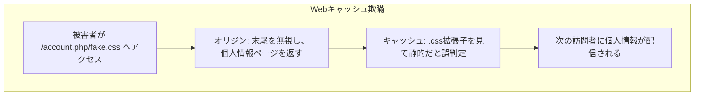
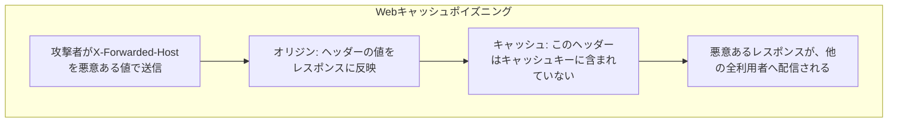

## はじめに

- **この記事で得られること**: [Cache-ControlとVaryヘッダーの仕組み](/articles/cache-control-vary-guide)で扱った、Varyヘッダーが「レスポンスが何によって変化するか」をキャッシュへ伝える仕組みの先にある、**Webキャッシュ欺瞞**(Web Cache Deception)と**Webキャッシュポイズニング**(Web Cache Poisoning)という、2つの異なる攻撃手法を体系的に理解します。
- **対象読者**: キャッシュの基本的な仕組みは理解しているものの、これらの攻撃がどのような前提の違いを悪用しているのかを説明できない方を想定しています。
- **読むのにかかる想定時間**: 約20分

この記事は[『上位1%』シリーズ 全記事ガイド](/sitemap)の一部、[Webプロキシ・キャッシュシリーズ](/sitemap#シリーズ一覧)の6.2本目です。

## 前提知識

- [Cache-ControlとVaryヘッダーの仕組み](/articles/cache-control-vary-guide): Varyヘッダーと、キャッシュキーという考え方の基本的な理解が前提になっています。

## 全体像をつかむ

**Webキャッシュ欺瞞は、キャッシュ層とオリジンサーバーが、同じURLを異なる方法で解釈してしまうことを悪用**します。**例えば`/account.php/nonexistent.css`というURLに対し、オリジンサーバーは末尾の余分なパスを無視して通常の`/account.php`として個人情報入りのページを返しますが、キャッシュ層は`.css`という拡張子だけを見て「これは静的なアセットだ」と判断し、この個人情報入りのレスポンスを、そのままキャッシュしてしまい**ます。**一方、Webキャッシュポイズニングは、レスポンスの内容が実際には変化する要素(ヘッダーやパラメータ)を、キャッシュキーに含めていないことを悪用**し、**攻撃者が1回だけ悪意あるリクエストを送れば、その悪意あるレスポンスが、以降そのURLへアクセスする他の利用者全員に配信され続け**ます。

## 基礎から徹底解説

### Webキャッシュ欺瞞:静的アセットの拡張子が、キャッシュ判定の唯一の根拠になっている

**多くのキャッシュ層は、URLの拡張子だけを見て、そのレスポンスをキャッシュすべきかどうかを判断**します。**しかし、オリジンサーバー側のルーティングが、URLの末尾に余分なパス情報が付いていても、それを無視して本来のエンドポイントとして処理してしまう場合、キャッシュ層とオリジンサーバーの間で、「このURLが指しているものは何か」という解釈が一致しなくなり**ます。**この解釈の不一致こそが、Webキャッシュ欺瞞を成立させる根本的な原因**です。

### Webキャッシュポイズニング:「キーに含まれていない入力」が、攻撃の入口になる

**キャッシュキーには、通常、URLパスとクエリパラメータの一部だけが含まれ、`X-Forwarded-Host`のようなヘッダーや、`utm_content`のような一部のクエリパラメータは、キーに含まれないことが一般的**です。**しかし、オリジンサーバーが、これらの「キーに含まれていない入力」の値を、実際にはレスポンスの内容(生成されるURLやリダイレクト先など)へ反映してしまっている場合、攻撃者は、悪意ある値を持つこれらの入力を使って、1回だけ悪意あるリクエストを送るだけで、そのレスポンスをキャッシュへ焼き付け、以降の全利用者へ配信**できます。

2024年の研究が明らかにした、パーサーの解釈の違いを悪用する、より広範な手法

**2024年に公開された研究では、さまざまなHTTPサーバーやプロキシが、巧妙に作成されたURLを、それぞれ異なる方法で解釈してしまうという、RFCの曖昧さに起因する問題が、多数のWebサイトとCDNプロバイダーに対して、任意のキャッシュポイズニングとキャッシュ欺瞞を成立させる手法として、体系的に明らかに**されました。**`;`・`?`・`#`のような区切り文字の解釈の違いも、同様の悪用パターンとして指摘されて**います。

## プロが見ている視点(上位1%の理解)

### 「キャッシュ層」と「オリジンサーバー」は、同じURLを、必ずしも同じ意味で解釈していない

**キャッシュとオリジンという、2つの異なるソフトウェアが、同じURLという文字列を、異なるルールで解釈する可能性がある、という前提そのものを持っていない設計者は、意外と多いものです。** **「このURLを、キャッシュ層とオリジンサーバーは、本当に同じ意味で解釈しているか」を、キャッシュを導入するたびに問い直す**習慣が、上位1%のエンジニアの視点です。

## よくある誤解・つまずきポイント

- **誤解1: 「Webキャッシュ欺瞞とWebキャッシュポイズニングは、同じ攻撃の別名だ」**
  Webキャッシュ欺瞞は、キャッシュ層とオリジンの解釈の不一致を悪用する攻撃、Webキャッシュポイズニングは、キャッシュキーに含まれていない入力を悪用する攻撃という、異なる仕組みを持つ攻撃です。
- **誤解2: 「レスポンスをキャッシュするかどうかの判断は、常にオリジンサーバーの指示通りに行われる」**
  多くのキャッシュ層は、URLの拡張子だけを見て、独自にキャッシュすべきかどうかを判断することがあります。
- **誤解3: 「Varyヘッダーで指定していない要素は、レスポンスの内容に一切影響しない」**
  オリジンサーバーが、Varyヘッダーで宣言していない入力の値を、実際にはレスポンスへ反映してしまっている場合があり、これがキャッシュポイズニングの入口になります。

## 障害・トラブルシューティングの視点

1. **個人情報を含むページが、意図せずキャッシュされてしまっている可能性がある**: URLの末尾に、静的アセットの拡張子を付けたリクエストを送り、オリジンサーバーが同じ動的コンテンツを返すかどうかを確認します。
2. **特定のヘッダーの値が、他の利用者のレスポンスに混入している**: そのヘッダーが、レスポンスの内容に影響を与えているにもかかわらず、キャッシュキーに含まれていないかを確認します。
3. **CDNの導入後、予期しないキャッシュの挙動が発生している**: キャッシュ層とオリジンサーバーが、URLのパス解釈について、本当に同じルールを共有しているかを確認します。

## まとめ

- Webキャッシュ欺瞞は、キャッシュ層とオリジンサーバーが同じURLを異なる方法で解釈することを悪用し、個人情報を含むページをキャッシュさせてしまう攻撃です。
- Webキャッシュポイズニングは、レスポンスが実際には変化する要素をキャッシュキーに含めていないことを悪用する攻撃です。
- 2024年の研究では、さまざまなHTTPサーバーやプロキシのURL解釈の違いが、これらの攻撃の広範な悪用パターンとして明らかにされました。
- キャッシュを導入する際は、キャッシュ層とオリジンサーバーが、同じURLを本当に同じ意味で解釈しているかを確認する必要があります。

**今日から意識すべきこと**
1. キャッシュを導入する際は、URLの拡張子だけでキャッシュ判定を行っていないか、オリジンサーバーの実際のルーティングと照らし合わせて確認しましょう。
2. レスポンスの内容に影響を与えるすべての入力が、キャッシュキーまたはVaryヘッダーに正しく反映されているかを確認しましょう。

## 参考文献

- [Gotta Cache 'Em All | PortSwigger Research](https://portswigger.net/research/gotta-cache-em-all)
