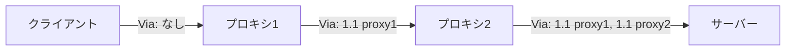

## はじめに

- **この記事で得られること**: [フォワードプロキシとリバースプロキシの違い](/articles/forward-reverse-proxy-guide)の先にある、**Viaヘッダー**という、HTTP仕様そのものが持つ、プロキシ経由の記録・ループ検出の仕組みを体系的に理解します。
- **対象読者**: X-Forwarded-Forヘッダーは知っているものの、Viaヘッダーという、HTTP仕様自身が定義している別のヘッダーの存在を知らない方を想定しています。
- **読むのにかかる想定時間**: 約15分

この記事は[『上位1%』シリーズ 全記事ガイド](/sitemap)の一部、[Webプロキシ/キャッシュ基礎シリーズ](/sitemap#シリーズ一覧)の1.2本目です。

## 前提知識

- [フォワードプロキシとリバースプロキシの違い](/articles/forward-reverse-proxy-guide): プロキシが、クライアントとサーバーの間に立つ中継者であるという概念の理解が前提になっています。

## 全体像をつかむ

**Viaヘッダーは、リクエストやレスポンスが実際にどのプロキシ(あるいはゲートウェイ)を経由したかを記録する、HTTP仕様(RFC 9110の前身であるRFC 7230)自身が定義している、標準のヘッダー**です。**各プロキシは、メッセージを転送する際、自分自身の情報をViaヘッダーへ追記していき、複数のプロキシを経由すると、カンマ区切りで経路の履歴が積み重なっていきます。** **これは、クライアントのIPアドレスを記録する、非標準のX-Forwarded-Forとは、記録する目的も対象もまったく異なるヘッダー**です。

## 基礎から徹底解説

### Viaヘッダーの書式と、ループ検出への応用

**Viaヘッダーの書式は、`[プロトコル名/]プロトコルバージョン ホスト名(またはプロキシの別名)`という形式で、複数のプロキシを経由する場合は、カンマで連結**されます。**例えば`Via: 1.0 fred, 1.1 p.example.net`であれば、まずHTTP/1.0のfredというプロキシを経由し、続いてHTTP/1.1のp.example.netを経由したことを示します。** **プロキシは、受け取ったリクエストのViaヘッダーに、自分自身の識別子がすでに含まれているかどうかを確認することで、意図しない転送ループを検出し、無限ループによるリソース消費を防ぐことができます。**

### X-Forwarded-Forとの、目的の違い

**X-Forwarded-Forは、プロキシの背後にいる、クライアントの本当のIPアドレスを記録するために使われる、非標準(ただし広く使われている)のヘッダーです。** **一方、Viaヘッダーが記録しているのは、クライアントのIPアドレスではなく、メッセージが経由したプロキシ自身の情報とプロトコルバージョンです。** **この2つは、「誰がリクエストしたか」(X-Forwarded-For)と「どの経路を通ったか」(Via)という、まったく異なる問いに答えるための、別々のヘッダー**です。

補足:実務では、ループ検出専用の別ヘッダーも登場している

**一部の実装では、Viaヘッダーを本来のループ検出以外の目的(HTTP/1.1の機能の一部を無効化する判定など)にも利用しているため、Viaヘッダーの存在だけでループ検出を行うと、意図しない副作用が生じることがあります。** **このため、CDN事業者間では、ループ検出専用の`CDN-Loop`という、別の新しいヘッダーを定義する動きも進んでいます。**

## プロが見ている視点(上位1%の理解)

### 「広く使われている」ことと「標準である」ことは、別の軸

**X-Forwarded-Forは、デファクトスタンダードとして広く使われていますが、HTTP仕様そのものが定義した標準ヘッダーではありません。Viaヘッダーは、地味で見落とされがちですが、HTTP仕様自身が標準として定義している、プロキシ経由を記録する仕組み**です。**「このヘッダーは広く使われているから標準だろう」と思い込まず、「このヘッダーは、HTTP仕様自身が定義したものか、実務での慣習として広まったものか」を区別する**習慣が、上位1%のエンジニアの視点です。

## よくある誤解・つまずきポイント

- **誤解1: 「Viaヘッダーは、クライアントのIPアドレスを記録するためのヘッダーだ」**
  クライアントのIPアドレスを記録するのはX-Forwarded-Forの役割であり、Viaヘッダーが記録するのは、経由したプロキシ自身の情報です。
- **誤解2: 「X-Forwarded-Forは、HTTP仕様が定義した標準ヘッダーだ」**
  X-Forwarded-Forは広く使われていますが、非標準のヘッダーです。HTTP仕様自身が定義しているのはViaヘッダーです。
- **誤解3: 「Viaヘッダーさえ確認すれば、転送ループを完全に検出できる」**
  一部の実装はViaヘッダーを別の目的にも使っているため、ループ検出専用の別ヘッダー(CDN-Loopなど)が新たに定義される動きもあります。

## 障害・トラブルシューティングの視点

1. **複数のプロキシを経由する構成で、意図しない無限ループが発生している**: 各プロキシが、Viaヘッダーで自分自身の識別子をすでに検出できているか、ループ検出の設定が有効になっているかを確認します。
2. **クライアントの本当のIPアドレスが分からない**: Viaヘッダーではなく、X-Forwarded-Forヘッダー(または標準化されたForwardedヘッダー)を確認します。
3. **リバースプロキシ構成で、Viaヘッダーに基づくループ検出が誤作動する**: その実装がViaヘッダーを別の目的にも利用していないか、ループ検出機能自体を無効化すべきかを検討します。

## まとめ

- Viaヘッダーは、HTTP仕様自身が定義している、プロキシ経由の履歴を記録する標準ヘッダーです。
- 複数のプロキシを経由すると、カンマ区切りで経路の履歴が積み重なります。
- Viaヘッダーは、自分自身の識別子の重複を確認することで、転送ループを検出できます。
- X-Forwarded-Forはクライアントの身元を、Viaヘッダーは経由した経路を記録する、目的の異なる別々のヘッダーです。

**今日から意識すべきこと**
1. プロキシチェーンのトラブルシューティングでは、X-Forwarded-ForとViaヘッダーの両方を確認し、それぞれが記録している対象を混同しないようにしましょう。
2. 複数のプロキシを経由する構成を設計する際は、Viaヘッダーによるループ検出が正しく機能しているかを確認しましょう。

## 参考文献

- [Via Header | MDN Web Docs](https://developer.mozilla.org/en-US/docs/Web/HTTP/Headers/Via)
- [Via and X-Forwarded-For Headers (Proxy Loop Prevention) | Skyhigh Security](https://success.skyhighsecurity.com/Skyhigh_Secure_Web_Gateway_(On-Prem)/Best_Practices/Proxy_Related/Via_and_X-Forwarded-For_Headers_(Proxy_Loop_Prevention))
