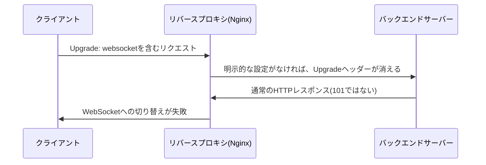

## はじめに

- **この記事で得られること**: [CONNECTメソッドの仕組み](/articles/http-connect-method-guide)で扱った、プロトコルの切り替えを依頼する仕組みの、もう1つの実例である、**WebSocketのUpgradeヘッダーが、リバースプロキシ経由でどう扱われるか**を体系的に理解します。
- **対象読者**: WebSocketの基本的な仕組みは理解しているものの、リバースプロキシ経由で接続すると、なぜ突然つながらなくなるのかを説明できない方を想定しています。
- **読むのにかかる想定時間**: 約18分

この記事は[『上位1%』シリーズ 全記事ガイド](/sitemap)の一部、[Webプロキシ・キャッシュシリーズ](/sitemap#シリーズ一覧)の3.2本目です。

## 前提知識

- [CONNECTメソッドの仕組み](/articles/http-connect-method-guide): クライアントがプロキシへ、プロトコルの解釈をやめて生のバイト列として中継するよう依頼する、という発想の理解が前提になっています。

## 全体像をつかむ

**WebSocketの接続は、最初は通常のHTTPリクエストとして始まり、`Upgrade: websocket`と`Connection: Upgrade`というヘッダーを使って、サーバーへ「これ以降はWebSocketプロトコルへ切り替えたい」と依頼**します。**しかし、`Upgrade`ヘッダーは、HTTPの仕様上、「ホップバイホップヘッダー」という分類に属しており、プロキシが次のホップ(バックエンドサーバー)へ、これを自動的に転送する義務を持ちません。** **Nginxのようなリバースプロキシは、既定ではバックエンドとHTTP/1.0で通信するため、この`Upgrade`ヘッダー自体を、明示的に設定しない限り、転送してくれません。**

## 基礎から徹底解説

### Nginxで、WebSocketを正しく中継するための明示的な設定

**Nginxで、Upgradeヘッダーを正しくバックエンドへ転送するには、`proxy_http_version 1.1;`に加え、`proxy_set_header Upgrade $http_upgrade;`と`proxy_set_header Connection "upgrade";`を、明示的に設定する必要**があります。**通常のHTTPリクエストとWebSocketの両方を、同じlocationブロックで受け付ける場合は、`$http_upgrade`の値に応じて`Connection`ヘッダーの値を切り替える、`map`ディレクティブを使うことが、公式ドキュメントで推奨されている方法**です。

### もう1つの落とし穴:アイドルタイムアウトによる、長時間接続の強制切断

**WebSocketは、長時間にわたって接続を維持し続ける性質を持ちますが、リバースプロキシの既定のタイムアウト設定(Nginxの`proxy_read_timeout`は既定60秒)は、その間にデータが一切流れない期間が続くと、接続を強制的に切断してしまい**ます。**対策としては、タイムアウトの値を大きく延長する方法と、アプリケーション側からWebSocketのPINGフレームを定期的に送信し、タイマーをリセットしつつ、接続が生きていることも確認する方法**があります。

診断の手がかり:成功時は101、失敗時は200か400

**WebSocketのハンドシェイクが成功すると、サーバーは`101 Switching Protocols`というステータスコードを返します。** **代わりに`200`や`400`が返ってきた場合、UpgradeヘッダーやConnectionヘッダーが、プロキシを経由する間に失われてしまっている可能性が高く、`proxy_set_header`の設定漏れを、まず疑うべき**です。

## プロが見ている視点(上位1%の理解)

### 「HTTPの仕様上、転送が保証されていないヘッダー」という分類が存在する

**多くのヘッダーは、プロキシを経由しても、特に意識せずに転送されますが、`Upgrade`のような「ホップバイホップヘッダー」は、HTTPの仕様自体が、転送を保証していません。** **新しい仕組みがプロキシ経由で動かないという症状に遭遇したときに、「これは、そもそもHTTPの仕様上、転送が保証されているヘッダーなのか」を、一段掘り下げて確認する**習慣が、上位1%のエンジニアの視点です。

## よくある誤解・つまずきポイント

- **誤解1: 「WebSocketのUpgradeヘッダーは、プロキシを経由しても自動的に転送される」**
  Upgradeヘッダーはホップバイホップヘッダーであり、Nginxのようなプロキシは、明示的な設定なしにこれを転送しません。
- **誤解2: 「WebSocketの接続が途中で切れるのは、アプリケーション側の実装の問題だ」**
  リバースプロキシの既定のアイドルタイムアウトが、データのやり取りがない期間に接続を強制的に切断していることが、よくある原因です。
- **誤解3: 「プロキシのタイムアウト設定を、ただ非常に大きな値にしておけば十分だ」**
  タイムアウトを大きくする代わりに、WebSocketのPINGフレームを使って、タイマーのリセットと接続の生存確認を同時に行う方法が、より確実な対策として推奨されています。

## 障害・トラブルシューティングの視点

1. **リバースプロキシ経由だと、WebSocketの接続が確立できない**: レスポンスのステータスコードが101になっているかを確認し、`proxy_set_header`でUpgrade/Connectionヘッダーが正しく設定されているかを確認します。
2. **WebSocketの接続が、一定時間後に突然切れる**: リバースプロキシのアイドルタイムアウト設定(`proxy_read_timeout`など)を確認し、必要であれば延長するか、PINGフレームの送信を検討します。
3. **通常のHTTPリクエストとWebSocketを、同じエンドポイントで両方受け付けたい**: `$http_upgrade`の値に応じてConnectionヘッダーを切り替える、mapディレクティブの利用を検討します。

## まとめ

- WebSocketは、UpgradeヘッダーとConnectionヘッダーを使い、通常のHTTPリクエストからプロトコルの切り替えを依頼します。
- Upgradeヘッダーはホップバイホップヘッダーであり、プロキシは明示的な設定なしにこれを転送しません。
- リバースプロキシの既定のアイドルタイムアウトが、長時間接続を強制的に切断することがあります。
- ハンズシェイク成功時は101、失敗時は200や400が返ることが、診断の手がかりになります。

**今日から意識すべきこと**
1. リバースプロキシ経由でWebSocketを動かす際は、Upgrade/Connectionヘッダーの転送設定を必ず確認しましょう。
2. 新しい仕組みがプロキシ経由で動かない場合、そのヘッダーがホップバイホップヘッダーに分類されていないかを確認しましょう。

## 参考文献

- [How to Proxy WebSocket Connections With Nginx | OneUptime](https://oneuptime.com/blog/post/2026-01-25-nginx-websocket-proxy/markdown)
- [WebSocket Proxying | NGINX Documentation](https://freenginx.org/hg/nginx-site/file/tip/xml/en/docs/http/websocket.xml)
