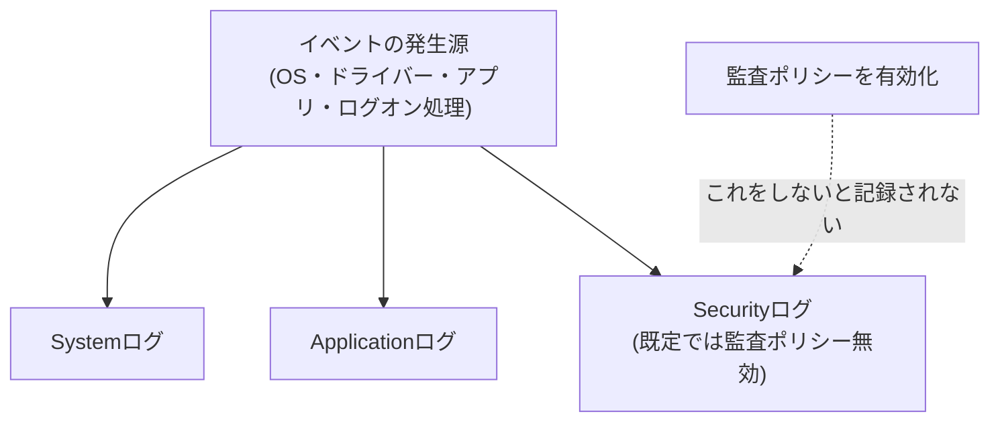

## はじめに

- **この記事で得られること**: Linuxの[journalctlでエラーログを調査する方法](/articles/linux-journalctl-guide)は、システムログをまとめて見るための窓口でした。この記事では、**Windowsにおける同じ役割を持つ、Event Viewer**(イベントビューアー)という仕組みを体系的に理解します。System・Application・Securityという3つの主要なログの違い、そして「イベントID」という番号の、見落とされがちな落とし穴を理解します。
- **対象読者**: Event Viewerを開いたことはあるものの、System・Application・Securityログの違いを説明できない、あるいは、セキュリティログがなぜ空なのかを説明できない方を想定しています。
- **読むのにかかる想定時間**: 約17分

この記事は[『上位1%』シリーズ 全記事ガイド](/sitemap)の一部、[Windows Server運用シリーズ](/sitemap#シリーズ一覧)の9本目です。

## 前提知識

- [journalctlでエラーログを調査する方法](/articles/linux-journalctl-guide): Linuxにおける、同じ役割を持つ仕組みの理解があると、この記事の内容がより明確になります。

## 全体像をつかむ

**Event Viewerには、目的がまったく異なる、複数のログが存在します。** 代表的な3つが、**System(OS自体やドライバーが記録するログ)**、**Application(個々のアプリケーションが記録するログ)**、**Security**(ログオンの成功・失敗やアクセス制御の監査結果を記録するログ)です。**このうちSecurityログだけは、既定では監査ポリシーが有効化されていないため、構築直後はほとんど空のまま**です。これは故障ではなく、「何を記録するか」を、管理者自身が明示的に選択しなければならない、という設計上の前提です。

## 基礎から徹底解説

### セキュリティログは、監査ポリシーを有効化しない限り、記録されない

**SystemログとApplicationログは、OSやアプリケーションが標準的な動作として自動的に記録しますが、Securityログは、「監査ポリシー」という、別の設定を明示的に有効化しない限り、ほとんどの項目が記録されません。** 例えば、ログオンの成功・失敗を記録したい場合、`gpedit.msc`または`auditpol.exe`から、対象の監査サブカテゴリを有効化する必要があります。**「セキュリティログを見ればすべて分かる」という前提は誤りであり、「見たい項目を、事前に記録対象として設定しておいたかどうか」が、すべての前提**になります。

### イベントIDは、「プロバイダー」単位でしか一意ではない

**イベントIDという番号は、Windows全体で一意なわけではありません。一意性が保証されているのは、あくまで「プロバイダー(そのログを発生させた機能やサービス)」の範囲内だけ**です。**同じ「イベントID 50」という番号が、NTFSのプロバイダーが発生させた場合と、Win32Timeのプロバイダーが発生させた場合とでは、まったく別の意味を持つ**という、実際に報告されている事例があります。

イベントIDだけで検索・フィルタすると、見当違いの原因にたどり着く

**「イベントID〇〇で検索すればよい」という考え方は、半分だけ正しく、半分は危険**です。**イベントIDと同時に、必ず「プロバイダー名(ソース名)」も確認し、両方が一致していることを確かめる**必要があります。PowerShellの`Get-WinEvent`コマンドレットでは、`-FilterHashtable`パラメータに`ProviderName`と`Id`を両方指定することで、この取り違えを防げます。

## プロが見ている視点(上位1%の理解)

### Event ViewerはWindows版のjournalctl、しかし「既定で記録される範囲」の設計思想が違う

**journalctlは、systemdが管理するほぼすべてのサービスのログを、既定で収集し続けます。一方、Windowsのセキュリティログは、既定では「何も記録しない」側に倒されており、管理者が明示的に監査ポリシーを有効化することで、初めて記録が始まります。** この違いは、**「できるだけ多くの情報を残しておき、後から絞り込む」という設計と、「必要な情報だけを、事前に選んで残す」という設計の、思想の違い**です。障害調査で「ログに何も残っていない」と感じたら、**そもそも、その項目を記録する設定が有効化されていたのかどうか**を、最初に確認することが、上位1%のエンジニアが持っている視点です。

## よくある誤解・つまずきポイント

- **誤解1: 「セキュリティログを見れば、ログオンの失敗はすべて分かる」**
  監査ポリシーが有効化されていない項目は、そもそもセキュリティログに記録されません。
- **誤解2: 「同じイベントIDなら、常に同じ意味を持つ」**
  イベントIDは、プロバイダー単位でしか一意性が保証されておらず、同じ番号が別のプロバイダーでは、まったく別の意味を持つことがあります。
- **誤解3: 「Event Viewerに何も表示されないなら、何も起きていない」**
  記録対象として設定されていない項目は、実際に発生していても、そもそも記録されません。

## 障害・トラブルシューティングの視点

1. **ログオンの失敗を調査したいのに、セキュリティログに何も記録されていない**: `auditpol.exe`または`gpedit.msc`で、対象の監査サブカテゴリが有効化されているかを確認します。
2. **イベントIDで検索した結果が、状況と噛み合わない**: そのイベントのプロバイダー名(ソース名)が、想定しているものと一致しているかを確認します。
3. **特定のイベントだけを、確実に取り出したい**: `Get-WinEvent`の`-FilterHashtable`で、`ProviderName`と`Id`を両方指定します。

## まとめ

- Event Viewerには、System・Application・Securityという、目的がまったく異なる複数のログが存在します。
- Securityログは、既定では監査ポリシーが有効化されていないため、構築直後はほとんど空のままです。
- イベントIDは、プロバイダー単位でしか一意性が保証されておらず、同じ番号が別の意味を持つことがあります。
- イベントIDとプロバイダー名を、常に組み合わせて確認する習慣が、見当違いの調査を防ぎます。

**今日から意識すべきこと**
1. セキュリティログに何も記録されていないときは、まず監査ポリシーの有効化状況を確認しましょう。
2. イベントIDで調査する際は、必ずプロバイダー名もあわせて確認する習慣をつけましょう。

## 参考文献

- [Windows event ID | NXLog](https://docs.nxlog.co/glossary/windows-event-id.html)
- [Windows Event Log | artifacts-kb](https://artifacts-kb.readthedocs.io/en/latest/sources/windows/EventLog.html)
