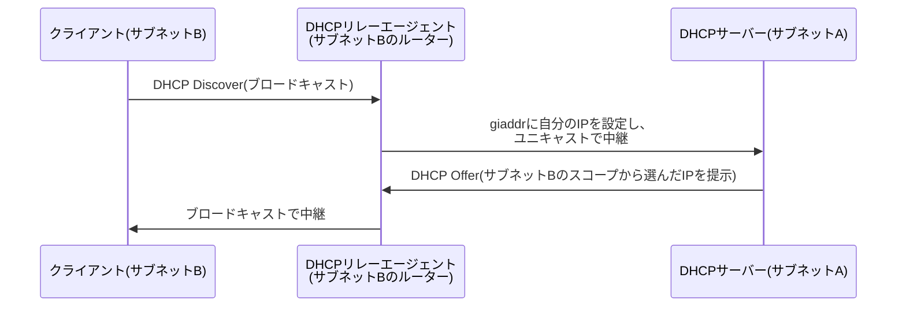

## はじめに

- **この記事で得られること**: 1台のDHCPサーバーで、本社の複数のVLAN・複数のサブネットにいる端末すべてへIPアドレスを配布したい、という実務上の要求があります。しかし、**DHCPの最初の問い合わせ(DHCP Discover)は、そもそもブロードキャストであり、既定ではルーターを越えて別のサブネットへ届きません。** この記事では、この矛盾を解決している**DHCPリレーエージェント**という、ブロードキャストをユニキャストへ変換して中継する仕組みと、**`giaddr`という1つのフィールドが、DHCPサーバーに「どのサブネットからの要求か」を伝えている**実態を体系的に理解します。
- **対象読者**: DHCPサーバーが、クライアントへIPアドレスを配布するという基本的な動作は理解しているものの、複数のサブネットにまたがる環境で、1台のDHCPサーバーがどのように機能しているのかを説明できない方を想定しています。
- **読むのにかかる想定時間**: 約17分

この記事は[『上位1%』シリーズ 全記事ガイド](/sitemap)の一部、[Windows Server運用シリーズ](/sitemap#シリーズ一覧)の2.1本目です。

## 前提知識

- [Windows ServerでNTPサーバーを構築する際の設定値](/articles/windows-ntp-server-guide): Windows Serverが、ネットワークサービスの役割を複数持てるという理解が前提になっています。

## 全体像をつかむ

**DHCPクライアントが電源投入時に送信する最初の問い合わせ(DHCP Discover)は、宛先IPアドレスが`255.255.255.255`、宛先MACアドレスが`ff:ff:ff:ff:ff:ff`という、同一セグメント内の全端末に向けた、ブロードキャストパケットです。** **ブロードキャストは、その性質上、既定ではルーター(L3機器)を越えて、別のサブネットへ転送されません。** つまり、**DHCPサーバーを本社の1つのサブネットにだけ設置した場合、そのままでは、別のVLANやサブネットにいるクライアントからのDHCP Discoverは、DHCPサーバーまで到達しません。** この問題を解決するのが、**DHCPリレーエージェント**です。

## 基礎から徹底解説

### DHCPリレーエージェントが、ブロードキャストをユニキャストへ変換する

**DHCPリレーエージェントは、クライアントと同じサブネット上に存在し、クライアントが送信したDHCPのブロードキャストパケットを受け取ると、それを、あらかじめ設定されたDHCPサーバーのIPアドレス宛てに、ユニキャストパケットとして転送し直します。** この際、リレーエージェントは、受け取ったパケットの`giaddr`(Gateway IP Address)という**フィールドに、自分自身(リレーエージェント)のIPアドレスを書き込みます。** **DHCPサーバーは、この`giaddr`フィールドを見ることで、「このリクエストは、どのサブネットから来たものか」を正確に判断でき、そのサブネットに対応する、正しいスコープ(IPアドレスの配布範囲)からアドレスを選んで応答を返すことができます。** サーバーからの応答も、`giaddr`に書かれたリレーエージェントのIPアドレス宛てに、ユニキャストで送り返され、リレーエージェントが、それを再びクライアントのサブネットへブロードキャストで中継します。

Windows ServerにおけるDHCPリレーエージェントの実体

Windows Server環境では、**DHCPリレーエージェントの機能は、RRAS(ルーティングとリモートアクセス)の一部として提供されます。** 多くの実務環境では、専用のL3スイッチやルーター側で、Ciscoの`ip helper-address`のような機能を使ってリレーを行うのが一般的ですが、専用のネットワーク機器を用意できない小規模な環境では、Windows Server自身にRRASの役割を追加し、DHCPリレーエージェントとして動作させることも可能です。

### なぜDHCPサーバーを、すべてのサブネットに個別に置かないのか

**「各サブネットに、それぞれ専用のDHCPサーバーを置けばよいのではないか」という発想もありえますが、実務ではDHCPリレーエージェントを使い、1台(または少数)のDHCPサーバーに集約する構成が広く採用されています。** 理由は、**スコープの設定・IPアドレスの利用状況の確認・予約の管理といった運用作業を、1か所に集約できる**ためです。サブネットの数が増えるたびに、個別のDHCPサーバーを構築・保守する手間と比べると、**ルーター側にリレーエージェントの設定を1行追加するだけで、既存のDHCPサーバーの管理対象を拡張できる**リレーエージェント方式の方が、運用コストの面で優れています。

## プロが見ている視点(上位1%の理解)

### DHCPサーバー自体の冗長化は、リレーエージェントとは別の問題

**DHCPリレーエージェントが解決しているのは、「ブロードキャストがサブネットを越えられない」という到達性の問題であり、「DHCPサーバー自体が1台しかなく、単一障害点になっている」という冗長性の問題は、まったく別に対処する必要があります。** 歴史的には、1つのスコープを2台のDHCPサーバーへ、重複しないIPアドレス範囲で分割して登録する「80/20ルール」(主系に80%、副系に20%を割り当てる)という運用上の工夫が広く使われていました。**現代のWindows Serverでは、DHCPフェイルオーバーという標準機能により、2台のDHCPサーバー間でリース情報そのものをリアルタイムに同期し、片方が停止しても、残った1台がシームレスに応答を継続できる**ようになっています。**リレーエージェントによる到達性の確保と、フェイルオーバーによる冗長性の確保は、まったく別の軸の設計判断であり、両方を組み合わせて初めて、実務で求められる可用性が実現します。**

## よくある誤解・つまずきポイント

- **誤解1: 「DHCPサーバーを1台立てれば、ネットワーク内のどこからでも自動的にIPアドレスが配布される」**
  DHCP Discoverはブロードキャストであり、既定ではルーターを越えません。別のサブネットへ配布するには、DHCPリレーエージェントの設定が別途必要です。
- **誤解2: 「`giaddr`は、クライアント自身のIPアドレスを表すフィールドだ」**
  `giaddr`は、クライアントのIPアドレスではなく、中継を行ったリレーエージェント自身のIPアドレスを表すフィールドであり、DHCPサーバーがスコープを選ぶための判断材料です。
- **誤解3: 「DHCPリレーエージェントを設定すれば、DHCPサーバーの冗長化も自動的に実現される」**
  リレーエージェントは到達性の問題を解決するだけであり、DHCPサーバー自体の冗長化には、DHCPフェイルオーバーなど、別の仕組みが必要です。

## 障害・トラブルシューティングの視点

1. **特定のサブネットの端末だけ、DHCPによるIPアドレスの取得に失敗する**: そのサブネットのルーター側で、DHCPリレーエージェント(`ip helper-address`相当)が、正しいDHCPサーバーのIPアドレスを指して設定されているかを確認します。
2. **DHCPサーバーのログで、想定と異なるスコープからIPアドレスが配布されている**: リレーエージェントの`giaddr`に書かれているIPアドレスと、DHCPサーバー側のスコープ設定の対応関係を確認します。
3. **DHCPサーバーが1台停止すると、その配下の端末全体がIPアドレスを更新できなくなる**: DHCPフェイルオーバーが構成されているか、構成されている場合はその同期状態を確認します。

## まとめ

- DHCP Discoverはブロードキャストパケットであり、既定ではルーターを越えて別のサブネットへ届きません。
- DHCPリレーエージェントは、クライアントのブロードキャストを受け取り、ユニキャストに変換してDHCPサーバーへ中継します。
- `giaddr`フィールドにリレーエージェント自身のIPアドレスが書き込まれることで、DHCPサーバーは要求元のサブネットを判断し、正しいスコープから応答できます。
- DHCPリレーエージェントは到達性の問題を解決するものであり、DHCPサーバー自体の冗長化(DHCPフェイルオーバーなど)とは別の軸の設計判断です。

**今日から意識すべきこと**
1. 複数サブネットにまたがる環境でDHCPを構成する際は、各サブネットのルーター側にDHCPリレーエージェントの設定が必要であることを、計画の初期段階で確認しましょう。
2. DHCPサーバーの可用性を検討する際は、到達性(リレーエージェント)と冗長性(フェイルオーバー)という、2つの別々の軸で設計しましょう。

## 参考文献

- [RFC 2131: Dynamic Host Configuration Protocol](https://www.rfc-editor.org/rfc/rfc2131)
- [DHCP relay agent | Microsoft Learn](https://learn.microsoft.com/en-us/windows-server/networking/technologies/dhcp/dhcp-relay-agent)
