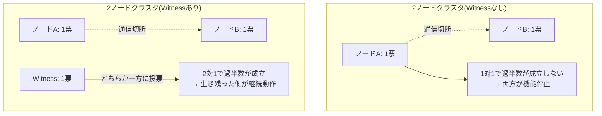

## はじめに

- **この記事で得られること**: [DFS名前空間とDFSレプリケーション](/articles/windows-server-dfs-guide)は、複数のファイルサーバー間でファイルを複製する仕組みでした。この記事では、SQL ServerやHyper-Vのような、**状態を持つサービスを高可用化**するための、まったく別の仕組みである**WSFC**(Windows Server Failover Clustering)と、その中核にある**クォーラム**(Quorum)という多数決の仕組みを体系的に理解します。
- **対象読者**: クラスタリングという言葉は聞いたことがあるものの、2ノードクラスタに「目撃者(Witness)」という、第三の存在が必要とされる理由を説明できない方を想定しています。
- **読むのにかかる想定時間**: 約18分

この記事は[『上位1%』シリーズ 全記事ガイド](/sitemap)の一部、[Windows Server運用シリーズ](/sitemap#シリーズ一覧)の10.1本目です。

## 前提知識

- [DFS名前空間とDFSレプリケーション](/articles/windows-server-dfs-guide): 複数サーバーを組み合わせる、別の種類の仕組みの理解があると、WSFCとの違いがより明確になります。

## 全体像をつかむ

**WSFC(Windows Server Failover Clustering)は、複数のサーバー(ノード)を束ね、1台が故障しても、サービスを別のノードへ自動的に引き継ぐ、高可用性の仕組み**です。**ここで重大な問題が発生します。ノード間の通信が、ネットワークの問題で切断された場合、それぞれのノードは、「自分だけが生き残った」と誤認してしまう可能性があり、両方が同時にサービスを提供し始めると、データが矛盾した状態(スプリットブレイン)になってしまいます。** **この矛盾を防ぐため、WSFCは、「クォーラム(過半数)」という投票の仕組みを使い、過半数の票を得られたノード群だけが、実際にサービスを提供することを許可**します。

## 基礎から徹底解説

### なぜ、2ノードクラスタだけでは、過半数が成立しないのか

**クォーラムは、「全投票権の過半数」を得たノード群だけが、クラスタとして動作を続けることを許可する仕組み**です。**ノードが2台しかない場合、ノード間の通信が切断されると、どちらのノードも1票しか持たず、1対1では、どちらも過半数(2票中2票、または50%を超える票)を得ることができません。** この状態では、WSFCは、安全側に倒れ、**両方のノードが、サービスの提供を停止**してしまいます。

### Witness(目撃者):3人目の投票権を提供する

**この問題を解決するのが、Witness(目撃者)という、クラスタのリソースを一切提供しないものの、1票だけを持つ、第三の投票者**です。Witnessには、ファイル共有(File Share Witness)、専用ディスク(Disk Witness)、クラウドストレージ(Cloud Witness)という、複数の実装方法があります。**Witnessが、生き残った側のノードへ投票することで、2対1という、明確な過半数が成立し、サービスの継続が可能**になります。

Dynamic Quorumは便利だが、Witnessの代わりにはならない

**Windows Server 2012 R2以降の既定機能であるDynamic Quorumは、ノードが1台ずつ、順番に失われていく状況では、自動的に投票権を調整し、クォーラムを維持しやすくしてくれます。** **しかし、サイト全体が一度に失われるような、同時多発的な障害には対応できません。** また、2ノードクラスタでWitnessを使わない場合、Dynamic Quorumは、あらかじめどちらかのノードの投票権を奪っておく、という挙動をすることがあり、**たまたまメンテナンスで停止させたノードが、投票権を持つ側だった場合、残ったノードは、単独では過半数を得られず、フェイルオーバーが機能しない**という、実務上の落とし穴があります。Microsoftの現在の推奨は、2ノードクラスタには、常にWitnessを使用することです。

## プロが見ている視点(上位1%の理解)

### クォーラムは、「誰が正しいか」ではなく、「誰が多数派か」を機械的に決める仕組み

**クォーラムの仕組みは、「どちらのノードが技術的に正常か」を判断しているわけではありません。単純に、「過半数の票を集められた側」を、正当なクラスタとして扱う、機械的なルール**です。**この設計思想を理解していると、「技術的には健全なはずのノードが、なぜサービスを提供できないのか」という、直感に反する状況に遭遇したときも、冷静に、票の数という、別の軸で原因を特定できる**ようになります。

## よくある誤解・つまずきポイント

- **誤解1: 「2ノードクラスタは、Witnessがなくても、Dynamic Quorumがあれば十分に安全だ」**
  Dynamic Quorumは順次的な障害には対応できますが、たまたま投票権を持つノードがメンテナンスで停止すると、フェイルオーバーが機能しないという落とし穴があります。
- **誤解2: 「Witnessは、クラスタのリソースそのものを提供している」**
  Witnessは、クラスタリソースを提供せず、クォーラムの判断に使う1票だけを提供します。
- **誤解3: 「クォーラムは、技術的にどちらのノードが正常かを判断している」**
  クォーラムは、技術的な正常性ではなく、単純に過半数の票を得られたかどうかだけを判断する、機械的なルールです。

## 障害・トラブルシューティングの視点

1. **2ノードクラスタで、片方のノードをメンテナンスのために停止したら、フェイルオーバーが機能しなかった**: Dynamic Quorumが、そのノードの投票権を、残ったノードから奪っていた可能性を確認します。
2. **クラスタ全体が、意図せず機能停止した**: ノード間通信の切断と、Witnessへの接続状況を確認します。
3. **Witnessを追加すべきかどうか迷っている**: 2ノードクラスタであれば、現在の推奨に従い、常にWitnessを追加することを検討します。

## まとめ

- WSFCは、ノードが故障してもサービスを継続する、高可用性の仕組みです。
- クォーラムは、過半数の票を得たノード群だけに、サービス提供を許可する仕組みで、スプリットブレインを防ぎます。
- 2ノードクラスタでは、通信切断時に1対1となり、過半数が成立しないため、Witnessという3人目の投票者が必要です。
- Dynamic Quorumは便利ですが、2ノードクラスタにおけるWitnessの代わりにはなりません。

**今日から意識すべきこと**
1. 2ノードクラスタを構築する際は、常にWitnessを追加しましょう。
2. クラスタの障害調査では、「技術的な正常性」ではなく、「票の数」という軸でも原因を確認しましょう。

## 参考文献

- [Define Windows Server Failover Cluster | Microsoft Learn](https://learn.microsoft.com/en-us/training/modules/implement-windows-server-failover-cluster/2-define-windows-server-failover-cluster)
- [Understanding Cluster and Pool Quorum | Microsoft Learn](https://learn.microsoft.com/azure-stack/hci/concepts/quorum)
