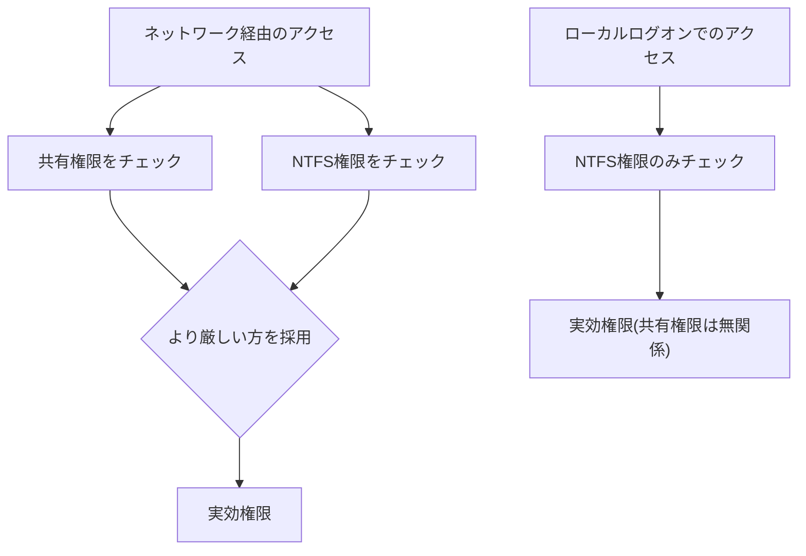

## はじめに

- **この記事で得られること**: [DFS名前空間とDFSレプリケーションの仕組み](/articles/windows-server-dfs-guide)の前提となる、ファイルサーバー1台が持つ、**NTFS権限**と**共有権限**という、2つの独立した権限システムが、どう組み合わさって実効権限を決めるのかを体系的に理解します。
- **対象読者**: NTFS権限と共有権限、それぞれの設定方法は知っているものの、両方が設定されている場合に、実際にどちらが優先されるのかを説明できない方を想定しています。
- **読むのにかかる想定時間**: 約16分

この記事は[『上位1%』シリーズ 全記事ガイド](/sitemap)の一部、[Windows Server運用シリーズ](/sitemap#シリーズ一覧)の9.1本目です。

## 全体像をつかむ

**Windowsのファイル共有には、まったく独立した2つの権限システムが存在します。NTFS権限は、ファイルシステムそのものに付与される権限で、ローカルアクセスにもネットワークアクセスにも適用されます。共有権限は、共有フォルダーという『入口』に付与される権限で、ネットワーク経由のアクセスにのみ適用されます。** **ネットワーク越しにアクセスする場合、この2つの権限が両方チェックされ、より厳しい(制限の強い)方が、実効権限として採用**されます。

## 基礎から徹底解説

### 「より厳しい方が勝つ」の具体例

**例えば、共有権限が「読み取り」、NTFS権限が「変更」に設定されている場合、ネットワーク越しにアクセスしたユーザーの実効権限は、より厳しい方である「読み取り」になります。** **しかし、同じユーザーが、そのサーバーへ直接ログオンしてローカルにアクセスした場合は、共有権限は一切関与せず、NTFS権限である「変更」がそのまま適用されます。** **「ネットワーク越しには読み取りしかできないのに、サーバーへ直接ログオンすると書き込める」という現象は、設定ミスではなく、この2層構造が正しく機能している証拠です。**

### グループ所属による権限の加算と、Denyの絶対的な優先順位

**ユーザー自身に付与された権限と、そのユーザーが所属するグループに付与された権限は、同じ権限システム内では、加算(より緩い方が有効)されます。** **例えば、ユーザー自身には「読み取り」しか付与されていなくても、所属するグループに「変更」が付与されていれば、そのユーザーの実効権限は「変更」になります。** **ただし、この加算のルールより常に優先されるのが、明示的な拒否(Deny)です。どれだけ多くの許可(Allow)が積み重なっていても、1つでも明示的な拒否が存在すれば、その項目に関しては拒否が優先**されます。

補足:実効アクセスを正確に確認する方法

**Windowsには、NTFSの「セキュリティの詳細設定」ダイアログに、「実効アクセス」というタブが用意されており、特定のユーザーやグループが、最終的にどの権限を持つことになるのかを、NTFS権限単体で確認**できます。**ただし、このタブは共有権限を考慮しないため、ネットワーク越しの実効権限を完全に確認するには、共有権限も別途確認する必要**があります。

## プロが見ている視点(上位1%の理解)

### 「権限が足りない」という障害は、2つの独立した場所を疑う

**NTFS権限と共有権限は、まったく独立した2つのシステムであるにもかかわらず、両方が同じ「アクセスできない」という症状を引き起こすため、トラブルシューティングの際に混同されがちです。** **「このユーザーはアクセスできるはずなのに、できない」という障害に遭遇したときは、NTFS権限だけ、あるいは共有権限だけを確認するのではなく、「ネットワーク越しのアクセスなのか、ローカルアクセスなのか」を最初に切り分け、該当する権限システムの両方(またはNTFS単体)を、系統立てて確認する**習慣が、上位1%のエンジニアの視点です。

## よくある誤解・つまずきポイント

- **誤解1: 「共有権限を『フルコントロール』にしておけば、NTFS権限は気にしなくていい」**
  ネットワーク越しのアクセスでは、より厳しい方の権限が採用されるため、NTFS権限が厳しければ、共有権限をフルコントロールにしても無意味です。
- **誤解2: 「サーバーへ直接ログオンした場合も、共有権限がアクセスを制限する」**
  共有権限はネットワーク経由のアクセスにのみ適用され、ローカルログオンではNTFS権限のみが適用されます。
- **誤解3: 「グループに付与された拒否(Deny)は、個人に付与された許可(Allow)より弱い」**
  明示的な拒否は、同じ権限システム内のどの許可よりも常に優先されます。

## 障害・トラブルシューティングの視点

1. **ネットワーク越しにはアクセスできないが、サーバーへ直接ログオンするとアクセスできる**: 共有権限がNTFS権限より厳しく設定されていないかを確認します。
2. **ユーザー自身の権限を確認したのに、実際のアクセス結果と食い違う**: そのユーザーが所属するすべてのグループの権限、特に明示的な拒否(Deny)が設定されていないかを確認します。
3. **実効権限を正確に把握したい**: NTFSの「実効アクセス」タブで確認し、さらに共有権限を別途確認して、両方の結果を組み合わせます。

## まとめ

- NTFS権限と共有権限は、まったく独立した2つの権限システムです。
- ネットワーク越しのアクセスでは、両方のうちより厳しい方が実効権限になります。
- ローカルログオンでは、共有権限は無関係で、NTFS権限のみが適用されます。
- 同じ権限システム内では、グループの権限が加算されますが、明示的な拒否は常に優先されます。

**今日から意識すべきこと**
1. 「アクセスできない」という障害では、まずネットワーク越しかローカルかを切り分けましょう。
2. 共有権限は基本的にフルコントロールにしておき、実際の制御はNTFS権限で行う、という設計方針を検討しましょう。

## 参考文献

- [NTFS vs. Share Permissions in Windows | MCSI Library](https://mcsi-library.readthedocs.io/articles/2023/09/ntfs-vs-share-permissions/ntfs-vs-share-permissions.html)
- [Understanding File and Folder Permissions in Windows | Dell](https://www.dell.com/support/kbdoc/en-in/000137238/understanding-file-and-folder-permissions-in-windows)
