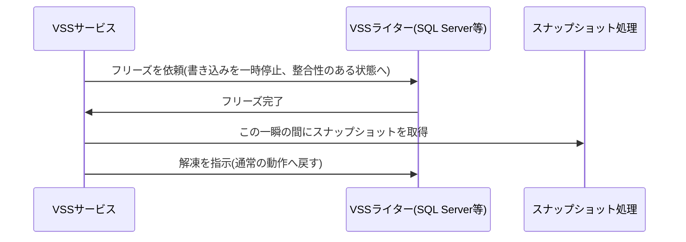

## はじめに

- **この記事で得られること**: [シャドウコピー(VSS)の仕組み](/articles/windows-server-vss-guide)で扱った、コピーオンライトというブロック単位のスナップショット技術の先にある、**VSSライター**という、アプリケーション側の協調の仕組みを体系的に理解します。
- **対象読者**: VSSによるスナップショットの仕組みは理解しているものの、バックアップが「アプリケーション整合性」を持つために、何が必要なのかを説明できない方を想定しています。
- **読むのにかかる想定時間**: 約18分

この記事は[『上位1%』シリーズ 全記事ガイド](/sitemap)の一部、[Windows Serverシリーズ](/sitemap#シリーズ一覧)の5.2本目です。

## 前提知識

- [シャドウコピー(VSS)の仕組み](/articles/windows-server-vss-guide): コピーオンライトという、ブロック単位のスナップショット技術の理解が前提になっています。

## 全体像をつかむ

**コピーオンライトは、ブロック単位では完璧に正確なスナップショットを作れますが、そのスナップショットが取られた、まさにその瞬間に、SQL ServerやExchangeのようなアプリケーションが、ちょうどデータの書き込み処理の途中だった場合、復元後にアプリケーションが正常に起動できない、壊れたデータになってしまう可能性**があります。**VSSライターは、スナップショットを取る直前に、登録されている各アプリケーションへ「フリーズ」(書き込みを一時停止し、整合性のある状態になる)を依頼し、その一瞬の間にスナップショットを取り、直後に「解凍」(通常の動作へ戻す)を指示する、アプリケーション側の協調の仕組み**です。

## 基礎から徹底解説

### 診断コマンド:vssadmin list writers

**各VSSライターの現在の状態を確認するには、管理者権限で`vssadmin list writers`を実行**します。**正常であれば「Stable」という状態が表示されますが、「Failed」(失敗)や「Retryable error」(再試行可能なエラー)、「Waiting for completion」(完了待ち)といった、異常な状態が表示されることがあり**ます。

### SQL Serverライターが一覧に表示されない、または失敗する場合

**SQL Serverのライターが、そもそも一覧に表示されない場合、データベース名に末尾の空白を含むスペースが含まれていないか、そしてSQL Server VSS Writerサービスのアカウントが、SQL Server側でsysadmin権限を持っているかを確認**します。**ライターが「Failed」と表示されている場合は、Windowsのアプリケーションイベントログで、`SQLWRITER`という記録元からのエラーを確認**します。

対処の基本パターン:サービスの再起動、それでも解決しない場合は再起動が必要

**典型的な対処は、該当ライターのサービスを停止し、30秒ほど待ってから再起動し、必要であればVolume Shadow CopyサービスとMicrosoft Software Shadow Copy Providerサービスも再起動する**という手順です。**ただし、これでも解決しない場合は、サーバー自体の再起動が必要になることもあり、同じ失敗が繰り返されるのであれば、その根本原因を別途調査する必要**があります。

## プロが見ている視点(上位1%の理解)

### 「スナップショットが取れた」ことと、「そのスナップショットから正常に復元できる」ことは、別の保証である

**ブロック単位のコピーオンライトという技術が、技術的に完璧に機能していても、その瞬間にアプリケーションが整合性のある状態になっていなければ、復元後に使えないデータになってしまいます。** **「このバックアップは、クラッシュコンシステント(単にその瞬間のディスクの状態を保存しただけ)なのか、それともアプリケーションコンシステント(アプリケーション側の協調を経た、整合性のある状態)なのか」を、バックアップの仕組みを設計するたびに問い直す**習慣が、上位1%のエンジニアの視点です。

## よくある誤解・つまずきポイント

- **誤解1: 「VSSによるスナップショットが成功すれば、バックアップは必ず正常に復元できる」**
  ブロック単位のスナップショットが成功しても、アプリケーション側のVSSライターが正しく協調していなければ、復元後に壊れたデータになる可能性があります。
- **誤解2: 「VSSライターの状態確認は、バックアップソフトウェアに任せておけば十分だ」**
  `vssadmin list writers`を直接実行し、各ライターの状態を確認することが、バックアップの信頼性を自分自身で検証するための、基本的な手段です。
- **誤解3: 「ライターのサービスを再起動すれば、必ず問題が解決する」**
  サービスの再起動で解決しない場合は、サーバー自体の再起動が必要になることがあり、同じ失敗が繰り返されるなら、根本原因の調査が必要です。

## 障害・トラブルシューティングの視点

1. **バックアップは成功しているはずなのに、復元したデータベースが起動しない**: `vssadmin list writers`で、バックアップ時のライターの状態が「Stable」だったかを確認します。
2. **SQL Serverのライターが一覧に表示されない**: データベース名に末尾の空白が含まれていないか、サービスアカウントがsysadmin権限を持っているかを確認します。
3. **ライターが「Failed」のまま、サービス再起動でも解決しない**: Windowsのアプリケーションイベントログで、該当ライターのエラー記録元からの詳細を確認し、根本原因を特定します。

## まとめ

- VSSライターは、スナップショットの直前にアプリケーションへフリーズを依頼し、整合性のある状態でスナップショットを取るための、アプリケーション側の協調の仕組みです。
- `vssadmin list writers`を実行し、各ライターの状態が「Stable」かどうかを確認することが、基本的な診断手段です。
- ブロック単位のスナップショットの成功と、アプリケーション整合性のあるバックアップであることは、別々の保証です。
- SQL Serverライターの典型的な失敗原因には、データベース名の末尾の空白や、サービスアカウントの権限不足があります。

**今日から意識すべきこと**
1. バックアップを設計する際は、「このバックアップは、クラッシュコンシステントかアプリケーションコンシステントか」を必ず確認しましょう。
2. 重要なバックアップの前後には、`vssadmin list writers`で各ライターの状態を確認する習慣をつけましょう。

## 参考文献

- [Troubleshooting SQL VSS Writer Issues | Zmanda](https://www.zmanda.com/kb/troubleshooting-sql-vss-writer-issues/)
- [Windows VSS Writers and Corresponding Service Names | Veeam](https://www.veeam.com/kb2041)
