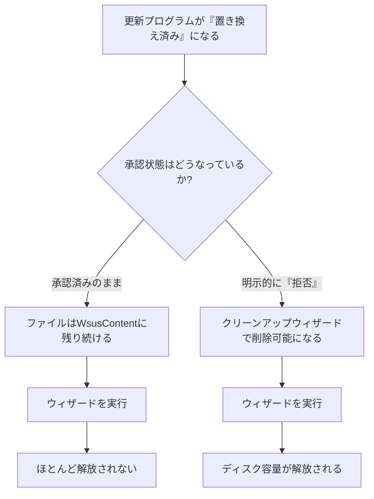

## はじめに

- **この記事で得られること**: WSUS(Windows Server Update Services)の`WsusContent`フォルダーが肥大化したとき、**なぜサーバークリーンアップウィザードを実行しても、ディスク容量がほとんど解放されないのか**という、実際に遭遇しやすい症状の原因と対処法を体系的に理解します。
- **対象読者**: WSUSを運用しているものの、ディスク容量の肥大化に対する、サーバークリーンアップウィザードの限界を知らない方を想定しています。
- **読むのにかかる想定時間**: 約18分

この記事は[『上位1%』シリーズ 全記事ガイド](/sitemap)の一部、[Windows Serverシリーズ](/sitemap#シリーズ一覧)の12.1本目です。

## 全体像をつかむ

**WSUSは、同期した更新プログラムの実体ファイルを、`WsusContent`というフォルダーへ保存し続け、運用を続けるうちに、このフォルダーが数百GB、時には1TBを超えるまで肥大化**することがあります。**多くの管理者は、サーバークリーンアップウィザードを実行すれば、不要になったファイルが解放されると期待しますが、実際には、ほんの数MBしか解放されない、という症状に遭遇**します。**この理由は、ウィザードが、「承認済み」のまま残っている「置き換え済み」の更新プログラムのファイルには、一切手を付けないという仕様**にあります。

## 基礎から徹底解説

### 本当にディスク容量を取り戻すための、正しい手順

**ディスク容量を本当に取り戻すには、承認済みのビューを「置き換え済み」でフィルターし、該当する更新プログラムを選択して、明示的に「拒否」に変更する必要**があります。**この「拒否」の操作を行ってから、サーバークリーンアップウィザードを実行することで、ようやく、それらのファイルが実際に削除され、ディスク容量が解放され**ます。**「未承認」に戻すだけでは、関連ファイルは一切削除されない**ことも、忘れないでください。

### 「置き換え済み」の判定は、完全には信頼できない

**ある更新プログラムが「置き換え済み」と判定されていても、その判定は、特定のシステム構成の組み合わせの下でのみ成立している場合があり、完全に信頼できるとは限りません。** **このため、置き換え済みの更新プログラムを拒否し、クリーンアップウィザードを実行した後、再度「未承認」の状態へ戻しておくという、安全側に倒した運用**が、現場では推奨されています。

もう1つの肥大化要因:Express installation filesという設定

**Express installation filesという設定を有効にすると、低速なリンクで接続するクライアント向けに、バイナリ差分パッチが利用できるようになりますが、この設定は、必要なディスク容量を通常の3倍から4倍に増加させ**ます。**多くの管理者が、このディスク容量への影響を意識せずに有効化してしまっており、クライアントが低速なリンクで接続していない環境では、この設定を無効にすることが推奨されています。**

## プロが見ている視点(上位1%の理解)

### 「クリーンアップ機能がある」ことと、「クリーンアップが完全に機能する」ことは、別の話である

**多くの管理ツールには、クリーンアップや最適化のためのウィザードが用意されていますが、そのウィザードが、実際にどのような条件の下でだけ効果を発揮するのかを、仕様として正確に理解している管理者は、意外と少ないものです。** **「このクリーンアップ機能は、具体的にどの条件を満たしたデータを対象にしているのか」を、使う前に一段掘り下げて確認する**習慣が、「ウィザードを実行したのに容量が減らない」という、原因不明の症状に悩まされないための、上位1%のエンジニアの視点です。

## よくある誤解・つまずきポイント

- **誤解1: 「サーバークリーンアップウィザードを実行すれば、不要な更新プログラムのファイルは自動的にすべて削除される」**
  ウィザードは、承認済みのまま残っている置き換え済みの更新プログラムのファイルには、一切手を付けません。
- **誤解2: 「更新プログラムを『未承認』に戻せば、ディスク容量が解放される」**
  「未承認」に戻すだけでは、関連ファイルは一切削除されず、明示的に「拒否」する必要があります。
- **誤解3: 「Express installation filesは、常に有効にしておくべき設定だ」**
  この設定は、低速なリンクで接続するクライアント向けの機能であり、必要なディスク容量を3倍から4倍に増加させるため、該当しない環境では無効にすべきです。

## 障害・トラブルシューティングの視点

1. **`WsusContent`フォルダーが、想定以上にディスク容量を圧迫している**: 承認済みのまま残っている置き換え済みの更新プログラムを、明示的に「拒否」してから、サーバークリーンアップウィザードを実行します。
2. **イベントID 10041・10042が記録されている**: コンテンツ格納先のボリュームの空き容量が不足しているサインであり、同期自体が失敗する可能性があります。
3. **コンテンツの格納先ボリューム自体を、より大きなボリュームへ移動したい**: `wsusutil movecontent`コマンドを使い、既存の更新プログラムの参照関係を壊さずに移動します。

## まとめ

- WSUSの`WsusContent`フォルダーは、運用を続けるうちに、数百GBから1TBを超えるまで肥大化することがあります。
- サーバークリーンアップウィザードは、承認済みのまま残っている置き換え済みの更新プログラムのファイルには、一切手を付けません。
- 本当にディスク容量を取り戻すには、置き換え済みの更新プログラムを明示的に「拒否」してから、ウィザードを実行する必要があります。
- Express installation filesという設定は、必要なディスク容量を3倍から4倍に増加させるため、低速リンクのクライアントがいない環境では無効にすべきです。

**今日から意識すべきこと**
1. WSUSのディスク容量を管理する際は、サーバークリーンアップウィザードの限界を踏まえた、正しい手順を踏みましょう。
2. 管理ツールのクリーンアップ機能を使う前に、その機能が具体的にどの条件のデータを対象にしているのかを、一段掘り下げて確認しましょう。

## 参考文献

- [Issues With Update Storage | Microsoft TechNet](https://technet.microsoft.com/en-us/library/cc708524(v=ws.10))
- [Why Is My WSUS Content Folder Using Almost 1TB | Microsoft Q&A](https://learn.microsoft.com/en-us/answers/questions/695783/why-is-my-wsus-content-folder-using-almost-1tb)
