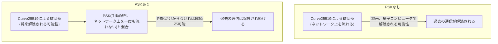

## はじめに

- **この記事で得られること**: [WireGuardの仕組み](/articles/wireguard-internals-guide)が使う、Curve25519という鍵交換方式には、将来の量子コンピュータに対する、理論上の弱点があります。この記事では、**PresharedKey**(PSK)という、WireGuardが標準で用意している、オプションの対称鍵を使い、この弱点を実質的に補強する方法を体系的に理解します。
- **対象読者**: WireGuardの基本的な鍵交換の仕組みは理解しているものの、PresharedKeyというオプション機能の意味を説明できない方を想定しています。
- **読むのにかかる想定時間**: 約18分

この記事は[『上位1%』シリーズ 全記事ガイド](/sitemap)の一部、[現代的VPNプロトコル深掘りシリーズ](/sitemap#シリーズ一覧)の2.1本目です。

## 前提知識

- [WireGuardの仕組み](/articles/wireguard-internals-guide): Curve25519による鍵交換の基本的な理解が前提になっています。

## 全体像をつかむ

**「Harvest Now, Decrypt Later」(今のうちに記録し、後で解読する)という攻撃が、長期的な懸念として知られています。攻撃者は、現時点では解読できない、暗号化された通信を、そのまま記録・保存しておきます。そして将来、十分な性能を持つ量子コンピュータが実現すれば、現在の鍵交換方式(Curve25519など)を遡って解読し、過去に記録しておいた通信の内容を、後から入手できてしまう**可能性があります。**WireGuardのPresharedKey(PSK)は、この攻撃に対する、実用的な防御**です。PSKは、ネットワーク上を一度も流れることのない、事前に、管理者自身の手で、両方の端末へ手動配布される、対称鍵だからです。

## 基礎から徹底解説

### PSKは、「交換」されない鍵だからこそ、強い

**通常のWireGuardの鍵交換(Curve25519による公開鍵暗号)は、必ずネットワーク上を流れます。攻撃者が、この鍵交換のやり取り自体を記録しておけば、将来、鍵交換の仕組み自体を破る計算能力があれば、理論上は解読できてしまう**可能性があります。**PresharedKeyは、これとは根本的に異なります。`wg genpsk`コマンドで生成したこの対称鍵は、管理者が、USBメモリやSSHなど、ネットワークの鍵交換とは別の経路で、両方の端末のconfigファイルへ、事前に手動でコピーする**ものです。**このPSKそのものは、通信中に一度もネットワーク上を流れないため、鍵交換の部分がどれだけ将来解読されても、攻撃者はPSKの値そのものを入手できません。**

### PSKは、最終的な暗号鍵の生成に、混合される

**WireGuardは、Curve25519による鍵交換で得られた共有鍵と、このPSKを、暗号学的に混合して、最終的な暗号鍵を導出**します。**この混合により、Curve25519の部分が将来破られたとしても、PSKという、もう1つの秘密情報を知らない限り、最終的な暗号鍵を導出できず、過去の通信内容を復元できません。**

PSKだけでは、「完全な耐量子」とまでは言えない

**PSKを使うことは、Harvest Now, Decrypt Laterという特定の攻撃シナリオに対して、実用的な防御になりますが、これをもって「WireGuardが完全に耐量子になった」とまでは言えません。** 本格的な耐量子暗号(ML-KEMなどの量子耐性鍵カプセル化メカニズム)を使い、鍵交換そのものを量子耐性にする取り組みも、別途進行しています。**PSKは、「手動で、ネットワークを経由せずに配布された秘密情報を混ぜる」という、比較的シンプルな仕組みで、実用上の防御を得られる**という点が、PSKの現実的な価値です。

## プロが見ている視点(上位1%の理解)

### 「鍵交換を強くする」のではなく、「鍵交換に依存しない経路を、もう1つ用意する」という発想

**PSKの本質は、Curve25519という鍵交換方式そのものを、より強力にしているわけではありません。「鍵交換を一切経由しない、別の秘密情報の配布経路」を、もう1つ用意し、最終的な鍵の強度を、その経路に依存させる**という発想です。**将来のリスクに対処する方法は、必ずしも「弱い部分を直接強化する」ことだけではなく、「その部分に依存しない、別の経路を追加する」ことでも実現できる**という視点が、この設計から読み取れます。

## よくある誤解・つまずきポイント

- **誤解1: 「PSKを設定すれば、WireGuardは完全に耐量子になる」**
  PSKはHarvest Now, Decrypt Later攻撃に対する実用的な防御ですが、これをもって完全な耐量子とは言えません。
- **誤解2: 「PSKも、Curve25519の鍵交換と同じように、ネットワーク上を流れている」**
  PSKは、管理者が事前に、ネットワークとは別の経路で、両方の端末へ手動配布する対称鍵であり、通信中にネットワーク上を流れることは一度もありません。
- **誤解3: 「PSKは、WireGuardの既定設定で、自動的に有効になっている」**
  PSKはオプション機能であり、管理者が`wg genpsk`で生成し、明示的に設定ファイルへ追記する必要があります。

## 障害・トラブルシューティングの視点

1. **PSKを設定したはずなのに、ハンドシェイクが成立しない**: 両端のconfigファイルに、まったく同じPSKの値が、正しく設定されているかを確認します。
2. **長期的な耐量子性を、より本格的に確保したい**: ML-KEMのような、量子耐性鍵カプセル化メカニズムを使う、専用の実装や取り組みを調査します。
3. **PSKの配布経路自体が安全かどうか不安**: USBメモリやSSHなど、PSKを配布した経路自体が、記録・傍受されていないかを確認します。

## まとめ

- Harvest Now, Decrypt Laterは、現在の暗号化通信を記録し、将来の量子コンピュータで遡って解読する攻撃です。
- WireGuardのPresharedKey(PSK)は、ネットワーク上を一度も流れない、事前に手動配布された対称鍵です。
- PSKは、Curve25519による鍵交換の結果と混合され、最終的な暗号鍵の強度を高めます。
- PSKは実用的な防御ですが、本格的な耐量子暗号とは異なる、比較的シンプルな仕組みです。

**今日から意識すべきこと**
1. 長期的な機密性が重要な通信では、WireGuardのPresharedKeyを有効にすることを検討しましょう。
2. PSKの配布経路自体の安全性も、あわせて確認しましょう。

## 参考文献

- [Quantum-Resistant VPN Connections | IVPN](https://ivpn.net/knowledgebase/general/quantum-resistant-vpn-connections/)
- [Post-Quantum WireGuard | engrXiv](https://engrxiv.org/preprint/view/5020)
